# CHƯƠNG 3: PHÂN TÍCH VÀ THIẾT KẾ HỆ THỐNG

---

## 3.1. PHÂN TÍCH YÊU CẦU

### 3.1.0. Giới thiệu tổng quan bài toán và phương pháp phân tích

Trong công tác đào tạo tại các trường đại học, học phần **Thực tập tốt nghiệp** (Internship Program) đóng vai trò bản lề giúp sinh viên tiếp cận môi trường làm việc thực tế, củng cố kiến thức chuyên môn và rèn luyện kỹ năng nghề nghiệp. Tuy nhiên, quy trình quản lý thực tập truyền thống hiện nay đang bộc lộ nhiều điểm nghẽn nghiêm trọng:
- **Đối với Nhà trường và Khoa:** Việc quản lý danh sách hàng trăm sinh viên phân tán tại nhiều doanh nghiệp gặp khó khăn lớn; thiếu công cụ theo dõi tiến độ nộp báo cáo hàng tuần theo thời gian thực; quy trình phân công giảng viên hướng dẫn thủ công; công tác tổng hợp điểm đánh giá hai chiều (từ doanh nghiệp và giảng viên) tốn nhiều thời gian và dễ xảy ra sai sót dữ liệu.
- **Đối với Doanh nghiệp:** Quá trình tiếp nhận hồ sơ thực tập thường rơi vào tình trạng quá tải hoặc sàng lọc không hiệu quả do phải duyệt thủ công hàng trăm CV ở định dạng khác nhau; thiếu cơ chế đối soát năng lực ứng viên tự động; quy trình lên lịch phỏng vấn và trao đổi thông tin với sinh viên bị phân tán qua nhiều kênh không đồng nhất.
- **Đối với Sinh viên:** Gặp khó khăn trong việc tìm kiếm các vị trí thực tập uy tín, đúng chuyên ngành đào tạo; không có công cụ định hướng, so khớp năng lực bản thân với yêu cầu tuyển dụng; quy trình nộp báo cáo thực tập, nhận phản hồi từ giảng viên và cập nhật kết quả đánh giá cuối kỳ còn rời rạc.

Hệ thống **CareerBridge** (Nền tảng Quản lý và Kết nối Thực tập Thông minh) được xây dựng nhằm giải quyết triệt để các bài toán trên bằng cách tin học hóa toàn diện toàn bộ **vòng đời thực tập (End-to-End Internship Lifecycle)**. Hệ thống tạo lập một môi trường làm việc số thống nhất kết nối 4 bên liên quan: **Sinh viên**, **Doanh nghiệp**, **Giảng viên hướng dẫn** và **Nhà trường/Quản trị viên**.

Phương pháp phân tích yêu cầu được tiếp cận theo hướng **Công nghệ phần mềm hiện đại (Modern Software Engineering)** kết hợp **Thiết kế hướng nghiệp vụ (Domain-Driven Design - DDD)**:
1. **Khảo sát và chuẩn hóa quy trình:** Rà soát và mô hình hóa chặt chẽ quy định thực tập tốt nghiệp của nhà trường và quy trình tuyển dụng thực tế của doanh nghiệp thành các trạng thái dữ liệu (State Machine) rõ ràng.
2. **Phân rã yêu cầu chức năng:** Phân định ranh giới giữa các phân hệ nghiệp vụ, thiết lập danh mục yêu cầu chức năng (FR) được đánh chỉ mục và xếp hạng ưu tiên theo kỹ thuật **MoSCoW** (*Must-have*, *Should-have*, *Could-have*, *Won't-have*).
3. **Đặc tả yêu cầu phi chức năng:** Phân tích theo tiêu chuẩn chất lượng phần mềm quốc tế **ISO/IEC 25010** và mô hình **FURPS+** nhằm bảo đảm hệ thống vận hành ổn định, hiệu năng cao, bảo mật dữ liệu và sẵn sàng mở rộng.
4. **Mô hình hóa tác nhân:** Xác định tường minh trách nhiệm, thẩm quyền và tương tác của từng tác nhân con người cũng như các tác nhân dịch vụ tự động trong hệ thống.

---

### 3.1.1. Yêu cầu chức năng (Functional Requirements)

Yêu cầu chức năng của hệ thống CareerBridge được cấu trúc thành **12 phân hệ nghiệp vụ cốt lõi**, bao phủ toàn diện từ khâu xác thực, tuyển dụng, sàng lọc hồ sơ cho đến giám sát học vụ và nghiệm thu thực tập.

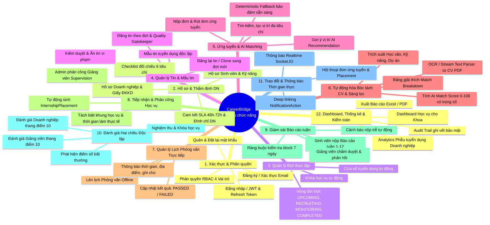

---

#### Chi tiết các phân hệ chức năng:

#### Phân hệ 1: Quản lý Xác thực, Tài khoản và Phân quyền (Authentication & Authorization)
- **FR-01: Đăng ký tài khoản người dùng:**
  - Hỗ trợ người dùng đăng ký tài khoản với hai vai trò tự đăng ký: Sinh viên (`STUDENT`) và Doanh nghiệp (`COMPANY`).
  - Sinh viên bắt buộc sử dụng địa chỉ email chính thức của nhà trường với tên miền học vụ chuẩn hóa (ví dụ: `@ut.edu.vn`).
  - Tài khoản mới tạo được khởi tạo ở trạng thái chờ kích hoạt `PENDING_VERIFICATION`. Hệ thống tự động tạo mã token kích hoạt bảo mật có thời hạn 24 giờ và gửi liên kết xác nhận qua email.
- **FR-02: Xác thực email kích hoạt:**
  - Cho phép người dùng nhấn vào liên kết kích hoạt hoặc nhập token xác nhận. Sau khi xác thực hợp lệ, tài khoản chuyển sang trạng thái hoạt động `ACTIVE`.
  - Hỗ trợ chức năng gửi lại email kích hoạt (`Resend Verification`) với cơ chế giới hạn tần suất (Rate Limiting).
- **FR-03: Đăng nhập và Quản lý phiên làm việc:**
  - Xác thực thông tin đăng nhập bằng email và mật khẩu (sử dụng giải thuật băm mật khẩu an toàn Argon2/Bcrypt).
  - Chỉ cho phép tài khoản ở trạng thái `ACTIVE` đăng nhập vào hệ thống. Tài khoản `INACTIVE`, `PENDING_VERIFICATION` hoặc `BANNED` sẽ bị từ chối kèm thông báo phù hợp.
  - Cấp phát cặp mã xác thực: **Access Token** (thời hạn ngắn: 15 phút, chứa định danh `userId`, `role`, `status`) và **Refresh Token** (thời hạn dài: 7 ngày, lưu trữ dưới dạng băm một chiều SHA-256 trong cơ sở dữ liệu).
  - Áp dụng kỹ thuật xoay vòng mã xác thực (**Refresh Token Rotation**) để phòng chống tấn công phát lại (Replay Attack).
- **FR-04: Đăng xuất và Thu hồi phiên:**
  - Thu hồi Refresh Token hiện tại trong cơ sở dữ liệu ngay khi người dùng thực hiện đăng xuất, vô hiệu hóa phiên truy cập.
- **FR-05: Quên mật khẩu và Đặt lại mật khẩu:**
  - Cho phép người dùng gửi yêu cầu đặt lại mật khẩu khi quên.
  - Cơ chế phản hồi an toàn: Hệ thống luôn trả về thông báo tiếp nhận chung (Generic Response), không tiết lộ sự tồn tại của email trong hệ thống nhằm chống dò quét tài khoản (User Enumeration).
  - Tạo `PasswordResetToken` mã hóa băm có hiệu lực trong vòng 30 phút, chỉ sử dụng được duy nhất một lần. Khi đặt lại mật khẩu thành công, hệ thống tự động thu hồi toàn bộ các Refresh Token đang tồn tại của người dùng.
- **FR-06: Phân quyền theo vai trò (Role-Based Access Control - RBAC):**
  - Kiểm soát truy cập nghiêm ngặt dựa trên 4 vai trò chính: `ADMIN`, `STUDENT`, `COMPANY`, `LECTURER`.
  - Toàn bộ các API nghiệp vụ đều được bảo vệ bởi bộ lọc xác thực (JWT Auth Guard) và bộ lọc phân quyền vai trò (Roles Guard).

---

#### Phân hệ 2: Quản lý Hồ sơ Người dùng và Thẩm định Doanh nghiệp (Profile & Verification)
- **FR-07: Quản lý Hồ sơ Sinh viên (`StudentProfile`):**
  - Cho phép sinh viên cập nhật thông tin cá nhân: Mã số sinh viên (MSSV duy nhất), họ và tên, chuyên ngành đào tạo, lớp học, số điện thoại liên lạc, liên kết hồ sơ nghề nghiệp (GitHub, LinkedIn, Portfolio cá nhân).
  - Đính kèm tệp tin CV mặc định (định dạng PDF) phục vụ nộp hồ sơ nhanh.
  - Khai báo danh mục kỹ năng chuyên môn cá nhân kèm mức độ thành thạo: `BEGINNER` (Mới bắt đầu), `INTERMEDIATE` (Trung cấp), `ADVANCED` (Nâng cao), `EXPERT` (Chuyên gia).
  - Thêm, sửa, xóa danh sách các dự án thực tế cá nhân (`StudentProject`) kèm đường dẫn mã nguồn (Repository URL) và sản phẩm chạy thử (Demo URL).
- **FR-08: Quản lý Nguyện vọng Nghề nghiệp (`StudentJobPreference`):**
  - Cho phép sinh viên lưu trữ các tiêu chí mong muốn trong đợt thực tập hiện tại: Tối đa 5 vị trí công việc (Preferred Roles), tối đa 5 khu vực/địa điểm mong muốn (Preferred Locations), và các hình thức làm việc mong muốn (Onsite, Remote, Hybrid).
  - Dữ liệu nguyện vọng được sử dụng làm đầu vào cho thuật toán gợi ý thực tập thông minh.
- **FR-09: Quản lý Hồ sơ Doanh nghiệp (`CompanyProfile`):**
  - Doanh nghiệp tạo lập hồ sơ pháp nhân: Tên giao dịch và tên pháp lý chính thức, mã số thuế / mã số doanh nghiệp, địa chỉ trụ sở, website, quy mô nhân sự, lĩnh vực hoạt động, mô tả giới thiệu.
  - Khai báo thông tin đại diện pháp lý / người phụ trách nhân sự: Họ tên, số điện thoại liên hệ, email liên hệ chính thức.
  - Tải lên Giấy chứng nhận Đăng ký kinh doanh (ĐKKD) dạng tệp số (loại tệp tin bảo mật `COMPANY_REGISTRATION`).
- **FR-10: Quy trình Thẩm định Pháp lý Doanh nghiệp (Verification Flow & SLA):**
  - Vòng đời trạng thái hồ sơ doanh nghiệp: `DRAFT` $\rightarrow$ `PENDING` $\rightarrow$ `APPROVED` / `REJECTED` / `SUSPENDED`.
  - Doanh nghiệp hoàn thiện thông tin và gọi lệnh gửi xét duyệt (`submit-verification`). Hệ thống chuyển trạng thái sang `PENDING` và tự động gắn mốc thời hạn xử lý `reviewDueAt` theo cam kết chất lượng dịch vụ SLA (mặc định 48 đến 72 giờ).
  - Trong thời gian `PENDING`, doanh nghiệp bị khóa quyền chỉnh sửa thông tin để bảo đảm tính toàn vẹn hồ sơ đối soát.
  - **Quản trị viên thẩm định theo Bộ Checklist 6 tiêu chí:**
    1. Kiểm tra tính hợp lệ và rõ ràng của tài liệu Giấy phép ĐKKD.
    2. Đối chiếu mã số thuế / mã số doanh nghiệp trên Cổng thông tin đăng ký doanh nghiệp quốc gia.
    3. Đối chiếu sự trùng khớp giữa tên pháp lý trên tài liệu và tên khai báo.
    4. Xác thực địa chỉ trụ sở văn phòng hoạt động thực tế.
    5. Kiểm tra thông tin liên lạc của đầu mối nhân sự (email, số điện thoại).
    6. Kiểm tra tài khoản người dùng đã được kích hoạt email (`emailVerifiedAt != null`).
  - **Phê duyệt (`APPROVED`):** Chỉ khi vượt qua toàn bộ 6 tiêu chí checklist, hồ sơ mới được phê duyệt. Khi đã duyệt, hệ thống khóa cố định các trường định danh pháp lý để ngăn chặn việc đánh tráo danh tính sau khi được cấp phép.
  - **Từ chối (`REJECTED`):** Bắt buộc chọn mã lý do chuẩn (`CompanyRejectionReasonCode` như tài liệu không rõ ràng, sai mã số thuế, địa chỉ không khớp...) và nhập nội dung giải thích chi tiết tối thiểu 10 ký tự để doanh nghiệp bổ sung.
  - **Đình chỉ doanh nghiệp vi phạm (`SUSPENDED`):** Áp dụng cho doanh nghiệp đã duyệt nhưng có hành vi gian lận hoặc vi phạm chính sách (`CompanySuspensionReasonCode`). Khi đình chỉ, hệ thống thực hiện trong một Transaction: khóa tài khoản doanh nghiệp và tự động đóng toàn bộ các bài đăng tuyển dụng đang mở (`OPEN`) của doanh nghiệp đó.
  - **Khôi phục (`UNSUSPENDED`):** Cho phép Quản trị viên khôi phục quyền hoạt động khi doanh nghiệp đã giải trình hợp lệ (các tin cũ đã đóng không tự động mở lại để đảm bảo an toàn).
- **FR-11: Quản lý Hồ sơ Giảng viên (`LecturerProfile`):**
  - Quản lý danh sách giảng viên khoa: Mã giảng viên, học hàm, học vị, khoa/bộ môn trực thuộc, email, số điện thoại liên hệ.
  - Quản lý danh sách sinh viên đang được phân công hướng dẫn theo từng đợt thực tập.

---

#### Phân hệ 3: Quản lý Đợt thực tập (Semester Management)
- **FR-12: Khởi tạo và Quản lý Đợt thực tập (`Semester`):**
  - Quản trị viên thiết lập đợt thực tập gắn với năm học và học kỳ (ví dụ: *Học kỳ 1 - Năm học 2025-2026*).
  - Thiết lập mốc thời gian bắt đầu chính thức (`startDate`) và kết thúc đợt (`endDate`).
- **FR-13: Tự động hóa Vòng đời Đợt thực tập (Semester Lifecycle):**
  - Vòng đời đợt thực tập vận hành qua 5 trạng thái logic:
    - `UPCOMING`: Giai đoạn chuẩn bị, khởi tạo danh mục và thông báo kế hoạch.
    - `RECRUITING` (Cửa sổ tuyển dụng): Tự động kích hoạt đúng **1 tháng trước ngày `startDate`**. Đây là khoảng thời gian duy nhất cho phép: doanh nghiệp đăng tin tuyển dụng mới, sinh viên nộp đơn ứng tuyển, doanh nghiệp phỏng vấn và chấp thuận ứng viên.
    - `MONITORING` (Giai đoạn giám sát học vụ): Bắt đầu từ ngày `startDate` đến ngày `endDate`. Hệ thống tự động đóng toàn bộ các tin tuyển dụng còn đang mở (`OPEN`), khóa chức năng nộp hồ sơ mới. Chuyển trọng tâm sang giám sát báo cáo tuần và đánh giá.
    - `COMPLETED`: Toàn bộ đợt thực tập kết thúc, tổng kết điểm số học vụ và khóa sổ dữ liệu.
    - `CANCELLED`: Hủy đợt thực tập khi có sự cố phát sinh.

---

#### Phân hệ 4: Quản lý Tin tuyển dụng và Mẫu tin (Internship & Template Management)
- **FR-14: Đăng tin tuyển dụng thực tập (`Internship`):**
  - Chỉ các doanh nghiệp có trạng thái hồ sơ `APPROVED` và trong đợt thực tập đang ở pha `RECRUITING` mới được phép đăng bài tuyển dụng.
  - Các trường thông tin bắt buộc: Vị trí thực tập (Title), mô tả công việc (Description), yêu cầu ứng viên (Requirements), số lượng chỉ tiêu tiếp nhận (`slots`), hạn chót nộp hồ sơ (`deadline`), địa điểm làm việc, hình thức làm việc (Onsite, Hybrid, Remote), mức phụ cấp/lương hỗ trợ, thông tin người phụ trách liên hệ.
  - Gắn yêu cầu kỹ năng (`InternshipSkill`): Chọn kỹ năng từ danh mục chuẩn hóa, đánh dấu mức độ ưu tiên hoặc bắt buộc (`isRequired`) và thiết lập trọng số đánh giá (`weight`).
- **FR-15: Bộ lọc Kiểm soát Chất lượng Tin tuyển dụng (Quality Gatekeeper):**
  - Ràng buộc tự động trước khi xuất bản: Hạn nộp hồ sơ (`deadline`) phải nằm trong cửa sổ tuyển dụng và trước ngày bắt đầu đợt; số lượng chỉ tiêu phải lớn hơn 0; lịch học vụ dự kiến (`startDate`/`endDate`) nếu nhập phải nằm trọn trong khung thời gian của đợt thực tập.
  - Quản trị viên có quyền hậu kiểm: Tạm ẩn tin vi phạm (`HIDDEN`) hoặc yêu cầu doanh nghiệp chỉnh sửa tin có dấu hiệu lừa đảo, sai thông tin hoặc trùng lặp.
- **FR-16: Quản lý Mẫu tin tuyển dụng (`InternshipTemplate`):**
  - Cho phép doanh nghiệp lưu các bài đăng hiện tại thành Mẫu tin tuyển dụng hoặc tự tạo mẫu tin độc lập (tối đa 20 mẫu tin cho mỗi doanh nghiệp).
  - Mẫu tin lưu trữ cấu trúc nội dung, yêu cầu kỹ năng và quyền lợi chuẩn nhưng độc lập hoàn toàn với đợt thực tập, hạn nộp và số liệu ứng viên.
- **FR-17: Tái đăng tin và Tạo tin từ Mẫu (`Repost & Clone`):**
  - Doanh nghiệp có thể nhân bản tin tuyển dụng cũ hoặc tạo tin mới nhanh chóng từ mẫu tin sang một đợt tuyển dụng mới.
  - Hệ thống áp dụng toàn bộ quy tắc thẩm định chất lượng tin mới: Đặt lại lượt xem (`viewCount = 0`), số lượng đã tuyển (`filledSlots = 0`), kiểm tra đợt mới đang ở pha tuyển dụng, đồng thời tự động loại bỏ các kỹ năng cũ không còn tồn tại trong danh mục chuẩn và trả về cảnh báo `warnings[]`.

---

#### Phân hệ 5: Tìm kiếm, Gợi ý và Ứng tuyển Thực tập (Discovery, Recommendation & Application)
- **FR-18: Tìm kiếm và Lọc vị trí thực tập:**
  - Sinh viên tìm kiếm tin tuyển dụng theo từ khóa, lọc đa tiêu chí theo kỹ năng, chuyên ngành, khu vực địa lý, hình thức làm việc và mức trợ cấp.
  - Chỉ hiển thị các tin tuyển dụng ở trạng thái `OPEN`, chưa hết hạn nộp hồ sơ, thuộc doanh nghiệp đã xác minh và còn chỉ tiêu tuyển dụng (`filledSlots < slots`).
- **FR-19: Nộp đơn và Quản lý Tiến trình Ứng tuyển (`Application`):**
  - Sinh viên lựa chọn hồ sơ CV đính kèm và soạn thư giới thiệu (Cover Letter) để nộp ứng tuyển vào vị trí mong muốn.
  - **Ràng buộc nghiệp vụ toàn vẹn:** Một sinh viên chỉ được nộp duy nhất 1 đơn ứng tuyển cho một vị trí tuyển dụng trong cùng một đợt.
  - Theo dõi trạng thái đơn ứng tuyển theo cỗ máy trạng thái (State Machine): `PENDING` (Chờ xử lý) $\rightarrow$ `REVIEWING` (Đang xem xét) $\rightarrow$ `INTERVIEW_SCHEDULED` (Đã lên lịch phỏng vấn) $\rightarrow$ `ACCEPTED` (Được tiếp nhận) hoặc `REJECTED` (Bị từ chối).
  - Cho phép sinh viên chủ động rút đơn (`WITHDRAWN`) khi đơn chưa bước vào trạng thái hoàn tất (`ACCEPTED` / `REJECTED`).
  - Ghi nhận đầy đủ nhật ký thay đổi trạng thái đơn vào bảng `ApplicationStatusHistory` phục vụ tra cứu minh bạch.
- **FR-20: Gợi ý Vị trí Thực tập Thông minh (Smart Job Recommendation):**
  - Sinh viên chủ động kích hoạt tính năng đề xuất vị trí thực tập.
  - Thuật toán Backend tính toán điểm tương đồng giữa hồ sơ sinh viên (kỹ năng, cấp độ thành thạo, dự án cá nhân, nguyện vọng nghề nghiệp) với các tin tuyển dụng đang mở trong đợt, xếp hạng và chọn lọc tối đa 10 vị trí phù hợp nhất.
  - Tích hợp mô hình AI (Large Language Model) để tạo đoạn văn giải thích lý do gợi ý (AI Match Explanation) cho **tối đa 3 vị trí xếp hạng cao nhất**.
  - Lưu kết quả vào bộ nhớ đệm `InternshipRecommendationCache` kèm mã băm vân tay dữ liệu (Data Fingerprint) để tối ưu tốc độ phản hồi.
  - **Cơ chế dự phòng tất định (Deterministic Fallback):** Nếu dịch vụ AI bên ngoài gặp sự cố, hệ thống tự động trả về kết quả xếp hạng giải thuật thuần túy từ Backend mà không làm gián đoạn trải nghiệm người dùng.

---

#### Phân hệ 6: Tự động hóa Bóc tách CV và Sàng lọc Ứng viên (CV Parsing & AI Screening)
- **FR-21: Bóc tách Cấu trúc CV tự động (Automated CV Parser):**
  - Khi sinh viên nộp tệp CV dạng PDF, hệ thống tự động kích hoạt tiến trình bóc tách nội dung văn bản.
  - Đối với tệp PDF chuẩn có lớp văn bản (text stream): Trích xuất trực tiếp với tốc độ cao (< 500ms).
  - Đối với tệp PDF dạng ảnh scan: Kích hoạt module OCR (sử dụng Tesseract OCR đa ngữ `vie + eng`) để trích xuất lớp chữ.
  - Bộ trích xuất thực thể (Named Entity Extraction): Tự động phân đoạn và nhận diện các trường dữ liệu có cấu trúc: Họ tên, Email, Số điện thoại, Trường học, Điểm trung bình (GPA), Danh sách kỹ năng kỹ thuật, và Danh sách dự án/kinh nghiệm làm việc.
- **FR-22: Mô hình Chấm điểm Phù hợp Hồ sơ (AI Candidate Match Scoring):**
  - Tự động đối sánh dữ liệu bóc tách được từ CV với các tiêu chuẩn yêu cầu của tin tuyển dụng theo công thức chấm điểm đa tiêu chí:
    $$\text{Match Score} = 50\% \times S_{\text{skills}} + 25\% \times S_{\text{projects}} + 15\% \times S_{\text{education}} + 10\% \times S_{\text{preferences}}$$
  - Điểm số được chuẩn hóa trên thang điểm từ 0 đến 100.
  - Cung cấp bảng phân tích chi tiết tiêu chí (**Match Breakdown**): Liệt kê danh sách kỹ năng ứng viên đã đáp ứng, danh sách kỹ năng còn thiếu, mức độ phù hợp về hình thức làm việc.
  - Tự động sắp xếp thứ hạng ứng viên trong giao diện quản lý của nhà tuyển dụng theo Match Score, hỗ trợ doanh nghiệp ra quyết định sàng lọc hồ sơ nhanh chóng và khách quan.

---

#### Phân hệ 7: Quản lý Lịch Phỏng vấn Trực tiếp (Offline Interview Scheduling)
- **FR-23: Lên lịch Hẹn Phỏng vấn Trực tiếp:**
  - Thay vì tổ chức phỏng vấn trực tuyến phức tạp và kém ổn định, hệ thống chuẩn hóa quy trình phỏng vấn trực tiếp tại văn phòng doanh nghiệp.
  - Doanh nghiệp thiết lập thông tin lịch phỏng vấn cho ứng viên tiềm năng: Thời gian phỏng vấn cụ thể, địa điểm phòng họp/văn phòng công ty, tên người phỏng vấn/đầu mối đón tiếp, các hướng dẫn chuẩn bị (giấy tờ cần mang theo, trang phục, bài test chuyên môn).
  - Đơn ứng tuyển tự động chuyển trạng thái sang `INTERVIEW_SCHEDULED`.
- **FR-24: Thông báo Lịch Phỏng vấn và Nhắc hẹn:**
  - Hệ thống tự động gửi thông báo thời gian thực trên ứng dụng và gửi email xác nhận chi tiết lịch hẹn phỏng vấn đến sinh viên.
- **FR-25: Cập nhật Kết quả Phỏng vấn:**
  - Sau buổi phỏng vấn, doanh nghiệp cập nhật nhận xét và kết quả trực tiếp trên hệ thống: Đạt yêu cầu (`PASSED`) hoặc Không đạt (`FAILED`).
  - Nếu đạt, doanh nghiệp tiến hành xác nhận tiếp nhận ứng viên (`ACCEPTED`).

---

#### Phân hệ 8: Tiếp nhận Thực tập và Phân công Học vụ (Placement & Supervision)
- **FR-26: Xác nhận Tiếp nhận Thực tập (`InternshipPlacement`):**
  - Khi doanh nghiệp đánh dấu ứng viên `ACCEPTED`, hệ thống thực hiện trong một Transaction:
    1. Kiểm tra vị trí tuyển dụng còn chỉ tiêu tiếp nhận (`slots - filledSlots > 0`).
    2. Tăng số lượng chỉ tiêu đã tuyển (`filledSlots = filledSlots + 1`).
    3. Kiểm tra sinh viên chưa có Placement nào đang hiệu lực trong cùng đợt thực tập.
    4. Tự động khởi tạo một bản ghi `InternshipPlacement` duy nhất gắn với ứng viên, doanh nghiệp, vị trí và đợt thực tập.
    5. Khởi tạo cuộc hội thoại trao đổi nội bộ (`Conversation`) giữa các bên liên quan.
- **FR-27: Thiết lập Khung thời gian Giám sát Học vụ:**
  - Hệ thống phân định rạch ròi giữa thời gian làm việc thực tế tại doanh nghiệp và khoảng thời gian trường theo dõi học vụ (`placement.startDate` và `placement.endDate`).
  - Quản trị viên kiểm tra và chốt khung thời gian theo dõi học vụ của Placement nằm trong phạm vi của đợt thực tập.
- **FR-28: Phân công Giảng viên Hướng dẫn (`Supervision`):**
  - Quản trị viên Khoa thực hiện chỉ định một Giảng viên phụ trách hướng dẫn cho từng Placement.
  - Mỗi Placement có tối đa một bản ghi phân công giám sát đang hiệu lực.
  - Giảng viên được phân công sẽ có đầy đủ thẩm quyền học thuật: Theo dõi tiến độ sinh viên, chấm duyệt báo cáo tuần và thực hiện đánh giá kết quả thực tập cuối kỳ.

---

#### Phân hệ 9: Giám sát Học vụ và Quản lý Báo cáo tuần (Academic Monitoring & Reports)
- **FR-29: Nộp Báo cáo Thực tập tuần (`Report`):**
  - Sinh viên bắt buộc nộp báo cáo định kỳ theo từng tuần học vụ (Tuần 1 đến Tuần 12 tính từ ngày bắt đầu `placement.startDate`).
  - Mỗi Placement chỉ có duy nhất một bản ghi báo cáo cho mỗi tuần (`week`).
  - **Ràng buộc kiểm tra block thời gian:** Sinh viên chỉ được phép tạo và nộp báo cáo cho tuần hiện tại hoặc các tuần đã qua; nghiêm cấm việc nộp trước báo cáo cho các tuần tương lai hoặc nộp ngoài khung thời gian của Placement.
  - Nội dung báo cáo gồm: Tóm tắt công việc đã làm trong tuần, kiến thức/kỹ năng mới tiếp thu, khó khăn gặp phải, kế hoạch tuần kế tiếp và tệp tài liệu minh chứng đính kèm (loại tệp `REPORT`).
  - Trạng thái báo cáo: `DRAFT` (Bản nháp) $\rightarrow$ `SUBMITTED` (Đã nộp) $\rightarrow$ `APPROVED` (Được phê duyệt) hoặc `REJECTED` (Yêu cầu viết lại).
- **FR-30: Giảng viên Phản hồi và Chấm duyệt Báo cáo:**
  - Giảng viên xem nội dung báo cáo tuần của các sinh viên thuộc danh sách mình hướng dẫn.
  - Giảng viên gửi nhận xét, góp ý hướng dẫn và thực hiện duyệt (`APPROVED`) hoặc trả lời yêu cầu sửa đổi (`REJECTED` kèm lý do cụ thể).
  - Kể cả khi khung thời gian của đợt thực tập kết thúc, giảng viên vẫn được cấp quyền thẩm duyệt các báo cáo đã nộp trước đó để hoàn tất đánh giá học vụ.
- **FR-31: Cảnh báo Sinh viên Nộp trễ Báo cáo:**
  - Hệ thống tự động đối chiếu tuần hiện tại với số lượng báo cáo sinh viên đã nộp.
  - Tự động gắn nhãn cảnh báo nộp trễ và hiển thị trực quan trên Dashboard của Giảng viên và Quản trị viên để có biện pháp đôn đốc kịp thời.

---

#### Phân hệ 10: Đánh giá Hai chiều Độc lập và Khóa Học vụ (Dual Evaluation & Completion)
- **FR-32: Đánh giá Độc lập từ Doanh nghiệp (`Evaluation - COMPANY`):**
  - Người hướng dẫn tại doanh nghiệp thực hiện đánh giá sinh viên vào cuối kỳ thực tập theo thang điểm 10.
  - Các tiêu chí đánh giá bao gồm: Ý thức kỷ luật, thái độ làm việc, tinh thần trách nhiệm, năng lực hoàn thành nhiệm vụ chuyên môn và khả năng làm việc nhóm.
  - Chỉ tài khoản doanh nghiệp tiếp nhận sinh viên mới có quyền tạo và chỉnh sửa phiếu đánh giá này.
- **FR-33: Đánh giá Độc lập từ Giảng viên Hướng dẫn (`Evaluation - LECTURER`):**
  - Giảng viên phụ trách thực hiện đánh giá sinh viên dựa trên: Tiến độ và chất lượng các báo cáo tuần, thái độ học tập và mức độ hoàn thành mục tiêu học phần tốt nghiệp theo thang điểm 10.
  - Chỉ giảng viên được phân công chính thức cho Placement mới có quyền lập phiếu đánh giá này.
- **FR-34: Phát hiện Bất thường và Nghiệm thu Học vụ:**
  - Hệ thống tự động so sánh, phát hiện các trường hợp đánh giá có sự chênh lệch điểm số bất thường giữa Doanh nghiệp và Giảng viên (ví dụ: Doanh nghiệp chấm 9.5 nhưng Giảng viên chấm 4.0 hoặc ngược lại) để cảnh báo Khoa tiến hành hậu kiểm.
  - Khi cả hai bên hoàn thành đánh giá, trạng thái học vụ của Placement chuyển sang `COMPLETED`.
  - Khi đợt thực tập kết thúc, hệ thống tự động khóa phần học vụ (`academicStatus = CLOSED`), chốt toàn bộ điểm số phục vụ xét tốt nghiệp.

---

#### Phân hệ 11: Trao đổi Nội bộ và Thông báo Thời gian thực (Communication & Notifications)
- **FR-35: Hệ thống Hội thoại và Nhắn tin Nội bộ (`Conversation` & `Message`):**
  - Tự động tạo kênh trao đổi trực tiếp giữa Sinh viên và Doanh nghiệp gắn liền với ngữ cảnh của từng đơn ứng tuyển (`Application`).
  - Khi sinh viên trúng tuyển và có Placement, kênh trao đổi nâng cấp thành nhóm làm việc 3 bên có sự tham gia của Giảng viên hướng dẫn.
  - Phân quyền chặt chẽ: Chỉ các thành viên hợp lệ tham gia vào tiến trình mới có quyền đọc và gửi tin nhắn trong hội thoại.
- **FR-36: Hệ thống Thông báo Thời gian thực (Real-time Notifications):**
  - Tích hợp giao thức WebSocket (Socket.IO) kết hợp lưu trữ trong cơ sở dữ liệu để đẩy thông báo tức thì đến người dùng:
    - Sinh viên nhận thông báo khi: Trạng thái đơn thay đổi, có lịch phỏng vấn, báo cáo tuần được chấm hoặc có tin nhắn mới.
    - Doanh nghiệp nhận thông báo khi: Có đơn ứng tuyển mới, hồ sơ pháp lý được duyệt/từ chối hoặc sinh viên xác nhận phỏng vấn.
    - Giảng viên nhận thông báo khi: Được phân công sinh viên mới hoặc sinh viên nộp báo cáo tuần.
  - Hỗ trợ cơ chế điều hướng nhanh (**NotificationAction**): Nhấp vào thông báo sẽ tự động mở đúng trang chi tiết đơn ứng tuyển, báo cáo hoặc lịch phỏng vấn tương ứng.

---

#### Phân hệ 12: Thống kê Tuyển dụng, Dashboard Học vụ và Nhật ký Kiểm toán (Analytics & Audit)
- **FR-37: Dashboard Giám sát Học vụ Toàn diện cho Khoa (Admin Academic Dashboard):**
  - Cung cấp các chỉ số tổng quan thời gian thực: Tổng số sinh viên tham gia đợt, tỷ lệ sinh viên đã có nơi thực tập, số lượng doanh nghiệp đã xác minh.
  - Cung cấp 4 bộ lọc nghiệp vụ quan trọng:
    1. Danh sách sinh viên chưa có nơi thực tập (phân nhóm theo lớp/ngành).
    2. Danh sách sinh viên nộp trễ báo cáo tuần.
    3. Danh sách doanh nghiệp có phản hồi hoặc điểm đánh giá bất thường.
    4. Danh sách các Placement sắp hết hạn học vụ cần hoàn tất nghiệm thu.
- **FR-38: Thống kê Phân tích Tuyển dụng Chuyên sâu cho Doanh nghiệp (Recruitment Analytics):**
  - Thống kê lượt xem tin (`viewsCount`) và số lượng người xem độc lập (`uniqueViewerCount`).
  - Biểu đồ phễu tuyển dụng (Recruitment Funnel): Lượt xem tin $\rightarrow$ Số đơn ứng tuyển $\rightarrow$ Mời phỏng vấn $\rightarrow$ Nhận việc chính thức.
  - Đo lường thời gian tuyển dụng trung bình (Time-to-Hire) và tỷ lệ lấp đầy vị trí tuyển dụng (Fill Rate).
- **FR-39: Xuất Báo cáo Học vụ Quản lý (Excel & PDF Export):**
  - Xuất dữ liệu ra tệp bảng tính Excel đa trang tính: Trang 1 (Danh sách phân công thực tập), Trang 2 (Bảng theo dõi tiến độ nộp báo cáo tuần 1-12), Trang 3 (Bảng tổng hợp điểm số đánh giá hai chiều).
  - Xuất tệp văn bản PDF Biên bản đánh giá kết quả thực tập tốt nghiệp chuẩn thể thức hành chính của nhà trường phục vụ lưu trữ hồ sơ khoa.
- **FR-40: Nhật ký Kiểm toán Hệ thống (`AuditLog`):**
  - Ghi vết tự động toàn bộ các thao tác nhạy cảm: Duyệt/từ chối/đình chỉ doanh nghiệp, thay đổi trạng thái đơn ứng tuyển, phân công giảng viên hướng dẫn, cập nhật điểm đánh giá học phần.
  - Lưu trữ đầy đủ: Mã định danh người thực hiện (`userId`), loại hành động (`action`), thực thể bị tác động (`entity`, `entityId`), thời điểm thực hiện và siêu dữ liệu thay đổi (`metadata`).

---

#### Bảng tổng hợp Mã hóa Yêu cầu Chức năng (Functional Requirements Matrix)

| Mã FR | Tên chức năng | Tác nhân chính | Mức ưu tiên (MoSCoW) |
| :--- | :--- | :--- | :---: |
| **FR-01** | Đăng ký tài khoản Sinh viên (@ut.edu.vn) & Doanh nghiệp | Guest | Must |
| **FR-02** | Xác thực Email kích hoạt qua Token 24h & Gửi lại Email | Guest / User | Must |
| **FR-03** | Đăng nhập hệ thống, cấp Access Token & Refresh Token | Guest | Must |
| **FR-04** | Đăng xuất và thu hồi Refresh Token trong CSDL | User | Must |
| **FR-05** | Quên mật khẩu an toàn & Đặt lại mật khẩu với Token 30m | Guest | Must |
| **FR-06** | Phân quyền truy cập dựa trên vai trò (RBAC 4 vai trò) | System | Must |
| **FR-07** | Quản lý thông tin hồ sơ Sinh viên, kỹ năng và dự án cá nhân | Student | Must |
| **FR-08** | Thiết lập nguyện vọng nghề nghiệp (Vị trí, Địa điểm, Hình thức) | Student | Should |
| **FR-09** | Quản lý hồ sơ pháp nhân Doanh nghiệp & Tải lên Giấy ĐKKD | Company | Must |
| **FR-10** | Quy trình thẩm định Doanh nghiệp theo Checklist 6 bước & SLA | Admin | Must |
| **FR-11** | Quản lý thông tin hồ sơ Giảng viên và phân khoa học vụ | Admin | Must |
| **FR-12** | Khởi tạo và thiết lập khung thời gian Đợt thực tập | Admin | Must |
| **FR-13** | Tự động hóa vòng đời Đợt thực tập (5 trạng thái logic) | System | Must |
| **FR-14** | Đăng tin tuyển dụng thực tập theo đợt tuyển | Company | Must |
| **FR-15** | Bộ lọc kiểm soát chất lượng tin tuyển dụng (Gatekeeper) | System / Admin | Must |
| **FR-16** | Tạo và quản lý Mẫu tin tuyển dụng độc lập (Tối đa 20 mẫu) | Company | Should |
| **FR-17** | Đăng lại tin cũ (Repost) & Tạo tin mới từ Mẫu tin tuyển dụng | Company | Should |
| **FR-18** | Tìm kiếm, tra cứu và lọc tin tuyển dụng đa tiêu chí | Student | Must |
| **FR-19** | Nộp đơn ứng tuyển, theo dõi tiến trình & Rút đơn ứng tuyển | Student | Must |
| **FR-20** | Đề xuất vị trí thực tập thông minh (AI Job Recommendation) | Student | Should |
| **FR-21** | Tự động bóc tách cấu trúc nội dung CV từ tệp PDF (OCR) | System | Should |
| **FR-22** | Chấm điểm phù hợp hồ sơ (AI Match Score 0-100 & Breakdown) | System / Company | Should |
| **FR-23** | Lên lịch hẹn phỏng vấn trực tiếp tại văn phòng công ty | Company | Must |
| **FR-24** | Gửi thông báo và thư mời phỏng vấn tự động đến sinh viên | System | Must |
| **FR-25** | Cập nhật kết quả phỏng vấn trực tiếp (PASSED / FAILED) | Company | Must |
| **FR-26** | Xác nhận tiếp nhận ứng viên & Tự động tạo InternshipPlacement | Company / System | Must |
| **FR-27** | Thiết lập và quản lý khung thời gian giám sát học vụ | Admin | Must |
| **FR-28** | Phân công Giảng viên hướng dẫn cho Placement (Supervision) | Admin | Must |
| **FR-29** | Nộp báo cáo thực tập tuần (Kiểm tra block 7 ngày, Tuần 1-12) | Student | Must |
| **FR-30** | Giảng viên nhận xét, góp ý và chấm duyệt báo cáo tuần | Lecturer | Must |
| **FR-31** | Tự động quét và cảnh báo sinh viên nộp trễ báo cáo tuần | System | Should |
| **FR-32** | Doanh nghiệp đánh giá năng lực thực tế cuối kỳ (Thang điểm 10) | Company | Must |
| **FR-33** | Giảng viên đánh giá kết quả học phần thực tập (Thang điểm 10) | Lecturer | Must |
| **FR-34** | Phát hiện đánh giá bất thường & Tự động khóa học vụ | System / Admin | Must |
| **FR-35** | Hội thoại trao đổi tin nhắn nội bộ theo Đơn & Placement | User | Should |
| **FR-36** | Thông báo thời gian thực đa kênh kèm điều hướng nhanh | System / User | Must |
| **FR-37** | Dashboard Học vụ cho Khoa với 4 bộ lọc giám sát cảnh báo | Admin | Must |
| **FR-38** | Bảng phân tích số liệu tuyển dụng chuyên sâu cho Doanh nghiệp | Company | Should |
| **FR-39** | Xuất báo cáo quản lý học vụ định dạng bảng tính Excel & PDF | Admin | Must |
| **FR-40** | Ghi nhật ký kiểm toán hệ thống cho các thao tác nhạy cảm | System / Admin | Must |

---

### 3.1.2. Yêu cầu phi chức năng (Non-Functional Requirements)

Yêu cầu phi chức năng được xây dựng nhằm thiết lập các tiêu chuẩn kỹ thuật nghiêm ngặt về chất lượng phần mềm theo mô hình **ISO/IEC 25010** và **FURPS+**, bảo đảm hệ thống CareerBridge vận hành hiệu quả trong môi trường thực tế.

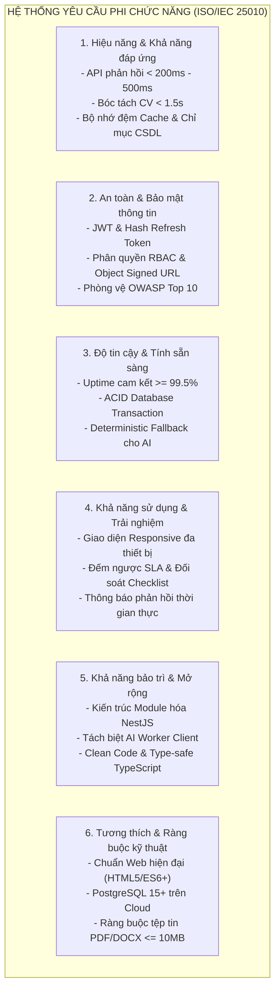

---

#### 1. Hiệu năng và Khả năng đáp ứng (Performance & Efficiency)
- **NFR-PERF-01: Thời gian phản hồi của API (API Response Time):**
  - Đối với các thao tác truy vấn dữ liệu chuẩn (đọc danh sách, xem chi tiết tin tuyển dụng, xem hồ sơ, xem báo cáo): Thời gian phản hồi trung bình của API phải đạt dưới **300ms** ở điều kiện tải thông thường, và không vượt quá **800ms** tại phân vị thứ 95 ($P_{95}$).
  - Đối với các thao tác ghi dữ liệu có xử lý nghiệp vụ phức tạp và Transaction (nộp đơn, duyệt doanh nghiệp, tạo placement): Thời gian phản hồi không vượt quá **1.000ms**.
- **NFR-PERF-02: Hiệu năng Module Bóc tách CV và AI Matching:**
  - Thời gian trích xuất cấu trúc văn bản từ tệp CV PDF dạng text stream không vượt quá **500ms** cho mỗi tệp tin.
  - Thời gian xử lý OCR hoàn tất cho tệp PDF dạng ảnh scan không vượt quá **2.500ms**.
  - Tiến trình tính điểm Match Score và xếp hạng ứng viên được thực thi bất đồng bộ thông qua Worker Client chuyên biệt, bảo đảm không gây nghẽn (non-blocking) luồng xử lý chính của máy chủ Web API.
- **NFR-PERF-03: Khả năng chịu tải và xử lý đồng thời (Concurrency):**
  - Hệ thống Backend có khả năng tiếp nhận và xử lý ổn định tối thiểu **200 yêu cầu đồng thời (Concurrent Requests)** tại cùng một thời điểm trong các giai đoạn cao điểm (như thời điểm mở cửa sổ tuyển dụng hoặc hạn chót nộp báo cáo tuần).
- **NFR-PERF-04: Tối ưu hóa Truy vấn và Cơ chế Caching:**
  - Áp dụng kỹ thuật đánh chỉ mục (Database Indexing) trên các trường dữ liệu có tần suất tìm kiếm và liên kết cao: `userId`, `email`, `studentId`, `companyId`, `semesterId`, `status`, `reviewDueAt`.
  - Kết quả gợi ý công việc thông minh (`InternshipRecommendationCache`) được lưu trữ đệm trong cơ sở dữ liệu với khóa định danh duy nhất theo sinh viên và thời gian hết hạn (`expiresAt`), giảm thiểu tối đa các truy vấn tính toán lặp lại.

---

#### 2. An toàn và Bảo mật thông tin (Security)
- **NFR-SEC-01: Bảo mật Xác thực và Phiên làm việc:**
  - Mật khẩu người dùng được băm bằng thuật toán an toàn một chiều (Argon2id hoặc Bcrypt với Work Factor $\ge 10$), tuyệt đối không lưu trữ mật khẩu dưới dạng văn bản thuần (plain text).
  - Sử dụng chuẩn mã hóa **JSON Web Token (JWT)** có chữ ký số bí mật (Secret Key) với độ dài tối thiểu 256-bit.
  - Mã Refresh Token được băm bằng giải thuật SHA-256 trước khi lưu vào cơ sở dữ liệu; áp dụng kỹ thuật thu hồi tức thì toàn bộ phiên đăng nhập khi phát hiện dấu hiệu tái sử dụng token bất thường.
- **NFR-SEC-02: Kiểm soát Phân quyền Dữ liệu đa tầng (Multi-layer Authorization):**
  - Thực thi kiểm soát phân quyền ở hai cấp độ: Cấp độ vai trò hệ thống (Role Guard) và Cấp độ sở hữu thực thể (Data-level Ownership Guard).
  - Đảm bảo nghiêm ngặt: Sinh viên chỉ xem và sửa hồ sơ cá nhân của mình; Giảng viên chỉ xem và đánh giá các sinh viên được phân công chính thức; Doanh nghiệp chỉ quản lý tin tuyển dụng và hồ sơ ứng viên ứng tuyển vào công ty mình.
- **NFR-SEC-03: Bảo vệ Tài liệu Nhạy cảm qua Cơ chế Signed URL:**
  - Các tệp tin cá nhân (CV sinh viên, Giấy chứng nhận ĐKKD, Báo cáo thực tập) được lưu trữ tại kho lưu trữ đối tượng đám mây riêng tư (Private Object Storage).
  - Cơ sở dữ liệu chỉ lưu trữ siêu dữ liệu và khóa lưu trữ bí mật (`storageKey`), tuyệt đối không mở đường dẫn truy cập công khai (Public URL).
  - Khi người dùng có thẩm quyền yêu cầu tải/xem tệp, Backend thực hiện kiểm tra quyền trước khi cấp phát một đường dẫn ký số tạm thời (**Time-limited Pre-signed URL**) có thời hạn tự hủy ngắn (mặc định từ 5 đến 15 phút).
- **NFR-SEC-04: Phòng chống các Lỗ hổng Bảo mật theo chuẩn OWASP Top 10:**
  - **Chống SQL Injection:** Toàn bộ các thao tác truy xuất cơ sở dữ liệu đều được thực thi thông qua Prisma ORM với cơ chế Parameterized Queries chuẩn mực.
  - **Chống Cross-Site Scripting (XSS):** Làm sạch và chuẩn hóa toàn bộ dữ liệu đầu vào thông qua các DTO (Data Transfer Object) với thư viện `class-validator` và `class-transformer`; mã hóa HTML entities ở tầng hiển thị giao diện React.
  - **Bảo mật Header HTTP:** Tích hợp bộ middleware `helmet` để thiết lập các tiêu đề HTTP an toàn (Content Security Policy, X-Frame-Options, Strict-Transport-Security).
  - **Giới hạn tần suất gọi API (Rate Limiting):** Cấu hình bảo vệ chống tấn công từ chối dịch vụ (DoS) và dò quét mật khẩu (Brute Force) tại các endpoint nhạy cảm như `/auth/login`, `/auth/register`, `/auth/forgot-password`.
- **NFR-SEC-05: An toàn Đường truyền:**
  - Toàn bộ giao tiếp giữa Client và Server bắt buộc mã hóa qua giao thức an toàn **HTTPS (TLS 1.3)** và kết nối WebSocket an toàn (**WSS**).

---

#### 3. Độ tin cậy và Tính sẵn sàng (Reliability & Availability)
- **NFR-REL-01: Tính sẵn sàng của Hệ thống (Availability):**
  - Hệ thống cam kết mức độ sẵn sàng vận hành đạt tối thiểu **99.5%** trong suốt thời gian diễn ra kỳ thực tập (tương đương tổng thời gian gián đoạn ngoài kế hoạch không vượt quá 3.6 giờ mỗi tháng).
- **NFR-REL-02: Toàn vẹn Dữ liệu qua Cơ chế Transaction (ACID Compliance):**
  - Các luồng nghiệp vụ liên quan đến biến động dữ liệu đa bảng (Duyệt doanh nghiệp, Tiếp nhận ứng viên và tăng `filledSlots`, Khởi tạo Placement và phân công giám sát) bắt buộc phải được đóng gói trong một **Database Transaction**. Nếu bất kỳ bước nào thất bại, toàn bộ tiến trình phải được hoàn tác (Rollback) hoàn toàn để tránh rác dữ liệu và sai lệch số lượng.
- **NFR-REL-03: Khả năng Chịu lỗi và Cơ chế Dự phòng (Fault Tolerance & Fallback):**
  - Hệ thống AI bóc tách CV và Gợi ý việc làm được thiết kế với cơ chế suy giảm tính năng có kiểm soát (Graceful Degradation). Nếu dịch vụ mô hình ngôn ngữ lớn (LLM) bên ngoài gặp sự cố mạng hoặc hết hạn mức, hệ thống tự động kích hoạt **Deterministic Fallback Engine** dựa trên luật tĩnh, bảo đảm người dùng vẫn nhận được kết quả xếp hạng mà không bị lỗi trang.
- **NFR-REL-04: Sao lưu và Khôi phục Dữ liệu (Backup & Disaster Recovery):**
  - Cơ sở dữ liệu PostgreSQL được cấu hình sao lưu tự động hàng ngày (Daily Automated Snapshots) trên nền tảng đám mây, cho phép khôi phục dữ liệu về bất kỳ thời điểm nào trong vòng 7 ngày gần nhất (Point-in-Time Recovery).

---

#### 4. Khả năng sử dụng và Trải nghiệm người dùng (Usability & User Experience)
- **NFR-USA-01: Tính thân thiện và Đồng nhất của Giao diện (Consistency & UI Guidelines):**
  - Giao diện người dùng tuân thủ chặt chẽ Bộ hướng dẫn thiết kế chuẩn hóa (**UI Design Style Guide**) của dự án: Bảng màu chuẩn Indigo/Slate hiện đại, typography rõ ràng, phân cấp thị giác mạch lạc.
  - Sử dụng hệ thống biểu tượng chuẩn hóa (Lucide Icons) đồng nhất trên toàn bộ các phân hệ chức năng.
- **NFR-USA-02: Khả năng Thích ứng Đa thiết bị (Responsive Web Design):**
  - Giao diện được tối ưu hóa hiển thị mượt mà trên đa dạng kích thước màn hình: Máy tính để bàn (Desktop $\ge 1280\text{px}$), Máy tính bảng (Tablet từ $768\text{px}$ đến $1024\text{px}$), và Điện thoại thông minh (Mobile $< 768\text{px}$).
- **NFR-USA-03: Phản hồi Trực quan và Hỗ trợ Tác vụ:**
  - Cung cấp đồng hồ đếm ngược trực quan cho hạn xử lý SLA của hồ sơ doanh nghiệp.
  - Hiển thị danh sách checklist đối soát 6 tiêu chí kèm thông báo trạng thái rõ ràng, giúp Quản trị viên thao tác chính xác.
  - Thông báo lỗi chi tiết, có định dạng chuẩn `{ success: false, statusCode, code, message, timestamp }`, thông báo bằng ngôn ngữ tiếng Việt tự nhiên, dễ hiểu.

---

#### 5. Khả năng bảo trì và Khả năng mở rộng (Maintainability & Scalability)
- **NFR-MAINT-01: Kiến trúc Module hóa Tách rời (Modular Architecture):**
  - Mã nguồn Backend được xây dựng trên nền tảng **NestJS** theo mô hình kiến trúc nhiều tầng (Controller $\rightarrow$ Service $\rightarrow$ Prisma Service $\rightarrow$ PostgreSQL).
  - Mỗi phân hệ nghiệp vụ là một Module độc lập với ranh giới trách nhiệm rõ ràng (`users`, `companies`, `students`, `internships`, `applications`, `placements`, `supervisions`, `reports`, `evaluations`).
- **NFR-MAINT-02: Kiến trúc AI Worker Tách biệt (Worker Decoupling):**
  - Module AI và OCR được thiết kế thành một dịch vụ Worker độc lập (`ai-worker-client`), kết nối với Backend thông qua giao tiếp hàng đợi nội bộ hoặc REST API, cho phép co giãn tài nguyên độc lập khi số lượng hồ sơ CV nộp vào tăng cao.
- **NFR-MAINT-03: Chuẩn hóa Mã nguồn và Kiểm thử Tự động:**
  - Áp dụng ngôn ngữ **TypeScript** hướng kiểu tĩnh chặt chẽ (Strict Type-checking) trên toàn bộ dự án từ Frontend đến Backend.
  - Định dạng mã nguồn thống nhất bằng Prettier và ESLint; duy trì độ bao phủ kiểm thử tự động (Unit Test / E2E Test) trên các service nghiệp vụ trọng yếu.

---

#### 6. Tính tương thích và Các ràng buộc Kỹ thuật (Compatibility & Constraints)
- **NFR-COMP-01: Tương thích Trình duyệt Web:**
  - Ứng dụng Web hoạt động tương thích hoàn toàn trên các trình duyệt web hiện đại phổ biến: Google Chrome, Microsoft Edge, Mozilla Firefox, Apple Safari (các phiên bản phát hành trong vòng 2 năm gần nhất).
- **NFR-COMP-02: Ràng buộc Định dạng và Dung lượng Tệp tin:**
  - Tệp hồ sơ CV của sinh viên chỉ chấp nhận định dạng `.pdf` với dung lượng tối đa không vượt quá **5 MB**.
  - Tệp Giấy phép Đăng ký kinh doanh và Tệp minh chứng báo cáo chấp nhận định dạng `.pdf`, `.png`, `.jpg`, `.jpeg` với dung lượng tối đa không quá **10 MB**.
- **NFR-COMP-03: Chuẩn hóa Dữ liệu và Ngôn ngữ:**
  - Toàn bộ cơ sở dữ liệu và API sử dụng chuẩn mã hóa ký tự quốc tế **UTF-8**, hỗ trợ đầy đủ tiếng Việt có dấu.
  - Đồng bộ múi giờ chuẩn Việt Nam (UTC+7 / Asia/Ho_Chi_Minh) cho toàn bộ các mốc thời gian hiển thị và lưu trữ kiểm toán.

---

### 3.1.3. Các tác nhân của hệ thống (System Actors)

Trong hệ thống CareerBridge, các tác nhân tham gia tương tác được phân chia thành hai nhóm chính: **Tác nhân con người (Human / Primary Actors)** và **Tác nhân hệ thống / Dịch vụ bên ngoài (System / Secondary Actors)**.

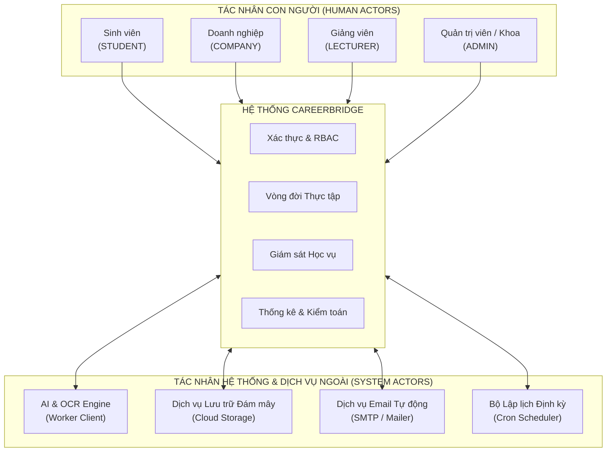

---

#### 1. Chi tiết các Tác nhân Con người (Primary Actors)

#### a) Tác nhân Sinh viên (Role: `STUDENT`)
- **Mô tả:** Là người học đang theo học tại trường đại học, có nhu cầu tìm kiếm nơi thực tập tốt nghiệp, nộp hồ sơ ứng tuyển, thực hiện kỳ thực tập thực tế tại doanh nghiệp và báo cáo kết quả học tập cho nhà trường.
- **Điều kiện định danh:** Bắt buộc sở hữu tài khoản email sinh viên hợp lệ có đuôi tên miền của nhà trường (`@ut.edu.vn`) và mã số sinh viên (MSSV) duy nhất.
- **Mục tiêu chính khi sử dụng hệ thống:**
  - Xây dựng hồ sơ năng lực số (Digital Profile) gồm thông tin cá nhân, kỹ năng, dự án thực tế và tệp CV.
  - Sử dụng công cụ tìm kiếm và hệ thống gợi ý thông minh (AI Recommendation) để chọn vị trí thực tập phù hợp.
  - Nộp đơn ứng tuyển, theo dõi trạng thái hồ sơ và nhận thư mời phỏng vấn trực tiếp từ doanh nghiệp.
  - Nộp báo cáo tuần đúng hạn theo quy định của nhà trường, tiếp thu góp ý từ giảng viên hướng dẫn.
  - Xem kết quả đánh giá thực tập cuối kỳ từ doanh nghiệp và giảng viên.

#### b) Tác nhân Doanh nghiệp (Role: `COMPANY`)
- **Mô tả:** Là tổ chức, công ty hoặc doanh nghiệp có tư cách pháp nhân hợp pháp, có nhu cầu tuyển dụng thực tập sinh, đào tạo thực tế và tiếp nhận sinh viên làm việc.
- **Đại diện sử dụng:** Cán bộ phụ trách nhân sự (HR Recruiter) hoặc người hướng dẫn trực tiếp tại cơ sở (Mentor).
- **Mục tiêu chính khi sử dụng hệ thống:**
  - Khai báo thông tin pháp nhân và tải lên Giấy chứng nhận ĐKKD để được nhà trường thẩm định.
  - Quản lý tin tuyển dụng theo đợt, sử dụng mẫu tin (`Templates`) và tái đăng tin nhanh chóng.
  - Tiếp nhận hồ sơ ứng tuyển, xem bảng phân tích điểm tương thích CV tự động (AI Match Score & Breakdown) để sàng lọc hồ sơ nhanh.
  - Lên lịch phỏng vấn trực tiếp tại văn phòng công ty và gửi thông báo lịch hẹn cho sinh viên.
  - Tiếp nhận ứng viên trúng tuyển chính thức vào thực tập.
  - Theo dõi quá trình làm việc thực tế và thực hiện đánh giá cho điểm sinh viên vào cuối kỳ.

#### c) Tác nhân Giảng viên Hướng dẫn (Role: `LECTURER`)
- **Mô tả:** Là giảng viên thuộc các khoa/bộ môn chuyên ngành của nhà trường, được Ban chủ nhiệm Khoa phân công phụ trách theo dõi, hướng dẫn học vụ và đánh giá kết quả thực tập tốt nghiệp của một nhóm sinh viên.
- **Mục tiêu chính khi sử dụng hệ thống:**
  - Tiếp nhận danh sách sinh viên được phân công hướng dẫn theo từng đợt thực tập.
  - Kiểm tra tiến độ thực tập của sinh viên thông qua các báo cáo thực tập tuần (Tuần 1 đến Tuần 12).
  - Phản hồi nhận xét chuyên môn, phê duyệt hoặc yêu cầu sinh viên chỉnh sửa bổ sung báo cáo.
  - Trao đổi học vụ với sinh viên và người hướng dẫn phía doanh nghiệp qua kênh liên lạc nội bộ.
  - Thực hiện chấm điểm học phần thực tập tốt nghiệp độc lập (thang điểm 10) dựa trên chất lượng báo cáo và quá trình thực tập của sinh viên.

#### d) Tác nhân Quản trị viên Hệ thống / Giáo vụ Khoa (Role: `ADMIN`)
- **Mô tả:** Là cán bộ phụ trách công tác quản lý giáo vụ của Khoa hoặc cán bộ quản trị hệ thống của Nhà trường, chịu trách nhiệm quản lý vận hành toàn bộ nền tảng.
- **Mục tiêu chính khi sử dụng hệ thống:**
  - Quản trị toàn bộ tài khoản người dùng, phân quyền truy cập, khóa/mở khóa tài khoản khi có vi phạm.
  - Thẩm định tính hợp pháp của doanh nghiệp mới đăng ký theo quy trình Checklist 6 bước và giám sát cam kết SLA.
  - Thiết lập và quản lý các đợt thực tập tốt nghiệp (`Semester`), kiểm soát các pha thời gian tự động.
  - Hậu kiểm chất lượng các bài đăng tuyển dụng, ẩn các tin vi phạm hoặc yêu cầu chỉnh sửa.
  - Thực hiện phê duyệt khung thời gian học vụ của Placement và phân công giảng viên hướng dẫn (`Supervision`).
  - Giám sát tiến độ toàn trường thông qua Dashboard học vụ với 4 bộ lọc cảnh báo sớm.
  - Can thiệp xử lý các trường hợp phản hồi hoặc điểm đánh giá bất thường giữa doanh nghiệp và giảng viên.
  - Kết xuất báo cáo học vụ quản lý tổng hợp dạng bảng tính Excel và văn bản PDF phục vụ họp xét tốt nghiệp.
  - Tra cứu nhật ký kiểm toán (`AuditLog`) để truy vết hoạt động của toàn hệ thống khi có khiếu nại.

---

#### 2. Chi tiết các Tác nhân Hệ thống và Dịch vụ Bên ngoài (Secondary Actors)

#### a) Module AI & OCR Engine (Worker Client)
- **Bản chất:** Là một tiến trình dịch vụ xử lý nền (Background Worker Service) hoạt động độc lập với máy chủ Web.
- **Nhiệm vụ:**
  - Tiếp nhận tác vụ xử lý tệp PDF CV khi sinh viên nộp đơn.
  - Thực thi bộ bóc tách văn bản Stream và bộ máy OCR (Tesseract Engine) để trích xuất thực thể.
  - Chạy mô hình tính toán điểm Match Score và phân tích các tiêu chí kỹ năng.
  - Gọi dịch vụ mô hình ngôn ngữ lớn (Gemini / LLM) để sinh đoạn văn giải thích lý do gợi ý công việc cho sinh viên.
  - Trả kết quả về cơ sở dữ liệu và thông báo cho Backend hoàn tất tác vụ.

#### b) Dịch vụ Lưu trữ Đám mây (Cloud Object Storage)
- **Bản chất:** Nền tảng lưu trữ đối tượng dạng Blob chuyên dụng trên đám mây (Railway Bucket / AWS S3 / Cloudinary).
- **Nhiệm vụ:**
  - Lưu trữ vật lý an toàn toàn bộ các tệp tin nhạy cảm của hệ thống: Tệp CV ứng tuyển, Giấy phép ĐKKD, tệp minh chứng báo cáo tuần, ảnh đại diện.
  - Cung cấp cơ chế sinh URL ký số tạm thời (Pre-signed URL) để người dùng tải lên hoặc tải xuống tệp tin mà không đi trực tiếp qua băng thông máy chủ Web.

#### c) Dịch vụ Gửi thư Điện tử Tự động (Mail Delivery Service - SMTP/Mailer)
- **Bản chất:** Máy chủ gửi thư điện tử giao thức SMTP kết nối qua dịch vụ đám mây (SendGrid, Mailgun hoặc Gmail SMTP).
- **Nhiệm vụ:**
  - Tự động phát hành email kích hoạt tài khoản có kèm mã token xác thực 24 giờ.
  - Gửi email hướng dẫn đặt lại mật khẩu với liên kết an toàn 30 phút.
  - Gửi thư mời phỏng vấn trực tiếp kèm chi tiết thời gian, địa điểm văn phòng đến sinh viên.
  - Gửi email thông báo khẩn khi doanh nghiệp bị yêu cầu bổ sung hồ sơ hoặc sinh viên bị cảnh báo trễ báo cáo.

#### d) Bộ Lập lịch Hệ thống (System Scheduler / Cron Tasks)
- **Bản chất:** Dịch vụ lập lịch định kỳ chạy ngầm trong hệ thống máy chủ (NestJS Schedule / Bull Queue).
- **Nhiệm vụ:**
  - Chạy quét định kỳ hàng giờ để kiểm tra và tự động chuyển pha đợt thực tập (`Semester`) dựa trên mốc thời gian thực tế.
  - Tự động đóng các tin tuyển dụng `OPEN` khi đợt chuyển sang pha giám sát học vụ (`MONITORING`).
  - Quét kiểm tra thời hạn cam kết SLA xử lý hồ sơ doanh nghiệp (`reviewDueAt`), cảnh báo các hồ sơ sắp quá hạn cho Quản trị viên.
  - Quét phát hiện các báo cáo thực tập tuần nộp trễ so với block 7 ngày của Placement để tự động kích hoạt cờ cảnh báo trên Dashboard.

---

#### 3. Ma trận Phân quyền Tác nhân - Chức năng Nghiệp vụ (CRUD Matrix)

Bảng dưới đây mô tả chi tiết quyền hạn truy xuất và thao tác dữ liệu của 4 tác nhân con người đối với từng nhóm chức năng nghiệp vụ của hệ thống:
- **C (Create):** Quyền tạo mới
- **R (Read):** Quyền xem/tra cứu
- **U (Update):** Quyền chỉnh sửa/cập nhật
- **D (Delete):** Quyền xóa
- **- :** Không có quyền truy cập hoặc thực hiện

| Phân hệ chức năng | Sinh viên (`STUDENT`) | Doanh nghiệp (`COMPANY`) | Giảng viên (`LECTURER`) | Quản trị viên (`ADMIN`) |
| :--- | :---: | :---: | :---: | :---: |
| **Xác thực & Tài khoản cá nhân** | C, R, U | C, R, U | R, U | C, R, U, D |
| **Hồ sơ Sinh viên & Kỹ năng/Dự án** | C, R, U, D (Cá nhân) | R (Hồ sơ ứng viên) | R (SV phụ trách) | C, R, U, D |
| **Nguyện vọng việc làm** | C, R, U (Cá nhân) | - | - | R |
| **Hồ sơ Doanh nghiệp & ĐKKD** | R (Thông tin đã duyệt) | C, R, U (Cá nhân) | R (Đối tác thực tập) | R, U (Thẩm định/Đình chỉ) |
| **Quản lý Đợt thực tập** | R | R | R | C, R, U, D |
| **Đăng tin Tuyển dụng** | R (Tin OPEN) | C, R, U (Của công ty) | R | R, U (Hậu kiểm/Ẩn tin) |
| **Mẫu tin Tuyển dụng** | - | C, R, U, D (Cá nhân) | - | R |
| **Gợi ý Việc làm AI** | C, R (Cá nhân) | - | - | R (Thống kê) |
| **Nộp đơn Ứng tuyển** | C, R, U (Rút đơn) | R, U (Chuyển trạng thái) | - | R |
| **Bóc tách CV & Điểm Match Score** | - | R (Xem kết quả) | - | R |
| **Lịch Phỏng vấn Trực tiếp** | R (Lịch cá nhân) | C, R, U (Của công ty) | - | R |
| **Tiếp nhận Placement** | R (Placement cá nhân) | C, R (Khi nhận đơn) | R (SV phụ trách) | R, U (Chốt lịch học vụ) |
| **Phân công Hướng dẫn** | R (Xem GV phụ trách) | R (Xem GV liên hệ) | R (Xem DS phân công) | C, R, U, D |
| **Báo cáo Thực tập tuần** | C, R, U (Theo tuần) | R (Tham khảo) | R, U (Chấm duyệt/Phản hồi) | R |
| **Đánh giá Cuối kỳ Doanh nghiệp** | R (Kết quả sau khi khóa) | C, R, U (Của công ty) | R (Tham chiếu điểm) | R, U (Hậu kiểm) |
| **Đánh giá Cuối kỳ Giảng viên** | R (Kết quả sau khi khóa) | R (Tham chiếu điểm) | C, R, U (SV phụ trách) | R, U (Hậu kiểm) |
| **Hội thoại & Tin nhắn Nội bộ** | C, R (Theo đơn/Placement) | C, R (Theo đơn/Placement) | C, R (Placement phụ trách) | R (Khi cần điều tra) |
| **Thông báo Hệ thống** | R, U (Đánh dấu đã đọc) | R, U (Đánh dấu đã đọc) | R, U (Đánh dấu đã đọc) | C, R (Gửi thông báo hệ thống) |
| **Dashboard Học vụ & Cảnh báo** | - | - | R (SV phụ trách) | R (Toàn trường) |
| **Analytics Tuyển dụng** | - | R (Số liệu công ty) | - | R (Tổng hợp) |
| **Xuất Báo cáo Excel / PDF** | - | - | - | C, R |
| **Nhật ký Kiểm toán (Audit Log)** | - | - | - | R |

---

### 3.1.4. Tóm tắt mục 3.1

Mục **3.1. Phân tích yêu cầu** đã làm rõ nền tảng nghiệp vụ và các tiêu chuẩn kỹ thuật cốt lõi cho hệ thống CareerBridge:
1. Xác định tường minh **40 yêu cầu chức năng (FR)** thuộc 12 phân hệ nghiệp vụ, chuẩn hóa quy trình từ khâu tiền tuyển dụng, tuyển dụng tự động hóa, phỏng vấn trực tiếp, giám sát học vụ, đến nghiệm thu kết quả thực tập tốt nghiệp.
2. Xây dựng bộ tiêu chuẩn gồm **18 yêu cầu phi chức năng (NFR)** theo chuẩn ISO/IEC 25010, đặt ra các chỉ số định lượng về hiệu năng API, an toàn bảo mật OWASP, tính toàn vẹn giao dịch ACID, và cơ chế dự phòng tất định cho AI.
3. Mô hình hóa chi tiết **4 tác nhân con người** và **4 tác nhân hệ thống**, đồng thời thiết lập **Ma trận phân quyền CRUD** chặt chẽ, tạo tiền đề vững chắc cho việc xây dựng kiến trúc hệ thống, biểu đồ Use Case và thiết kế cơ sở dữ liệu ở các mục tiếp theo của Chương 3.


---

## 3.2. PHÂN TÍCH CHỨC NĂNG HỆ THỐNG

### 3.2.1. Biểu đồ Use Case tổng quát

Biểu đồ Use Case tổng quát phản ánh ranh giới của hệ thống CareerBridge và sự tương tác của 4 tác nhân con người (`STUDENT`, `COMPANY`, `LECTURER`, `ADMIN`) cùng các tác nhân dịch vụ ngoại vi với các gói chức năng chính của hệ thống.

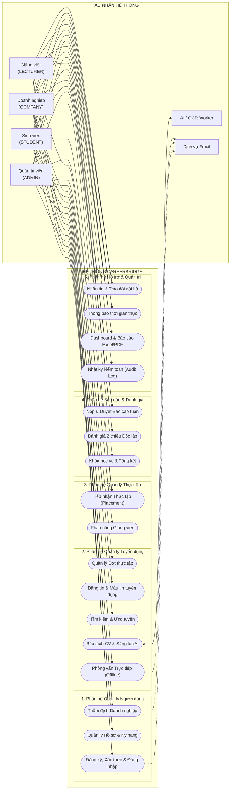

---

### 3.2.2. Biểu đồ Use Case quản lý người dùng

Phân hệ quản lý người dùng bao quát các chức năng về xác thực tài khoản, kích hoạt email, phân quyền truy cập, thiết lập hồ sơ cá nhân và thẩm định pháp lý doanh nghiệp.

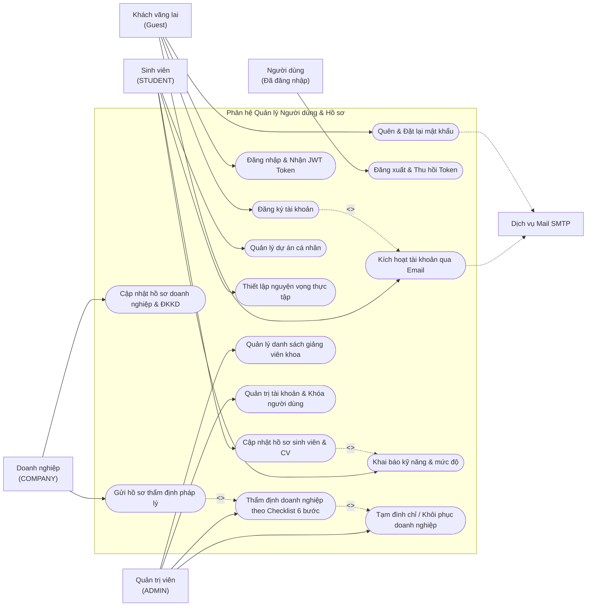

---

### 3.2.3. Biểu đồ Use Case quản lý tuyển dụng

Phân hệ tuyển dụng quản lý toàn bộ quá trình đăng tuyển vị trí thực tập, tìm kiếm cơ hội, bóc tách hồ sơ CV thông minh, chấm điểm phù hợp AI và tổ chức phỏng vấn trực tiếp.

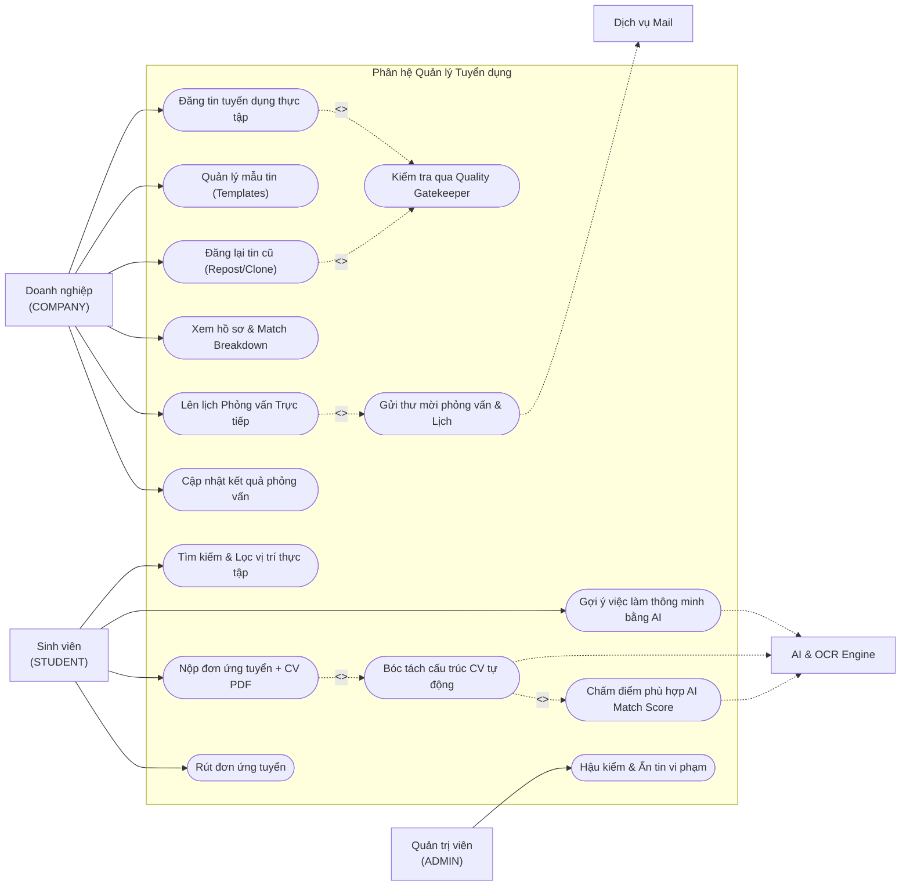

---

### 3.2.4. Biểu đồ Use Case quản lý thực tập

Phân hệ quản lý thực tập điều phối đợt thực tập của trường, tiếp nhận sinh viên trúng tuyển vào vị trí chính thức (`InternshipPlacement`) và phân công giảng viên hướng dẫn (`Supervision`).

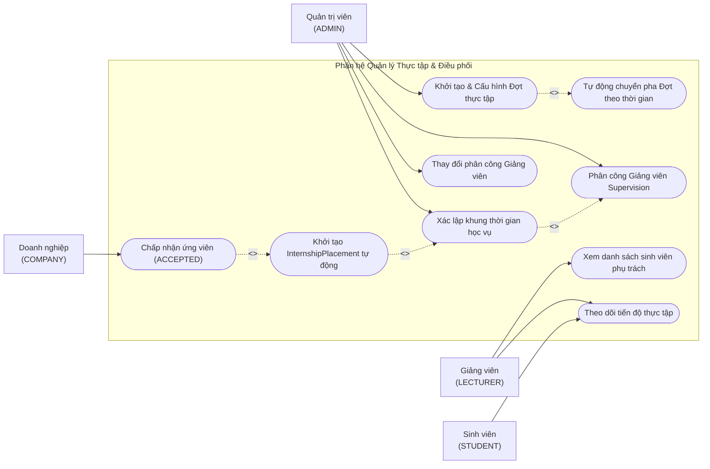

---

### 3.2.5. Biểu đồ Use Case quản lý báo cáo và đánh giá

Phân hệ báo cáo và đánh giá quản lý quy trình nộp báo cáo tuần của sinh viên, hoạt động phản hồi của giảng viên, công tác chấm điểm hai chiều độc lập và nghiệm thu khóa học vụ.

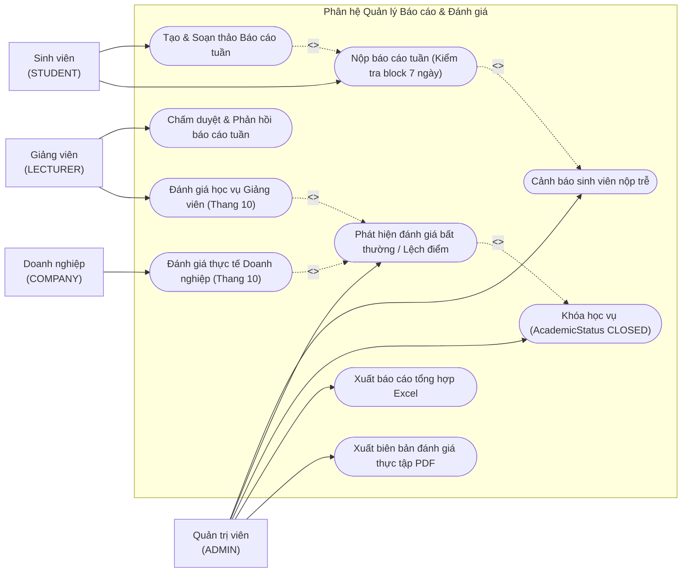

---

### 3.2.6. Đặc tả các Use Case chính

Dưới đây là bảng đặc tả chi tiết cho 6 Use Case nghiệp vụ trọng tâm nhất của hệ thống CareerBridge theo chuẩn tài liệu hóa phần mềm chuyên nghiệp.

#### 1. Đặc tả Use Case: UC-01 Thẩm định và Xét duyệt Doanh nghiệp
- **Mã Use Case:** `UC-VERIFY-01`
- **Tên Use Case:** Thẩm định và Xét duyệt Hồ sơ Doanh nghiệp
- **Tác nhân chính:** Quản trị viên (`ADMIN`)
- **Tác nhân phụ:** Doanh nghiệp (`COMPANY`), Dịch vụ gửi Email
- **Mục tiêu:** Kiểm tra tư cách pháp lý và độ tin cậy của doanh nghiệp đăng ký mới dựa trên Giấy phép ĐKKD và bộ Checklist 6 tiêu chí nhằm bảo đảm quyền lợi và an toàn cho sinh viên.
- **Tiền điều kiện:** Doanh nghiệp đã đăng ký, đã xác thực email thành công, hoàn thiện các trường pháp lý bắt buộc, tải lên Giấy chứng nhận ĐKKD và nhấn "Gửi xét duyệt" (`status = PENDING`).
- **Hậu điều kiện:**
  - Nếu phê duyệt: Hồ sơ chuyển `APPROVED`, doanh nghiệp được phép đăng tin tuyển dụng.
  - Nếu từ chối: Hồ sơ chuyển `REJECTED`, lưu mã lý do và ghi chú chi tiết.
- **Luồng sự kiện chính (Main Flow):**
  1. Quản trị viên truy cập vào danh sách hồ sơ doanh nghiệp chờ duyệt (`/admin/companies?status=PENDING`).
  2. Hệ thống hiển thị danh sách kèm đồng hồ đếm ngược hạn SLA (`reviewDueAt`).
  3. Quản trị viên chọn một hồ sơ cần xem xét.
  4. Hệ thống hiển thị toàn bộ thông tin công ty và tạo signed URL để mở xem trực tiếp Giấy phép ĐKKD.
  5. Quản trị viên đối chiếu và tích chọn lần lượt **6 tiêu chí checklist**:
     - *Tiêu chí 1:* Tệp ĐKKD rõ nét, có dấu mộc đỏ hợp lệ.
     - *Tiêu chí 2:* Mã số thuế/mã số doanh nghiệp chính xác trên cổng quốc gia.
     - *Tiêu chí 3:* Tên pháp lý trùng khớp với tên trên giấy phép.
     - *Tiêu chí 4:* Địa chỉ văn phòng hoạt động xác thực.
     - *Tiêu chí 5:* Đầu mối liên hệ nhân sự (email, điện thoại) chính xác.
     - *Tiêu chí 6:* Tài khoản email đăng ký đã được kích hoạt.
  6. Quản trị viên nhấn nút "Phê duyệt doanh nghiệp".
  7. Hệ thống kiểm tra hợp lệ toàn bộ 6 tiêu chí checklist, cập nhật `status = APPROVED`, khóa các trường thông tin pháp lý nhạy cảm, lưu thông tin người duyệt (`reviewedById`, `reviewedAt`), ghi nhật ký `AuditLog`.
  8. Hệ thống gửi email thông báo phê duyệt thành công đến doanh nghiệp.
- **Luồng rẽ nhánh / Ngoại lệ (Alternative & Exception Flows):**
  - *4a. Doanh nghiệp thiếu giấy tờ hoặc thông tin không rõ ràng:*
    - Quản trị viên chọn "Yêu cầu bổ sung / Từ chối".
    - Quản trị viên chọn mã chuẩn `CompanyRejectionReasonCode` (ví dụ: `DOCUMENT_UNCLEAR`, `NAME_MISMATCH`) và nhập nội dung giải thích chi tiết $\ge 10$ ký tự.
    - Hệ thống chuyển `status = REJECTED`, gửi email thông báo chi tiết lý do cho doanh nghiệp để bổ sung.
  - *5a. Quá hạn SLA xử lý (quá 48h-72h):*
    - Hệ thống đánh dấu cờ cảnh báo đỏ trên Dashboard quản trị để ưu tiên xử lý khẩn cấp.

---

#### 2. Đặc tả Use Case: UC-02 Ứng tuyển, Bóc tách CV và Chấm điểm AI
- **Mã Use Case:** `UC-APPLY-02`
- **Tên Use Case:** Nộp đơn Ứng tuyển, Bóc tách CV và Tính điểm phù hợp AI
- **Tác nhân chính:** Sinh viên (`STUDENT`)
- **Tác nhân phụ:** AI & OCR Worker, Doanh nghiệp (`COMPANY`)
- **Mục tiêu:** Sinh viên nộp đơn ứng tuyển kèm CV PDF vào vị trí thực tập mong muốn; hệ thống tự động bóc tách cấu trúc CV và tính điểm Match Score hỗ trợ nhà tuyển dụng.
- **Tiền điều kiện:** Sinh viên đã đăng nhập tài khoản hợp lệ; vị trí tuyển dụng đang ở trạng thái `OPEN`, chưa quá hạn nộp hồ sơ; đợt thực tập đang trong pha `RECRUITING`; sinh viên chưa từng nộp đơn vào vị trí này.
- **Hậu điều kiện:** Đơn ứng tuyển được tạo với trạng thái `PENDING`; dữ liệu CV được bóc tách và tính toán điểm `matchScore` thành công.
- **Luồng sự kiện chính (Main Flow):**
  1. Sinh viên xem chi tiết bài đăng tuyển dụng thực tập.
  2. Sinh viên nhấn nút "Ứng tuyển ngay".
  3. Hệ thống hiển thị hộp thoại ứng tuyển: Cho phép chọn CV có sẵn từ hồ sơ cá nhân hoặc tải lên tệp CV PDF mới, kèm ô nhập Thư giới thiệu (Cover Letter).
  4. Sinh viên chọn tệp CV, nhập thư giới thiệu và nhấn "Xác nhận nộp đơn".
  5. Hệ thống kiểm tra ràng buộc: Sinh viên chưa có đơn ứng tuyển tại vị trí này trong đợt; tệp tin là PDF dung lượng $\le 5\text{MB}$.
  6. Hệ thống lưu bản ghi `Application` với trạng thái `PENDING`, đồng thời đẩy tác vụ bóc tách vào hàng đợi xử lý `AiScanJob`.
  7. **Tiến trình AI Worker thực thi ngầm:**
     - Trích xuất văn bản từ CV PDF (sử dụng text stream hoặc OCR Tesseract).
     - Nhận diện các thực thể: Học vấn, GPA, Danh sách kỹ năng kỹ thuật, Dự án thực tế.
     - So sánh đối chiếu với danh mục kỹ năng yêu cầu của tin tuyển dụng (`InternshipSkill`).
     - Tính điểm `matchScore` từ 0 đến 100 theo trọng số đa tiêu chí.
     - Liệt kê bảng phân tích Match Breakdown (Kỹ năng đáp ứng, kỹ năng còn thiếu).
     - Cập nhật kết quả vào bản ghi `Application` và `AiScanJob`.
  8. Hệ thống gửi thông báo thời gian thực đến Doanh nghiệp về ứng viên mới.
- **Luồng rẽ nhánh / Ngoại lệ (Alternative & Exception Flows):**
  - *5a. Sinh viên đã có đơn ứng tuyển trước đó:* Hệ thống báo lỗi và từ chối tạo đơn mới.
  - *7a. Tệp CV bị lỗi định dạng hoặc không thể bóc tách:* Hệ thống kích hoạt cơ chế Fallback, ghi nhận trạng thái `SKIPPED`, vẫn cho phép nộp đơn thành công để nhà tuyển dụng xem tệp thủ công.

---

#### 3. Đặc tả Use Case: UC-03 Tiếp nhận Ứng viên và Khởi tạo Placement
- **Mã Use Case:** `UC-PLACE-03`
- **Tên Use Case:** Tiếp nhận Ứng viên Trúng tuyển và Tự động Khởi tạo Placement
- **Tác nhân chính:** Doanh nghiệp (`COMPANY`)
- **Tác nhân phụ:** Sinh viên (`STUDENT`), Quản trị viên (`ADMIN`)
- **Mục tiêu:** Chuyển trạng thái ứng viên trúng tuyển sang `ACCEPTED`, cập nhật chỉ tiêu tuyển dụng và tạo bản ghi trung tâm `InternshipPlacement` phục vụ giám sát học vụ.
- **Tiền điều kiện:** Ứng viên đang ở trạng thái hợp lệ (`PENDING`, `REVIEWING` hoặc `INTERVIEWING`); vị trí tuyển dụng còn chỉ tiêu (`filledSlots < slots`).
- **Hậu điều kiện:** Đơn ứng tuyển chuyển `ACCEPTED`, `filledSlots` tăng 1, khởi tạo bản ghi `InternshipPlacement` ở trạng thái học vụ `PENDING`.
- **Luồng sự kiện chính (Main Flow):**
  1. Doanh nghiệp xem danh sách ứng viên của bài đăng tuyển dụng.
  2. Doanh nghiệp chọn ứng viên đạt yêu cầu và nhấn nút "Tiếp nhận thực tập sinh (Accept)".
  3. Hệ thống mở một Database Transaction và thực hiện các bước kiểm tra toàn vẹn:
     - Kiểm tra số lượng chỉ tiêu của tin: `filledSlots < slots`.
     - Kiểm tra sinh viên chưa có bất kỳ `InternshipPlacement` nào đang ở trạng thái `ACTIVE` trong cùng đợt thực tập.
  4. Hệ thống cập nhật trạng thái đơn ứng tuyển thành `ACCEPTED`, lưu mốc thời gian `acceptedAt`.
  5. Hệ thống tăng số lượng chỉ tiêu đã tuyển: `filledSlots = filledSlots + 1`.
  6. Hệ thống tự động tạo bản ghi `InternshipPlacement` mới gắn với `studentId`, `companyId`, `internshipId`, `semesterId`, trạng thái học vụ ban đầu `academicStatus = PENDING`.
  7. Hệ thống tự động khởi tạo cuộc hội thoại nội bộ (`Conversation`) giữa sinh viên và doanh nghiệp.
  8. Hệ thống ghi nhật ký trạng thái `ApplicationStatusHistory` và nhật ký kiểm toán `AuditLog`.
  9. Transaction kết thúc thành công (Commit); hệ thống gửi thông báo chúc mừng đến sinh viên.
- **Luồng rẽ nhánh / Ngoại lệ (Alternative & Exception Flows):**
  - *3a. Vị trí đã hết chỉ tiêu tuyển dụng:* Hệ thống từ chối thao tác, thông báo "Vị trí đã đủ chỉ tiêu tiếp nhận".
  - *3b. Sinh viên đã được tiếp nhận ở một vị trí khác trong đợt:* Hệ thống từ chối thao tác và hoàn tác transaction.

---

#### 4. Đặc tả Use Case: UC-04 Phân công Giảng viên Hướng dẫn Học vụ
- **Mã Use Case:** `UC-SUPERVISE-04`
- **Tên Use Case:** Phân công Giảng viên Hướng dẫn cho Placement
- **Tác nhân chính:** Quản trị viên Giáo vụ Khoa (`ADMIN`)
- **Tác nhân phụ:** Giảng viên (`LECTURER`), Sinh viên (`STUDENT`)
- **Mục tiêu:** Chỉ định chính thức một giảng viên của khoa chịu trách nhiệm học thuật, theo dõi báo cáo tuần và đánh giá kết quả thực tập của sinh viên.
- **Tiền điều kiện:** Bản ghi `InternshipPlacement` đã được tạo và Quản trị viên đã xác lập khung thời gian học vụ (`startDate`, `endDate`).
- **Hậu điều kiện:** Bản ghi `Supervision` được tạo thành công; giảng viên có toàn quyền truy cập hồ sơ học vụ của sinh viên.
- **Luồng sự kiện chính (Main Flow):**
  1. Quản trị viên truy cập danh sách các Placement chưa có giảng viên hướng dẫn.
  2. Quản trị viên kiểm tra khung thời gian học vụ của Placement bảo đảm nằm trong phạm vi đợt thực tập.
  3. Quản trị viên nhấn nút "Phân công giảng viên".
  4. Hệ thống hiển thị danh sách các giảng viên thuộc Khoa/Bộ môn tương ứng kèm số lượng sinh viên hiện đang phụ trách để quản trị viên cân đối khối lượng giảng dạy.
  5. Quản trị viên chọn một giảng viên và xác nhận phân công.
  6. Hệ thống tạo bản ghi `Supervision` gắn với `placementId` và `lecturerId`, lưu thông tin người phân công (`assignedById`, `assignedAt`).
  7. Hệ thống thêm giảng viên vào nhóm hội thoại trao đổi của Placement.
  8. Hệ thống ghi nhật ký kiểm toán `AuditLog` và gửi thông báo tức thì đến Giảng viên và Sinh viên.
- **Luồng rẽ nhánh / Ngoại lệ (Alternative & Exception Flows):**
  - *2a. Placement chưa có ngày bắt đầu và kết thúc học vụ:* Hệ thống yêu cầu nhập ngày học vụ trước khi cho phép phân công.
  - *5a. Giảng viên đã vượt quá định mức hướng dẫn tối đa:* Hệ thống hiển thị cảnh báo để quản trị viên cân nhắc trước khi xác nhận.

---

#### 5. Đặc tả Use Case: UC-05 Nộp và Chấm duyệt Báo cáo Thực tập tuần
- **Mã Use Case:** `UC-REPORT-05`
- **Tên Use Case:** Nộp và Chấm duyệt Báo cáo Thực tập tuần
- **Tác nhân chính:** Sinh viên (`STUDENT`), Giảng viên hướng dẫn (`LECTURER`)
- **Tác nhân phụ:** Quản trị viên (`ADMIN`)
- **Mục tiêu:** Sinh viên định kỳ nộp báo cáo tiến độ công việc hàng tuần; giảng viên theo dõi, nhận xét góp ý và phê duyệt kết quả.
- **Tiền điều kiện:** Placement đang ở trạng thái học vụ `ACTIVE`; giảng viên đã được phân công qua `Supervision`.
- **Hậu điều kiện:** Báo cáo tuần chuyển sang trạng thái `SUBMITTED` hoặc `APPROVED` / `REJECTED`.
- **Luồng sự kiện chính (Main Flow):**
  1. Sinh viên truy cập vào phân hệ báo cáo học vụ cá nhân.
  2. Hệ thống tính toán tuần thực tập hiện tại dựa trên số ngày trôi qua kể từ `placement.startDate` (mỗi block 7 ngày tương ứng 1 tuần, từ Tuần 1 đến Tuần 12).
  3. Sinh viên chọn tuần cần nộp báo cáo, nhập tiêu đề, nội dung công việc đã thực hiện, bài học rút ra, kế hoạch tuần tới và tải lên tệp tài liệu minh chứng (loại `REPORT`).
  4. Sinh viên nhấn nút "Nộp báo cáo".
  5. Hệ thống kiểm tra tính hợp lệ: Chỉ cho phép nộp tuần hiện tại hoặc các tuần trong quá khứ; nghiêm cấm nộp tuần tương lai.
  6. Trạng thái báo cáo chuyển sang `SUBMITTED`, lưu mốc thời gian `submittedAt`.
  7. Hệ thống gửi thông báo đến Giảng viên hướng dẫn.
  8. Giảng viên mở giao diện quản lý báo cáo của sinh viên, xem nội dung và tải tệp tài liệu minh chứng qua signed URL.
  9. Giảng viên nhập nhận xét đánh giá và nhấn "Phê duyệt (Approve)".
  10. Trạng thái báo cáo chuyển sang `APPROVED`, lưu mốc thời gian `reviewedAt`. Sinh viên nhận thông báo kết quả.
- **Luồng rẽ nhánh / Ngoại lệ (Alternative & Exception Flows):**
  - *5a. Sinh viên cố tình nộp trước cho các tuần tương lai:* Hệ thống từ chối và hiển thị thông báo lỗi "Chưa đến thời gian nộp báo cáo cho tuần này".
  - *9a. Nội dung báo cáo sơ sài hoặc không đạt yêu cầu:*
    - Giảng viên nhập lý do cụ thể và nhấn "Yêu cầu sửa đổi (Reject)".
    - Trạng thái báo cáo chuyển `REJECTED`, sinh viên nhận thông báo để tiến hành chỉnh sửa và nộp lại.
  - *7a. Sinh viên không nộp báo cáo đúng hạn block tuần:*
    - Hệ thống tự động kích hoạt cờ "Nộp trễ (Late)" trên Dashboard giám sát của Giảng viên và Khoa.

---

#### 6. Đặc tả Use Case: UC-06 Đánh giá Hai chiều Độc lập và Khóa Học vụ
- **Mã Use Case:** `UC-EVAL-06`
- **Tên Use Case:** Đánh giá Thực tập Hai chiều Độc lập và Hoàn tất Khóa Học vụ
- **Tác nhân chính:** Doanh nghiệp (`COMPANY`), Giảng viên hướng dẫn (`LECTURER`)
- **Tác nhân phụ:** Quản trị viên (`ADMIN`), Hệ thống
- **Mục tiêu:** Thu thập hai đánh giá độc lập về năng lực làm việc thực tế và kết quả học thuật của sinh viên; tổng kết điểm số và khóa sổ học vụ tốt nghiệp.
- **Tiền điều kiện:** Kỳ thực tập bước vào giai đoạn cuối; Placement đang trong khung thời gian học vụ.
- **Hậu điều kiện:** Hai phiếu đánh giá được lưu trữ; Placement chuyển `academicStatus = CLOSED`.
- **Luồng sự kiện chính (Main Flow):**
  1. **Doanh nghiệp đánh giá thực tế:**
     - Người phụ trách tại doanh nghiệp mở mục đánh giá sinh viên cuối kỳ.
     - Nhập điểm số theo thang điểm 10 (thái độ, chuyên môn, kỷ luật, đóng góp) và lời nhận xét thực tế.
     - Tải lên tệp chứng nhận thực tập hoàn thành (nếu có).
     - Nhấn "Xác nhận gửi đánh giá Doanh nghiệp". Hệ thống lưu bản ghi `Evaluation` loại `COMPANY`.
  2. **Giảng viên đánh giá học thuật:**
     - Giảng viên mở mục đánh giá học phần của sinh viên mình phụ trách.
     - Nhập điểm số theo thang điểm 10 dựa trên quá trình nộp báo cáo tuần và chất lượng tiếp thu.
     - Nhập nhận xét kết quả học phần.
     - Nhấn "Xác nhận gửi đánh giá Giảng viên". Hệ thống lưu bản ghi `Evaluation` loại `LECTURER`.
  3. **Hệ thống đối soát và kiểm tra bất thường:**
     - Khi đã đủ 2 đánh giá, hệ thống kiểm tra độ lệch điểm: Nếu $|\text{Score}_{\text{Company}} - \text{Score}_{\text{Lecturer}}| \ge 4.0$ điểm, hệ thống tự động gắn cờ cảnh báo bất thường lên Dashboard của Khoa để Ban chủ nhiệm xem xét hậu kiểm.
  4. Khi đợt thực tập kết thúc hoặc Quản trị viên nghiệm thu, hệ thống cập nhật `academicStatus = CLOSED`, lưu `academicClosedAt`.
  5. Toàn bộ điểm số được chốt cố định, không thể chỉnh sửa; Khoa tiến hành xuất bảng điểm tổng hợp phục vụ xét tốt nghiệp.
- **Luồng rẽ nhánh / Ngoại lệ (Alternative & Exception Flows):**
  - *1a. Người đánh giá không phải doanh nghiệp tiếp nhận sinh viên:* Hệ thống kiểm tra quyền tại Service Guard và chặn truy cập.
  - *2a. Giảng viên chưa chấm hết báo cáo tuần:* Hệ thống hiển thị nhắc nhở hoàn thiện chấm duyệt báo cáo trước khi chốt điểm đánh giá cuối kỳ.

---

## 3.3. THIẾT KẾ KIẾN TRÚC HỆ THỐNG

### 3.3.1. Biểu đồ kiến trúc tổng thể

Kiến trúc hệ thống CareerBridge được thiết kế theo mô hình **Đa tầng (Multi-tier Architecture)** hiện đại kết hợp mô hình **Client-Server / API-Driven**, bảo đảm sự phân tách độc lập giữa giao diện người dùng, xử lý nghiệp vụ trung tâm, dịch vụ trí tuệ nhân tạo và kho lưu trữ dữ liệu.

```mermaid
flowchart TD
  subgraph PresentationLayer["1. TẦNG TRÌNH DIỄN (CLIENT / FRONTEND)"]
    direction LR
    UI_Student["Giao diện Sinh viên<br/>(React + Tailwind)"]
    UI_Company["Giao diện Doanh nghiệp<br/>(React + Vite)"]
    UI_Lecturer["Giao diện Giảng viên<br/>(React + Tailwind)"]
    UI_Admin["Giao diện Quản trị / Khoa<br/>(React + Dashboard)"]
  end

  subgraph GatewaySecurity["2. TẦNG BẢO MẬT & ĐIỀU HƯỚNG (GATEWAY / MIDDLEWARE)"]
    direction LR
    CORS["CORS Filter"]
    Helmet["Helmet Security Headers"]
    RateLimiter["Rate Limiter (Throttler)"]
    JWTGuard["JWT Auth Guard"]
    RoleGuard["RBAC Roles Guard"]
  end

  subgraph ApplicationLayer["3. TẦNG ỨNG DỤNG NGHIỆP VỤ (NESTJS BACKEND)"]
    direction TB
    subgraph CoreModules["Các Module Nghiệp vụ Cốt lõi"]
      M_Auth["Auth & User Module"]
      M_Company["Company & Verification Module"]
      M_Semester["Semester & Internship Module"]
      M_App["Application & Placement Module"]
      M_Supervise["Supervision & Report Module"]
      M_Eval["Evaluation & Audit Module"]
    end
    subgraph CrossCutting["Thành phần Xuyên suốt"]
      PrismaService["Prisma ORM Service"]
      SocketGateway["Socket.IO Realtime Gateway"]
      ExceptionFilter["Global Exception Filter"]
      ValidationPipe["Class Validation Pipe"]
    end
  end

  subgraph WorkerLayer["4. TẦNG DỊCH VỤ NỀN & AI (WORKER & ENGINE LAYER)"]
    direction LR
    CV_Parser["Text Stream Parser<br/>(Trích xuất tốc độ cao)"]
    OCR_Engine["Tesseract OCR Engine<br/>(Quét PDF ảnh)"]
    ScoringModel["AI Match Scoring Model<br/>(Chấm điểm trọng số)"]
    GeminiClient["Gemini API Client<br/>(Giải thích gợi ý việc làm)"]
  end

  subgraph PersistenceLayer["5. TẦNG LƯU TRỮ & DỊCH VỤ NGOÀI (DATA & INFRASTRUCTURE)"]
    direction LR
    PostgreSQL[("Railway PostgreSQL<br/>(CSDL Quan hệ chính)")]
    ObjectStorage[("Private Cloud Storage<br/>(Lưu tệp CV, ĐKKD, Báo cáo)")]
    SMTPMailer["Dịch vụ Email SMTP<br/>(Gửi thông báo & OTP)")]
  end

  PresentationLayer -->|HTTPS REST API / WSS| GatewaySecurity
  GatewaySecurity --> ApplicationLayer

  ApplicationLayer <-->|Query & Transaction| PrismaService
  PrismaService <--> PostgreSQL

  ApplicationLayer <-->|Giao tiếp Hàng đợi / IPC| WorkerLayer
  WorkerLayer <-->|Gọi LLM có kiểm soát| GeminiClient

  ApplicationLayer <-->|Pre-signed URL Token| ObjectStorage
  ApplicationLayer -.->|Gửi thư kích hoạt/mời| SMTPMailer
```

---

### 3.3.2. Biểu đồ thành phần (Component Diagram)

Biểu đồ thành phần biểu diễn cấu trúc module hóa cao độ của máy chủ Backend NestJS, minh họa sự phụ thuộc và giao tiếp lỏng (loose coupling) giữa các thành phần qua cơ chế **Dependency Injection (DI)**.

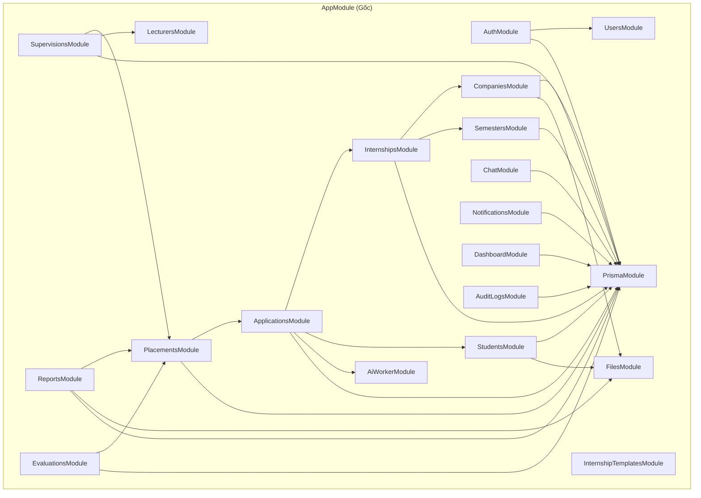

---

### 3.3.3. Biểu đồ triển khai (Deployment Diagram)

Biểu đồ triển khai thể hiện cấu hình hạ tầng mạng và cách thức đóng gói phần mềm trên môi trường điện toán đám mây thực tế.

```mermaid
flowchart TD
  subgraph ClientDevices["Thiết bị Người dùng (End-User Devices)"]
    Browser1["Trình duyệt Máy tính (Chrome, Edge, Firefox)"]
    Browser2["Trình duyệt Di động (Safari, Chrome Mobile)"]
  end

  subgraph CloudHosting["Hạ tầng Mạng & Nền tảng Đám mây (Cloud Infrastructure)"]
    subgraph FrontendHost["Vercel / Cloud Static CDN"]
      ReactApp["React Production Build<br/>(HTML5 / JS / CSS Assets)"]
    end

    subgraph BackendHost["Railway Cloud Container Platform"]
      subgraph WebContainer["Docker Container: API Server"]
        NodeJS["Node.js Runtime (v20 LTS)"]
        NestApp["NestJS Application Server<br/>(Port 3000 / Reverse Proxy)"]
      end

      subgraph WorkerContainer["Docker Container: AI Worker"]
        PythonOrNode["AI Worker Client Runtime"]
        TesseractBinary["Tesseract OCR Binary (vie + eng)"]
        ParserEngine["PDF Stream Parser Engine"]
      end

      subgraph DBService["Railway Database Platform"]
        PostgresContainer["PostgreSQL 15 Server<br/>(Port 5432 / SSD Storage)"]
      end
    end

    subgraph ExternalSaaS["Dịch vụ Đám mây Ngoại vi (Third-Party SaaS)"]
      CloudStorage["Cloudinary / S3 Storage<br/>(Private Encrypted Buckets)"]
      GoogleAI["Google Gemini AI API<br/>(LLM Explanation Service)"]
      MailSaaS["SMTP Mail Service<br/>(SendGrid / Google Workspace)"]
    end
  end

  Browser1 -->|HTTPS:443| ReactApp
  Browser2 -->|HTTPS:443| ReactApp

  ReactApp -->|REST API HTTPS / WSS:443| NestApp

  NestApp <-->|TCP:5432 Connection Pool (SSL)| PostgresContainer
  NestApp <-->|Internal Network / Redis Queue| WorkerContainer
  NestApp -->|API Call (Generate Signed URL)| CloudStorage
  NestApp -->|SMTP:587 TLS| MailSaaS

  WorkerContainer -->|External API Call| GoogleAI
```

---

### 3.3.4. Biểu đồ lớp (Class Diagram)

Biểu đồ lớp dưới đây minh họa các lớp thực thể nghiệp vụ cốt lõi (Domain Entity Classes), cấu trúc thuộc tính và quan hệ liên kết giữa chúng trong hệ thống Backend.

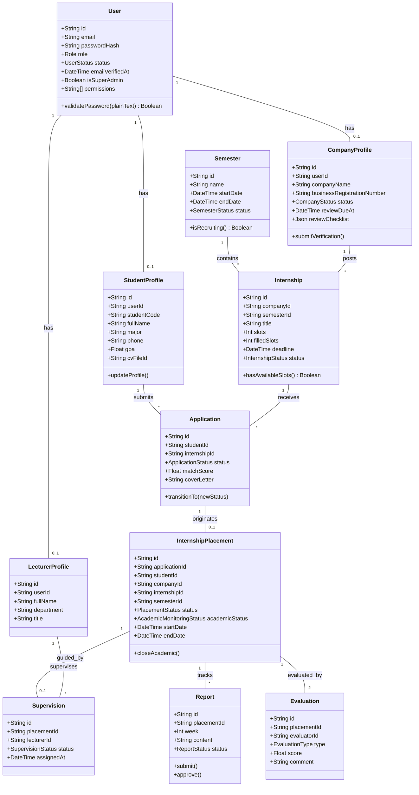


---

## 3.4. THIẾT KẾ CƠ SỞ DỮ LIỆU

### 3.4.1. Xác định các thực thể và mối quan hệ

Cơ sở dữ liệu của CareerBridge được xây dựng trên hệ quản trị cơ sở dữ liệu quan hệ **PostgreSQL 15+**, tuân thủ nghiêm ngặt dạng chuẩn **3NF (Third Normal Form)** nhằm loại bỏ dư thừa dữ liệu và đảm bảo tính toàn vẹn tham chiếu. Dựa trên phân tích nghiệp vụ, các thực thể trong hệ thống được phân thành 5 phân nhóm chính:

1. **Phân nhóm Định danh & Hồ sơ Người dùng (Identity & Profile Group):**
   - `User`: Thực thể người dùng gốc của hệ thống (lưu thông tin đăng nhập, vai trò, trạng thái tài khoản).
   - `StudentProfile`: Hồ sơ học vụ cá nhân của sinh viên, liên kết 1-1 với `User`.
   - `LecturerProfile`: Hồ sơ giảng viên hướng dẫn của khoa, liên kết 1-1 với `User`.
   - `CompanyProfile`: Hồ sơ pháp nhân và năng lực doanh nghiệp, liên kết 1-1 với `User`.
   - `Faculty` & `Major`: Thực thể Khoa và Ngành đào tạo chuẩn hóa trong nhà trường; quản lý quan hệ 1-N giữa Khoa và Ngành, giữa Ngành và Sinh viên.
   - `StudentProject`: Danh sách các dự án thực tế của sinh viên, quan hệ N-1 với `StudentProfile`.
   - `StudentJobPreference`: Nguyện vọng công việc (vị trí, địa điểm, hình thức), liên kết 1-1 với `StudentProfile`.
   - `VerificationToken`, `PasswordResetToken`, `RefreshToken`: Quản lý các mã xác thực bảo mật và phiên đăng nhập của người dùng.

2. **Phân nhóm Đợt thực tập, Vị trí tuyển dụng & Kỹ năng (Semester, Job & Skill Group):**
   - `Semester`: Đợt thực tập tốt nghiệp do nhà trường tổ chức theo từng năm học và học kỳ.
   - `Internship`: Bài đăng tuyển dụng thực tập của doanh nghiệp trong một đợt cụ thể; quan hệ N-1 với `CompanyProfile` và `Semester`.
   - `InternshipTemplate`: Mẫu tin tuyển dụng độc lập, quan hệ N-1 với `CompanyProfile`.
   - `Skill`: Danh mục kỹ năng chuyên môn chuẩn hóa trong hệ thống.
   - `StudentSkill`: Bảng liên kết N-N giữa `StudentProfile` và `Skill` kèm cấp độ thành thạo (`level`).
   - `InternshipSkill`: Bảng liên kết N-N giữa `Internship` và `Skill` kèm cờ bắt buộc (`isRequired`) và trọng số (`weight`).
   - `InternshipMajor`: Bảng liên kết N-N giữa `Internship` và `Major` xác định ngành đào tạo mục tiêu.
   - `InternshipView`: Ghi nhận nhật ký lượt xem tin tuyển dụng của người dùng.

3. **Phân nhóm Tuyển dụng, Bóc tách CV & Phỏng vấn (Recruitment & AI Group):**
   - `Application`: Đơn ứng tuyển của sinh viên vào bài đăng thực tập; quan hệ N-1 với `StudentProfile` và `Internship`. Ràng buộc duy nhất `(studentId, internshipId)`.
   - `ApplicationStatusHistory`: Nhật ký lưu vết toàn bộ các lần chuyển đổi trạng thái của đơn ứng tuyển.
   - `ApplicationInterview`: Lịch phỏng vấn trực tiếp tại văn phòng doanh nghiệp, liên kết 1-1 với `Application`.
   - `AiScanJob`: Quản lý tiến trình bóc tách CV và lưu trữ điểm số `aiScore`, danh sách kỹ năng trích xuất, điểm mạnh/yếu; liên kết 1-1 với `Application`.
   - `CompanyAiWorker`: Đăng ký các tiến trình AI Worker của từng doanh nghiệp.
   - `InternshipRecommendationCache`: Lưu trữ bộ nhớ đệm kết quả đề xuất vị trí thực tập AI cho sinh viên.

4. **Phân nhóm Quản lý Thực tập & Giám sát Học vụ (Placement & Academic Monitoring Group):**
   - `InternshipPlacement`: Bản ghi trung tâm đại diện cho quá trình thực tập chính thức của sinh viên tại doanh nghiệp, khởi tạo tự động khi đơn được chấp nhận (`ACCEPTED`).
   - `Supervision`: Bản ghi phân công một giảng viên phụ trách hướng dẫn một placement; liên kết 1-1 với `InternshipPlacement` và N-1 với `LecturerProfile`.
   - `Report`: Báo cáo tiến độ thực tập hàng tuần của sinh viên; quan hệ N-1 với `InternshipPlacement`. Ràng buộc duy nhất `(placementId, week)`.
   - `Evaluation`: Phiếu đánh giá thực tập cuối kỳ độc lập từ Doanh nghiệp và Giảng viên; quan hệ N-1 với `InternshipPlacement`. Ràng buộc duy nhất `(placementId, type)`.

5. **Phân nhóm Hỗ trợ & Hệ thống (System Support Group):**
   - `File`: Quản lý siêu dữ liệu và khóa lưu trữ an toàn (`storageKey`) của các tệp tin tải lên.
   - `Conversation` & `Message`: Hệ thống hội thoại và tin nhắn nội bộ theo ngữ cảnh Application hoặc Placement.
   - `Notification`: Thông báo thời gian thực gửi đến người dùng kèm mã điều hướng `NotificationAction`.
   - `AuditLog`: Nhật ký kiểm toán an ninh lưu trữ các hành động nhạy cảm trong hệ thống.
   - `SupportRequest`: Kênh tiếp nhận và giải quyết yêu cầu hỗ trợ học vụ của sinh viên.

---

### 3.4.2. Biểu đồ thực thể liên kết (ERD)

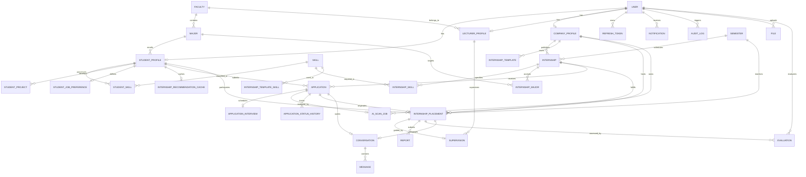

---

### 3.4.3. Lược đồ cơ sở dữ liệu quan hệ

Lược đồ cơ sở dữ liệu được biểu diễn dưới dạng chuẩn hóa quan hệ (các thuộc tính gạch chân đại diện cho Khóa chính - **PK**, các thuộc tính có dấu sao `*` đại diện cho Khóa ngoại - **FK**):

1. **`users`** (<ins>`id`</ins>, `email`, `passwordHash`, `role`, `status`, `emailVerifiedAt`, `isSuperAdmin`, `createdAt`, `updatedAt`)
2. **`student_profiles`** (<ins>`id`</ins>, `userId`*, `studentCode`, `fullName`, `major`, `majorId`*, `phone`, `summary`, `gpa`, `cvFileId`*, `avatarFileId`*, `createdAt`, `updatedAt`)
3. **`company_profiles`** (<ins>`id`</ins>, `userId`*, `companyName`, `businessRegistrationNumber`, `contactPersonName`, `contactPhone`, `contactEmail`, `address`, `status`, `reviewedById`*, `reviewedAt`, `rejectionReasonCode`, `rejectionReason`, `submittedAt`, `reviewDueAt`, `reviewChecklist`, `suspensionReasonCode`, `suspendedAt`, `registrationDocumentFileId`*, `createdAt`, `updatedAt`)
4. **`lecturer_profiles`** (<ins>`id`</ins>, `userId`*, `fullName`, `department`, `facultyId`*, `title`, `avatarFileId`*, `createdAt`, `updatedAt`)
5. **`faculties`** (<ins>`id`</ins>, `code`, `name`, `description`, `isActive`, `createdAt`, `updatedAt`)
6. **`majors`** (<ins>`id`</ins>, `facultyId`*, `code`, `name`, `description`, `isActive`, `createdAt`, `updatedAt`)
7. **`semesters`** (<ins>`id`</ins>, `name`, `startDate`, `endDate`, `status`, `createdAt`, `updatedAt`)
8. **`skills`** (<ins>`id`</ins>, `name`, `createdAt`, `updatedAt`)
9. **`student_skills`** (<ins>`studentId`*, `skillId`*</ins>, `level`)
10. **`internships`** (<ins>`id`</ins>, `companyId`*, `semesterId`*, `title`, `description`, `requirements`, `slots`, `filledSlots`, `deadline`, `startDate`, `endDate`, `status`, `sourceTemplateId`*, `viewCount`, `uniqueViewerCount`, `createdAt`, `updatedAt`)
11. **`internship_skills`** (<ins>`internshipId`*, `skillId`*</ins>, `isRequired`, `weight`)
12. **`internship_templates`** (<ins>`id`</ins>, `companyId`*, `name`, `title`, `description`, `requirements`, `slotsDefault`, `createdAt`, `updatedAt`)
13. **`applications`** (<ins>`id`</ins>, `studentId`*, `internshipId`*, `coverLetter`, `cvFileId`*, `matchScore`, `aiScore`, `status`, `appliedAt`, `acceptedAt`, `rejectedAt`, `withdrawnAt`, `updatedAt`)
14. **`application_interviews`** (<ins>`id`</ins>, `applicationId`*, `scheduledAt`, `mode`, `location`, `meetingLink`, `contactName`, `contactEmail`, `contactPhone`, `note`, `createdAt`, `updatedAt`)
15. **`ai_scan_jobs`** (<ins>`id`</ins>, `applicationId`*, `companyId`*, `status`, `aiScore`, `recommendation`, `experienceYears`, `extractedSkills`, `matchedSkills`, `missingSkills`, `strengths`, `weaknesses`, `summary`, `completedAt`, `createdAt`)
16. **`internship_placements`** (<ins>`id`</ins>, `applicationId`*, `studentId`*, `companyId`*, `internshipId`*, `semesterId`*, `status`, `academicStatus`, `startDate`, `endDate`, `academicClosedAt`, `createdAt`, `updatedAt`)
17. **`supervisions`** (<ins>`id`</ins>, `placementId`*, `lecturerId`*, `assignedById`*, `status`, `assignedAt`, `completedAt`)
18. **`reports`** (<ins>`id`</ins>, `placementId`*, `week`, `title`, `content`, `fileId`*, `status`, `feedback`, `submittedAt`, `reviewedAt`, `createdAt`, `updatedAt`)
19. **`evaluations`** (<ins>`id`</ins>, `placementId`*, `evaluatorId`*, `type`, `score`, `criteria`, `comment`, `certificateFileId`*, `submittedAt`, `updatedAt`)
20. **`files`** (<ins>`id`</ins>, `ownerId`*, `type`, `storageKey`, `originalName`, `mimeType`, `sizeBytes`, `createdAt`)
21. **`conversations`** (<ins>`id`</ins>, `applicationId`*, `placementId`*, `studentId`*, `companyId`*, `lecturerId`*, `createdAt`, `updatedAt`)
22. **`messages`** (<ins>`id`</ins>, `conversationId`*, `senderId`*, `content`, `readAt`, `createdAt`)
23. **`notifications`** (<ins>`id`</ins>, `userId`*, `type`, `action`, `title`, `content`, `eventKey`, `isRead`, `readAt`, `createdAt`)
24. **`audit_logs`** (<ins>`id`</ins>, `userId`*, `action`, `entity`, `entityId`, `metadata`, `ipAddress`, `createdAt`)

---

### 3.4.4. Mô tả các bảng dữ liệu chính

Dưới đây là từ điển dữ liệu (Data Dictionary) chi tiết của các bảng trọng yếu trong hệ thống.

#### 1. Bảng `users` (Tài khoản người dùng)
| Tên cột | Kiểu dữ liệu | Khóa | Null | Mô tả ý nghĩa |
| :--- | :--- | :---: | :---: | :--- |
| `id` | `VARCHAR(36)` | PK | Không | Định danh duy nhất của người dùng (CUID) |
| `email` | `VARCHAR(255)` | UK | Không | Địa chỉ email đăng nhập (sinh viên bắt buộc `@ut.edu.vn`) |
| `passwordHash` | `VARCHAR(255)` | | Không | Mật khẩu băm một chiều an toàn |
| `role` | `ENUM` | | Không | Vai trò hệ thống: `ADMIN`, `STUDENT`, `LECTURER`, `COMPANY` |
| `status` | `ENUM` | | Không | Trạng thái: `PENDING_VERIFICATION`, `ACTIVE`, `INACTIVE`, `BANNED` |
| `emailVerifiedAt`| `TIMESTAMP` | | Có | Thời điểm người dùng kích hoạt tài khoản qua email |
| `isSuperAdmin` | `BOOLEAN` | | Không | Cờ xác định quyền Quản trị viên cấp cao (mặc định `false`) |
| `createdAt` | `TIMESTAMP` | | Không | Thời điểm tạo tài khoản |
| `updatedAt` | `TIMESTAMP` | | Không | Thời điểm cập nhật thông tin gần nhất |

#### 2. Bảng `company_profiles` (Hồ sơ doanh nghiệp & Thẩm định)
| Tên cột | Kiểu dữ liệu | Khóa | Null | Mô tả ý nghĩa |
| :--- | :--- | :---: | :---: | :--- |
| `id` | `VARCHAR(36)` | PK | Không | Định danh hồ sơ doanh nghiệp |
| `userId` | `VARCHAR(36)` | FK, UK | Không | Khóa ngoại liên kết bảng `users(id)` |
| `companyName` | `VARCHAR(255)` | | Không | Tên pháp lý chính thức của doanh nghiệp |
| `businessRegistrationNumber` | `VARCHAR(50)` | UK | Có | Mã số doanh nghiệp / Mã số thuế đăng ký |
| `contactPersonName` | `VARCHAR(100)` | | Có | Họ tên cán bộ đầu mối nhân sự |
| `contactPhone` | `VARCHAR(20)` | | Có | Số điện thoại liên hệ chính thức |
| `contactEmail` | `VARCHAR(255)` | | Có | Địa chỉ email liên hệ tiếp nhận hồ sơ |
| `registrationDocumentFileId` | `VARCHAR(36)` | FK, UK | Có | Khóa ngoại tệp Giấy phép ĐKKD trỏ sang `files(id)` |
| `status` | `ENUM` | | Không | `DRAFT`, `PENDING`, `APPROVED`, `REJECTED`, `SUSPENDED` |
| `reviewedById` | `VARCHAR(36)` | FK | Có | Khóa ngoại Quản trị viên thực hiện duyệt |
| `reviewedAt` | `TIMESTAMP` | | Có | Thời điểm Quản trị viên thực hiện phê duyệt/từ chối |
| `reviewDueAt` | `TIMESTAMP` | | Có | Mốc thời gian cam kết hạn xử lý hồ sơ SLA (48h-72h) |
| `reviewChecklist` | `JSONB` | | Có | Kết quả đối soát 6 tiêu chí thẩm định pháp lý |
| `rejectionReasonCode` | `ENUM` | | Có | Mã lý do chuẩn khi từ chối hồ sơ |
| `rejectionReason` | `TEXT` | | Có | Diễn giải chi tiết lý do từ chối để doanh nghiệp sửa |
| `suspensionReasonCode` | `ENUM` | | Có | Mã lý do khi tạm đình chỉ doanh nghiệp vi phạm |

#### 3. Bảng `internships` (Tin tuyển dụng thực tập)
| Tên cột | Kiểu dữ liệu | Khóa | Null | Mô tả ý nghĩa |
| :--- | :--- | :---: | :---: | :--- |
| `id` | `VARCHAR(36)` | PK | Không | Định danh bài đăng tuyển dụng |
| `companyId` | `VARCHAR(36)` | FK | Không | Khóa ngoại liên kết `company_profiles(id)` |
| `semesterId` | `VARCHAR(36)` | FK | Không | Khóa ngoại liên kết đợt thực tập `semesters(id)` |
| `title` | `VARCHAR(255)` | | Không | Tiêu đề vị trí tuyển dụng thực tập |
| `description` | `TEXT` | | Không | Bản mô tả công việc chi tiết |
| `requirements` | `TEXT` | | Có | Yêu cầu đối với ứng viên thực tập |
| `slots` | `INT` | | Không | Tổng số lượng chỉ tiêu tuyển dụng tiếp nhận |
| `filledSlots` | `INT` | | Không | Số lượng ứng viên đã tiếp nhận chính thức (mặc định 0) |
| `deadline` | `TIMESTAMP` | | Có | Hạn chót nộp hồ sơ ứng tuyển |
| `status` | `ENUM` | | Không | Trạng thái tin: `DRAFT`, `OPEN`, `CLOSED`, `CANCELLED` |
| `sourceTemplateId`| `VARCHAR(36)` | FK | Có | Khóa ngoại trỏ sang mẫu tin nguồn nếu tạo từ template |
| `viewCount` | `INT` | | Không | Tổng lượt xem tin tuyển dụng |
| `uniqueViewerCount`| `INT` | | Không | Tổng số lượng người xem phân biệt |

#### 4. Bảng `applications` (Đơn ứng tuyển)
| Tên cột | Kiểu dữ liệu | Khóa | Null | Mô tả ý nghĩa |
| :--- | :--- | :---: | :---: | :--- |
| `id` | `VARCHAR(36)` | PK | Không | Định danh đơn ứng tuyển |
| `studentId` | `VARCHAR(36)` | FK | Không | Khóa ngoại sinh viên `student_profiles(id)` |
| `internshipId` | `VARCHAR(36)` | FK | Không | Khóa ngoại vị trí tuyển dụng `internships(id)` |
| `cvFileId` | `VARCHAR(36)` | FK | Có | Khóa ngoại tệp CV ứng tuyển `files(id)` |
| `coverLetter` | `TEXT` | | Có | Thư giới thiệu của sinh viên |
| `matchScore` | `FLOAT` | | Có | Điểm số tương thích CV tính toán từ hệ thống (0 - 100) |
| `status` | `ENUM` | | Không | `PENDING`, `REVIEWING`, `INTERVIEWING`, `ACCEPTED`, `REJECTED`, `WITHDRAWN` |
| `appliedAt` | `TIMESTAMP` | | Không | Thời điểm sinh viên nộp hồ sơ |
| `acceptedAt` | `TIMESTAMP` | | Có | Thời điểm doanh nghiệp xác nhận tiếp nhận |
| `rejectedAt` | `TIMESTAMP` | | Có | Thời điểm doanh nghiệp từ chối ứng viên |

#### 5. Bảng `internship_placements` (Bản ghi tiếp nhận thực tập)
| Tên cột | Kiểu dữ liệu | Khóa | Null | Mô tả ý nghĩa |
| :--- | :--- | :---: | :---: | :--- |
| `id` | `VARCHAR(36)` | PK | Không | Định danh bản ghi thực tập chính thức |
| `applicationId` | `VARCHAR(36)` | FK, UK | Không | Khóa ngoại đơn ứng tuyển trúng tuyển `applications(id)` |
| `studentId` | `VARCHAR(36)` | FK | Không | Khóa ngoại sinh viên thực tập `student_profiles(id)` |
| `companyId` | `VARCHAR(36)` | FK | Không | Khóa ngoại doanh nghiệp tiếp nhận `company_profiles(id)` |
| `internshipId` | `VARCHAR(36)` | FK | Không | Khóa ngoại vị trí thực tập `internships(id)` |
| `semesterId` | `VARCHAR(36)` | FK | Không | Khóa ngoại đợt thực tập `semesters(id)` |
| `status` | `ENUM` | | Không | Trạng thái thực tế: `PENDING`, `ACTIVE`, `COMPLETED`, `CANCELLED` |
| `academicStatus`| `ENUM` | | Không | Trạng thái học vụ: `PENDING`, `ACTIVE`, `CLOSED`, `CANCELLED` |
| `startDate` | `TIMESTAMP` | | Có | Ngày chính thức bắt đầu theo dõi học vụ |
| `endDate` | `TIMESTAMP` | | Có | Ngày kết thúc theo dõi học vụ |
| `academicClosedAt`| `TIMESTAMP` | | Có | Thời điểm Quản trị viên đóng học vụ tốt nghiệp |

#### 6. Bảng `reports` (Báo cáo thực tập tuần)
| Tên cột | Kiểu dữ liệu | Khóa | Null | Mô tả ý nghĩa |
| :--- | :--- | :---: | :---: | :--- |
| `id` | `VARCHAR(36)` | PK | Không | Định danh báo cáo tuần |
| `placementId` | `VARCHAR(36)` | FK | Không | Khóa ngoại liên kết `internship_placements(id)` |
| `week` | `INT` | | Không | Tuần học vụ báo cáo (từ Tuần 1 đến Tuần 12) |
| `title` | `VARCHAR(255)` | | Có | Tiêu đề báo cáo công việc trong tuần |
| `content` | `TEXT` | | Không | Nội dung chi tiết các công việc và kiến thức tiếp thu |
| `fileId` | `VARCHAR(36)` | FK | Có | Khóa ngoại tệp minh chứng đính kèm `files(id)` |
| `status` | `ENUM` | | Không | `DRAFT`, `SUBMITTED`, `APPROVED`, `REJECTED` |
| `feedback` | `TEXT` | | Có | Lời nhận xét, góp ý hướng dẫn của giảng viên |
| `submittedAt` | `TIMESTAMP` | | Có | Thời điểm sinh viên nộp báo cáo |
| `reviewedAt` | `TIMESTAMP` | | Có | Thời điểm giảng viên thực hiện chấm duyệt |

#### 7. Bảng `evaluations` (Đánh giá thực tập hai chiều độc lập)
| Tên cột | Kiểu dữ liệu | Khóa | Null | Mô tả ý nghĩa |
| :--- | :--- | :---: | :---: | :--- |
| `id` | `VARCHAR(36)` | PK | Không | Định danh phiếu đánh giá |
| `placementId` | `VARCHAR(36)` | FK | Không | Khóa ngoại liên kết `internship_placements(id)` |
| `evaluatorId` | `VARCHAR(36)` | FK | Không | Khóa ngoại người thực hiện đánh giá `users(id)` |
| `type` | `ENUM` | | Không | Loại đánh giá: `COMPANY` hoặc `LECTURER` |
| `score` | `FLOAT` | | Không | Điểm số đánh giá tổng kết (thang điểm 10.0) |
| `criteria` | `JSONB` | | Có | Điểm chi tiết theo từng tiêu chí con |
| `comment` | `TEXT` | | Có | Lời nhận xét tổng kết về sinh viên |
| `certificateFileId`| `VARCHAR(36)` | FK | Có | Khóa ngoại tệp giấy chứng nhận thực tập `files(id)` |
| `submittedAt` | `TIMESTAMP` | | Không | Thời điểm hoàn tất nộp đánh giá |


---

## 3.5. THIẾT KẾ CÁC QUY TRÌNH NGHIỆP VỤ

Mỗi quy trình nghiệp vụ trọng yếu trong hệ thống CareerBridge được phân tích đa chiều thông qua:
1. **Phân tích luồng xử lý nghiệp vụ:** Mô tả mục đích, các điều kiện nghiệp vụ và các điểm kiểm soát logic.
2. **Biểu đồ hoạt động (Activity Diagram):** Thể hiện cỗ máy trạng thái, rẽ nhánh điều kiện và luồng công việc giữa các tác nhân.
3. **Biểu đồ tuần tự (Sequence Diagram):** Minh họa chi tiết dòng thời gian tương tác giữa Người dùng, Giao diện Client, Bộ điều khiển Controller, Lớp dịch vụ Service, Cơ sở dữ liệu và Dịch vụ ngoại vi.

---

### 3.5.1. Quy trình quản lý đợt thực tập và thời gian tuyển dụng

#### 1. Phân tích luồng xử lý nghiệp vụ
- **Mục tiêu:** Tự động hóa hoàn toàn vòng đời của một đợt thực tập tốt nghiệp theo dòng thời gian học vụ, giảm thiểu can thiệp thủ công từ quản trị viên và bảo đảm tính kỷ luật về thời hạn.
- **Quy tắc thời gian cốt lõi:**
  - Quản trị viên khởi tạo `Semester` với ngày bắt đầu chính thức (`startDate`) và ngày kết thúc (`endDate`).
  - **Cửa sổ tuyển dụng (Recruiting Window):** Hệ thống tự động kích hoạt trạng thái `RECRUITING` đúng **1 tháng dương lịch trước ngày `startDate`**. Chỉ trong khoảng thời gian này, các doanh nghiệp mới được đăng tin tuyển dụng, sinh viên mới được nộp hồ sơ và doanh nghiệp mới được tuyển chọn.
  - **Khóa tuyển dụng tự động (Recruiting Cutoff):** Đúng vào ngày `startDate`, đợt thực tập tự động chuyển sang pha `MONITORING` (Giám sát học vụ). Tại thời điểm này, hệ thống tự động quét và đóng toàn bộ các bài đăng tuyển dụng đang mở (`status = OPEN` chuyển sang `CLOSED`), đồng thời khóa hoàn toàn chức năng nộp đơn mới.
  - **Kết thúc học vụ:** Đúng vào ngày `endDate`, đợt chuyển sang trạng thái `COMPLETED`, phục vụ tổng kết điểm và xét tốt nghiệp.

#### 2. Biểu đồ hoạt động (Activity Diagram)

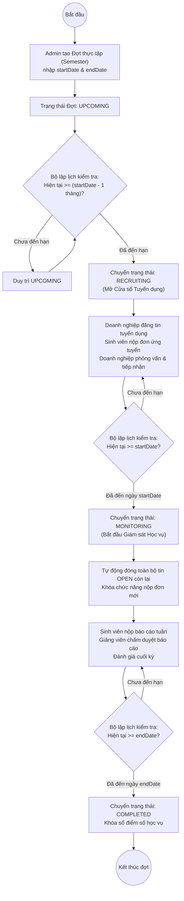

#### 3. Biểu đồ tuần tự (Sequence Diagram)

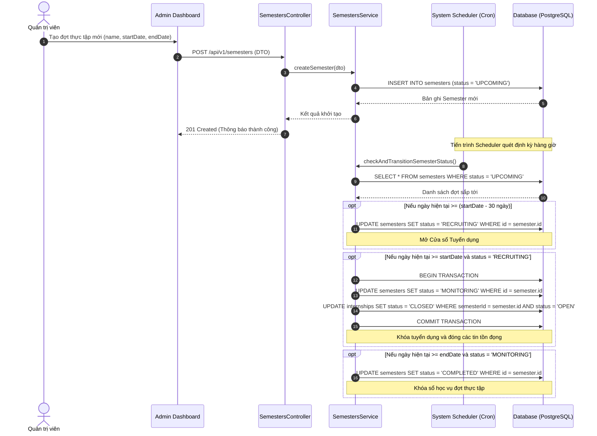

---

### 3.5.2. Quy trình thẩm định và xét duyệt doanh nghiệp

#### 1. Phân tích luồng xử lý nghiệp vụ
- **Mục tiêu:** Ngăn chặn các doanh nghiệp mạo danh hoặc tin tuyển dụng lừa đảo, bảo vệ an toàn tối đa cho sinh viên.
- **Tiêu chuẩn kiểm soát:**
  - Doanh nghiệp sau khi kích hoạt email bắt buộc phải hoàn thiện hồ sơ pháp nhân và tải lên Giấy phép ĐKKD hợp lệ.
  - Khi gửi xét duyệt (`submit-verification`), hồ sơ chuyển `PENDING` và kích hoạt đồng hồ cam kết SLA xử lý (48h-72h).
  - Quản trị viên bắt buộc phải kiểm tra và xác nhận đạt đầy đủ **6 tiêu chí đối soát**.
  - Nếu từ chối, bắt buộc chọn mã lỗi chuẩn và nhập lý do giải thích chi tiết.
  - Khi đã duyệt (`APPROVED`), các trường pháp lý bị khóa cứng để chống sửa đổi trái phép.
  - Nếu phát hiện vi phạm sau khi duyệt, Quản trị viên kích hoạt đình chỉ (`SUSPENDED`), hệ thống lập tức đóng toàn bộ tin tuyển dụng đang mở của doanh nghiệp trong cùng Transaction.

#### 2. Biểu đồ hoạt động (Activity Diagram)

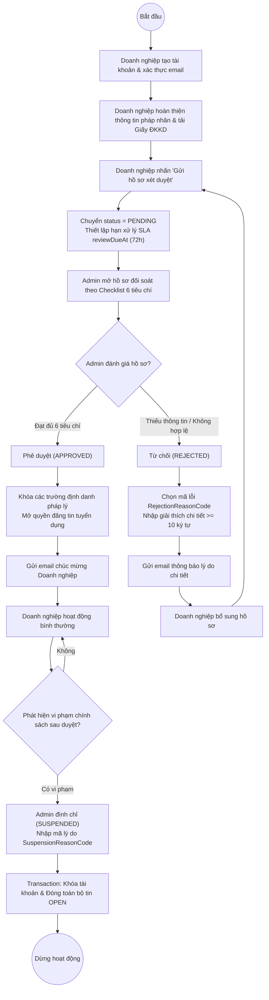

#### 3. Biểu đồ tuần tự (Sequence Diagram)

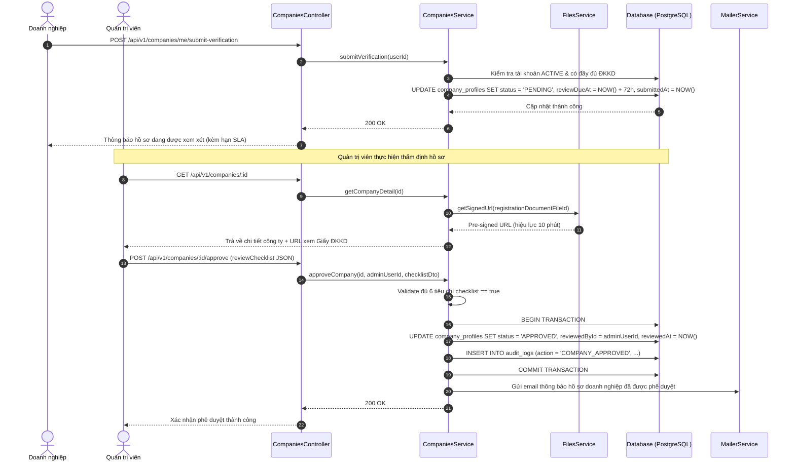

---

### 3.5.3. Quy trình đăng tuyển, ứng tuyển và phỏng vấn

#### 1. Phân tích luồng xử lý nghiệp vụ
- **Mục tiêu:** Tối ưu hóa phễu tuyển dụng thực tập, kết hợp kiểm soát chất lượng tin đăng với công nghệ bóc tách CV tự động và chuẩn hóa quy trình phỏng vấn trực tiếp tại văn phòng.
- **Tiến trình nghiệp vụ:**
  - Doanh nghiệp đã `APPROVED` tạo tin tuyển dụng. Bộ lọc **Quality Gatekeeper** kiểm tra chặt chẽ các trường thông tin trước khi chuyển tin sang `OPEN`.
  - Sinh viên nộp đơn kèm tệp CV PDF. Hệ thống kích hoạt **AI Worker** xử lý nền: Trích xuất văn bản, nhận diện thực thể kỹ năng và tính toán điểm số `matchScore`.
  - Nhà tuyển dụng theo dõi danh sách ứng viên đã được hệ thống sắp xếp theo độ tương thích, chủ động lên lịch phỏng vấn trực tiếp tại văn phòng (`Offline Interview`) kèm người đón tiếp và hướng dẫn chuẩn bị.
  - Sinh viên nhận lịch qua ứng dụng và email, tham gia phỏng vấn trực tiếp và nhận kết quả phản hồi minh bạch trên hệ thống.

#### 2. Biểu đồ hoạt động (Activity Diagram)

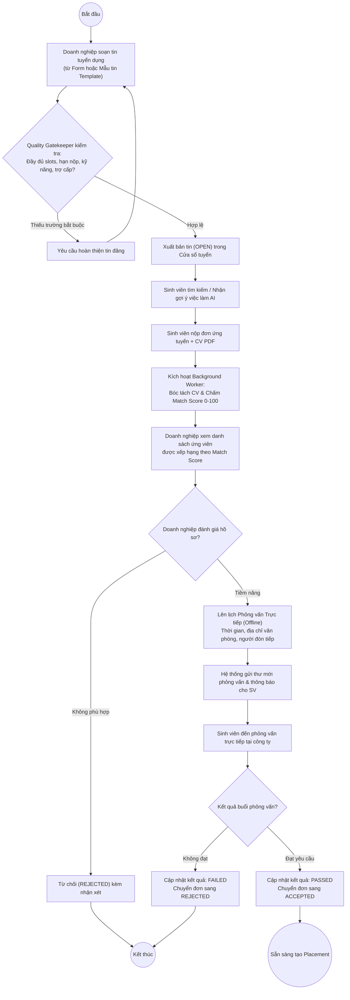

#### 3. Biểu đồ tuần tự (Sequence Diagram)

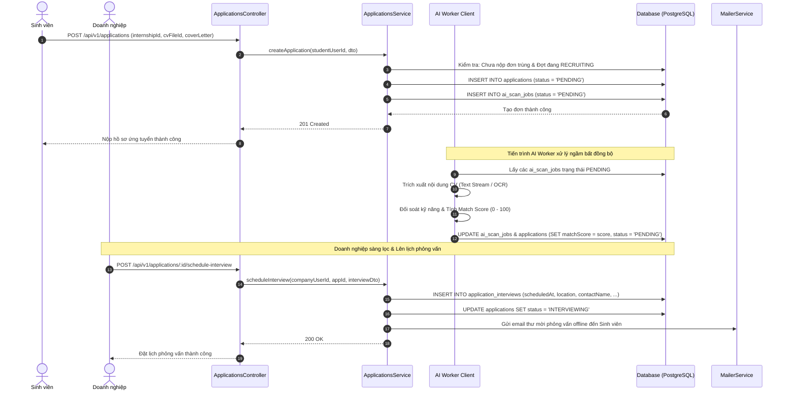

---

### 3.5.4. Quy trình tiếp nhận sinh viên và phân công giảng viên

#### 1. Phân tích luồng xử lý nghiệp vụ
- **Mục tiêu:** Chuyển đổi chính thức từ giai đoạn tuyển dụng sang giai đoạn đào tạo học vụ có sự giám sát của nhà trường.
- **Quy tắc Transaction cốt lõi:**
  - Khi doanh nghiệp nhấn "Tiếp nhận" (`ACCEPTED`), hệ thống bắt buộc mở một **Database Transaction**:
    1. Kiểm tra vị trí tuyển dụng còn chỉ tiêu (`filledSlots < slots`).
    2. Tăng số lượng đã tuyển: `filledSlots = filledSlots + 1`.
    3. Kiểm tra sinh viên chưa có Placement nào đang hiệu lực trong cùng một đợt thực tập.
    4. Tự động sinh bản ghi trung tâm `InternshipPlacement` với trạng thái học vụ `academicStatus = PENDING`.
  - **Phân công Giảng viên học vụ:** Quản trị viên Khoa duyệt khung thời gian theo dõi học vụ (`startDate`, `endDate`), sau đó chỉ định một Giảng viên phụ trách hướng dẫn (`Supervision`). Giảng viên được phân công sẽ có đầy đủ quyền học vụ để theo dõi và chấm điểm sinh viên.

#### 2. Biểu đồ hoạt động (Activity Diagram)

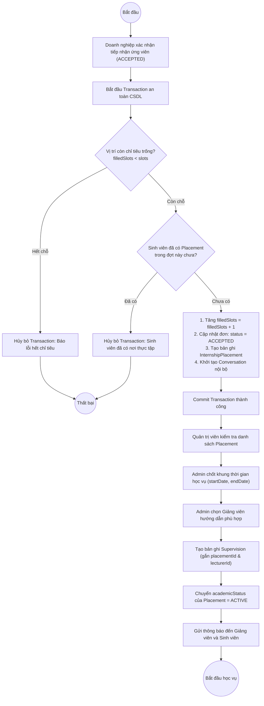

#### 3. Biểu đồ tuần tự (Sequence Diagram)

```mermaid
sequenceDiagram
  autonumber
  actor Comp as Doanh nghiệp
  actor Admin as Quản trị viên
  participant PC as PlacementsController
  participant PS as PlacementsService
  participant SC as SupervisionsController
  participant SS as SupervisionsService
  participant DB as Database (PostgreSQL)
  participant WS as Socket.IO Gateway

  Comp->>PC: PATCH /api/v1/applications/:id/status { status: 'ACCEPTED' }
  PC->>PS: acceptApplication(companyUserId, appId)
  PS->>DB: BEGIN TRANSACTION
  PS->>DB: SELECT slots, filledSlots FROM internships WHERE id = ... FOR UPDATE
  PS->>DB: SELECT id FROM internship_placements WHERE studentId = ... AND semesterId = ...
  PS->>DB: UPDATE internships SET filledSlots = filledSlots + 1
  PS->>DB: UPDATE applications SET status = 'ACCEPTED', acceptedAt = NOW()
  PS->>DB: INSERT INTO internship_placements (applicationId, studentId, companyId, status = 'PENDING', academicStatus = 'PENDING')
  PS->>DB: INSERT INTO conversations (applicationId, studentId, companyId)
  PS->>DB: COMMIT TRANSACTION
  PS->>WS: Phát sự kiện 'application_accepted' & 'placement_created'
  PS-->>PC: 200 OK
  PC-->>Comp: Tiếp nhận thực tập sinh thành công

  Note over Admin,SS: Quản trị viên phân công Giảng viên hướng dẫn
  Admin->>SC: POST /api/v1/supervisions { placementId, lecturerId, startDate, endDate }
  SC->>SS: assignSupervision(adminUserId, dto)
  SS->>DB: UPDATE internship_placements SET startDate = dto.startDate, endDate = dto.endDate
  SS->>DB: INSERT INTO supervisions (placementId, lecturerId, assignedById, status = 'ACTIVE')
  SS->>DB: UPDATE internship_placements SET academicStatus = 'ACTIVE'
  SS->>DB: INSERT INTO audit_logs (action = 'SUPERVISION_ASSIGNED', ...)
  SS->>WS: Gửi thông báo phân công đến Giảng viên & Sinh viên
  SS-->>SC: 201 Created
  SC-->>Admin: Phân công giảng viên thành công
```

---

### 3.5.5. Quy trình nộp báo cáo tuần và đánh giá thực tập

#### 1. Phân tích luồng xử lý nghiệp vụ
- **Mục tiêu:** Quản lý chặt chẽ tiến độ thực tập hàng tuần của sinh viên, cung cấp kênh phản hồi học thuật kịp thời từ giảng viên và kết thúc bằng việc thu thập hai đánh giá độc lập để chốt điểm tốt nghiệp.
- **Tiến trình nghiệp vụ:**
  - **Báo cáo tuần:** Sinh viên nộp báo cáo định kỳ theo các block 7 ngày (Tuần 1 đến Tuần 12). Hệ thống kiểm soát nghiêm ngặt không cho phép nộp vượt tuần. Giảng viên xem báo cáo, góp ý và chấm duyệt (`APPROVED` / `REJECTED`).
  - **Đánh giá hai chiều độc lập:** Vào cuối kỳ, Doanh nghiệp chấm điểm năng lực làm việc thực tế (thang 10), Giảng viên chấm điểm học vụ (thang 10). Hệ thống quét phát hiện độ lệch điểm bất thường ($\ge 4.0$ điểm) để Khoa hậu kiểm trước khi khóa học vụ (`academicStatus = CLOSED`).

#### 2. Biểu đồ hoạt động (Activity Diagram)

```mermaid
flowchart TD
  Start((Bắt đầu)) --> StudentCheck["Sinh viên kiểm tra tuần thực tập hiện tại<br/>(tính từ placement.startDate theo block 7 ngày)"]
  StudentCheck --> WriteReport["Soạn nội dung báo cáo & đính kèm tệp minh chứng"]
  WriteReport --> SubmitReport["Sinh viên nhấn 'Nộp báo cáo tuần'"]

  SubmitReport --> ValidateWeek{"Kiểm tra tuần nộp:<br/>Tuần <= Tuần hiện tại?"}
  ValidateWeek -- "Cố tình nộp trước" --> ErrorWeek["Báo lỗi: Chưa đến tuần nộp"]
  ErrorWeek --> WriteReport

  ValidateWeek -- "Hợp lệ" --> SaveSubmitted["Lưu báo cáo: status = SUBMITTED<br/>Gửi thông báo đến Giảng viên"]
  SaveSubmitted --> LecturerReview["Giảng viên xem báo cáo & tải tài liệu"]

  LecturerReview --> ReviewDecision{"Giảng viên đánh giá chất lượng?"}
  ReviewDecision -- "Chưa đạt yêu cầu" --> RejectReport["Từ chối (REJECTED) kèm góp ý sửa"]
  RejectReport --> StudentRevise["Sinh viên sửa lại báo cáo"]
  StudentRevise --> WriteReport

  ReviewDecision -- "Đạt yêu cầu" --> ApproveReport["Phê duyệt (APPROVED)"]
  ApproveReport --> CheckAllWeeks{"Đã hoàn thành toàn bộ 12 tuần?"}
  CheckAllWeeks -- "Chưa" --> NextWeek["Chờ tuần thực tập tiếp theo"]
  NextWeek --> StudentCheck

  CheckAllWeeks -- "Đã đủ" --> FinalEvaluation["Giai đoạn Đánh giá Cuối kỳ"]
  FinalEvaluation --> CompEval["Doanh nghiệp chấm điểm thực tế (Thang 10)"]
  FinalEvaluation --> LectEval["Giảng viên chấm điểm học vụ (Thang 10)"]

  CompEval --> SystemCheckAnomaly
  LectEval --> SystemCheckAnomaly{"Hệ thống đối soát độ lệch điểm:<br/>|Điểm DN - Điểm GV| >= 4.0?"}

  SystemCheckAnomaly -- "Có bất thường" --> FlagAnomaly["Gắn cờ cảnh báo bất thường lên Dashboard Khoa"]
  FlagAnomaly --> AdminResolve["Khoa họp xem xét & thẩm định"]
  AdminResolve --> CloseAcademic

  SystemCheckAnomaly -- "Bình thường" --> CloseAcademic["Khóa sổ học vụ: academicStatus = CLOSED"]
  CloseAcademic --> ExportResult["Khoa xuất Báo cáo tổng hợp Excel & PDF"]
  ExportResult --> EndNode((Hoàn tất tốt nghiệp))
```

#### 3. Biểu đồ tuần tự (Sequence Diagram)

```mermaid
sequenceDiagram
  autonumber
  actor Student as Sinh viên
  actor Lecturer as Giảng viên
  actor Comp as Doanh nghiệp
  actor Admin as Quản trị viên
  participant RC as ReportsController
  participant RS as ReportsService
  participant EC as EvaluationsController
  participant ES as EvaluationsService
  participant DB as Database (PostgreSQL)

  Student->>RC: POST /api/v1/reports { placementId, week: 5, content, fileId }
  RC->>RS: submitWeeklyReport(studentUserId, dto)
  RS->>DB: Kiểm tra: Placement đang ACTIVE & week <= tuần hiện tại
  RS->>DB: UPSERT INTO reports (status = 'SUBMITTED', submittedAt = NOW())
  DB-->>RS: Lưu thành công
  RS-->>RC: 200 OK
  RC-->>Student: Nộp báo cáo tuần 5 thành công

  Lecturer->>RC: POST /api/v1/reports/:id/review { status: 'APPROVED', feedback: 'Làm tốt' }
  RC->>RS: reviewReport(lecturerUserId, reportId, reviewDto)
  RS->>DB: Kiểm tra quyền Supervision của Giảng viên
  RS->>DB: UPDATE reports SET status = 'APPROVED', feedback = ..., reviewedAt = NOW()
  DB-->>RS: Cập nhật thành công
  RS-->>RC: 200 OK
  RC-->>Lecturer: Duyệt báo cáo thành công

  Note over Comp,Admin: Giai đoạn đánh giá cuối kỳ
  Comp->>EC: POST /api/v1/evaluations { placementId, type: 'COMPANY', score: 9.0, comment }
  EC->>ES: submitEvaluation(companyUserId, dto)
  ES->>DB: INSERT INTO evaluations (type = 'COMPANY', score = 9.0, ...)
  ES-->>EC: 201 Created

  Lecturer->>EC: POST /api/v1/evaluations { placementId, type: 'LECTURER', score: 8.5, comment }
  EC->>ES: submitEvaluation(lecturerUserId, dto)
  ES->>DB: INSERT INTO evaluations (type = 'LECTURER', score = 8.5, ...)
  ES-->>EC: 201 Created

  Admin->>EC: POST /api/v1/placements/:id/close-academic
  EC->>ES: closeAcademicPlacement(adminUserId, placementId)
  ES->>DB: UPDATE internship_placements SET academicStatus = 'CLOSED', academicClosedAt = NOW()
  ES-->>EC: 200 OK
  EC-->>Admin: Khóa sổ học vụ thành công
```

---

### 3.5.6. Quy trình xử lý CV và đề xuất vị trí thực tập bằng AI

#### 1. Phân tích luồng xử lý nghiệp vụ
- **Mục tiêu:** Ứng dụng trí tuệ nhân tạo nhằm nâng cao hiệu quả kết nối: Bóc tách cấu trúc CV ứng tuyển giúp nhà tuyển dụng tiết kiệm thời gian, đồng thời định hướng sinh viên đến các vị trí thực tập phù hợp nhất.
- **Tiến trình kép:**
  - **Nhánh 1 - Bóc tách CV và Tính Match Score:** Khi nhận tệp CV dạng PDF, hệ thống phân luồng xử lý: Nếu tệp có lớp text stream sẽ trích xuất trực tiếp; nếu tệp là ảnh scan sẽ gọi Tesseract OCR. Sau đó, bộ trích xuất nhận diện thực thể (Kỹ năng, Kinh nghiệm, Học vấn) và đối sánh với yêu cầu kỹ năng của tin tuyển dụng để tính điểm tương thích đa tiêu chí (0-100).
  - **Nhánh 2 - Gợi ý việc làm thông minh (AI Job Recommendation):** Backend lọc các tin tuyển dụng đang mở trong đợt, tính toán độ tương đồng giữa nguyện vọng/kỹ năng của sinh viên với các bài đăng để xếp hạng Top 10. Tiếp đó, hệ thống gọi dịch vụ AI (Gemini API) để tạo đoạn văn giải thích lý do đề xuất cho Top 3 vị trí dẫn đầu, lưu kết quả vào bộ nhớ đệm Cache và sẵn sàng kích hoạt **Deterministic Fallback** nếu AI gặp sự cố.

#### 2. Biểu đồ hoạt động (Activity Diagram)

```mermaid
flowchart TD
  Start((Bắt đầu)) --> TriggerInput{"Loại tác vụ AI?"}

  %% Nhánh 1: Bóc tách CV
  TriggerInput -- "Bóc tách CV ứng tuyển" --> CheckPdfType{"Kiểm tra định dạng tệp PDF?"}
  CheckPdfType -- "PDF có lớp chữ (Text Stream)" --> FastStream["Trích xuất văn bản trực tiếp qua Stream Parser (< 500ms)"]
  CheckPdfType -- "PDF dạng ảnh scan" --> TesseractEngine["Kích hoạt Tesseract OCR Engine (vie + eng)"]

  FastStream --> ExtractEntities["Nhận diện thực thể:<br/>Họ tên, SĐT, GPA, Kỹ năng, Dự án"]
  TesseractEngine --> ExtractEntities

  ExtractEntities --> MatchAlgorithm["Đối sánh với Kỹ năng yêu cầu (InternshipSkills)<br/>Tính Match Score theo trọng số (0 - 100)"]
  MatchAlgorithm --> BuildBreakdown["Tạo bảng phân tích Match Breakdown:<br/>- Kỹ năng đạt được<br/>- Kỹ năng còn thiếu"]
  BuildBreakdown --> SaveScanJob["Lưu kết quả vào AiScanJob & Application"]
  SaveScanJob --> EndNode1((Hoàn tất bóc tách))

  %% Nhánh 2: Đề xuất việc làm
  TriggerInput -- "Đề xuất việc làm cho Sinh viên" --> LoadStudentProfile["Đọc Hồ sơ Sinh viên, Kỹ năng & Nguyện vọng việc làm"]
  LoadStudentProfile --> FilterJobs["Lọc các tin OPEN, còn chỗ, trong đợt RECRUITING"]
  FilterJobs --> RankCandidates["Backend xếp hạng Top 10 vị trí phù hợp nhất"]

  RankCandidates --> CallGemini{"Gọi Gemini API sinh lời giải thích<br/>cho Top 3 vị trí dẫn đầu?"}
  CallGemini -- "Thành công" --> BuildExplanation["Gắn đoạn văn giải thích lý do gợi ý (AI Explanation)"]
  CallGemini -- "Sự cố / Hết hạn mức" --> FallbackEngine["Kích hoạt Deterministic Fallback Engine<br/>(Dùng luật tĩnh, không làm gián đoạn)"]

  BuildExplanation --> CacheResults["Lưu kết quả vào Cache (InternshipRecommendationCache)<br/>kèm mã băm Fingerprint dữ liệu"]
  FallbackEngine --> CacheResults
  CacheResults --> ReturnRecs["Trả kết quả danh sách gợi ý về giao diện"]
  ReturnRecs --> EndNode2((Hoàn tất gợi ý))
```

#### 3. Biểu đồ tuần tự (Sequence Diagram)

```mermaid
sequenceDiagram
  autonumber
  actor Student as Sinh viên
  participant RecCtrl as RecommendationsController
  participant RecSvc as RecommendationsService
  participant Cache as DB Cache (PostgreSQL)
  participant DB as Database (PostgreSQL)
  participant LLM as External AI (Google Gemini API)

  Student->>RecCtrl: GET /api/v1/recommendations/internships/me
  RecCtrl->>RecSvc: getRecommendations(studentUserId)
  RecSvc->>DB: Lấy StudentProfile, StudentSkills, StudentJobPreference
  RecSvc->>RecSvc: Tính mã băm vân tay dữ liệu (dataFingerprint)

  RecSvc->>Cache: SELECT * FROM recommendation_cache WHERE studentId = ... AND fingerprint = ... AND expiresAt > NOW()
  alt Có bản ghi Cache hợp lệ (Cache Hit)
    Cache-->>RecSvc: Trả về kết quả JSON từ Cache
    RecSvc-->>RecCtrl: 200 OK (Dữ liệu từ Cache)
    RecCtrl-->>Student: Hiển thị ngay danh sách đề xuất việc làm
  else Không có Cache hoặc đã hết hạn (Cache Miss)
    RecSvc->>DB: SELECT * FROM internships WHERE status = 'OPEN' AND slots > filledSlots ...
    DB-->>RecSvc: Danh sách các bài đăng tuyển dụng hợp lệ

    RecSvc->>RecSvc: Thuật toán Backend tính điểm tương quan & Xếp hạng Top 10

    critical Gọi dịch vụ AI tạo lời giải thích cho Top 3
      RecSvc->>LLM: POST generateContent(prompt: Top 3 jobs + student skills)
      LLM-->>RecSvc: Đoạn văn giải thích độ tương thích
    option AI phản hồi lỗi / Timeout quá 3 giây
      RecSvc->>RecSvc: Kích hoạt Deterministic Fallback (Tự sinh giải thích theo luật mẫu)
    end

    RecSvc->>Cache: UPSERT INTO recommendation_cache (fingerprint, result, expiresAt = NOW() + 24h)
    RecSvc-->>RecCtrl: 200 OK (Kết quả mới tính toán)
    RecCtrl-->>Student: Hiển thị danh sách việc làm gợi ý kèm giải thích
  end
```

---

### 3.5.7. Tổng kết Chương 3

Chương 3 đã hoàn thành toàn diện các nội dung phân tích và thiết kế cho hệ thống **CareerBridge (Nền tảng Quản lý và Kết nối Thực tập Thông minh)**:
1. **Phân tích yêu cầu (3.1):** Định nghĩa tường minh 40 yêu cầu chức năng (FR) thuộc 12 phân hệ nghiệp vụ, 18 yêu cầu phi chức năng (NFR) theo chuẩn ISO/IEC 25010 và phân loại 4 tác nhân con người cùng 4 tác nhân hệ thống.
2. **Phân tích chức năng (3.2):** Xây dựng hệ thống Biểu đồ Use Case tổng quát và 4 biểu đồ Use Case phân hệ, đồng thời hoàn thành bảng đặc tả chi tiết cho 6 Use Case trọng tâm nhất.
3. **Thiết kế kiến trúc hệ thống (3.3):** Xác lập kiến trúc đa tầng hiện đại, biểu đồ thành phần module hóa NestJS, biểu đồ triển khai đám mây phân tán và biểu đồ lớp thực thể nghiệp vụ.
4. **Thiết kế cơ sở dữ liệu (3.4):** Chuẩn hóa cơ sở dữ liệu 3NF trên PostgreSQL gồm 24 bảng dữ liệu, mô hình hóa quan hệ thực thể (ERD) chi tiết và xây dựng từ điển dữ liệu hoàn chỉnh.
5. **Thiết kế quy trình nghiệp vụ (3.5):** Mô hình hóa trực quan và phân tích chi tiết 6 quy trình cốt lõi của vòng đời thực tập bằng cả **Biểu đồ hoạt động (Activity Diagram)** và **Biểu đồ tuần tự (Sequence Diagram)**.

Toàn bộ các thiết kế trên đóng vai trò là bản đặc tả kỹ thuật nền tảng để nhóm tác giả tiến hành hiện thực hóa mã nguồn, kiểm thử và triển khai hệ thống ở các chương tiếp theo.
