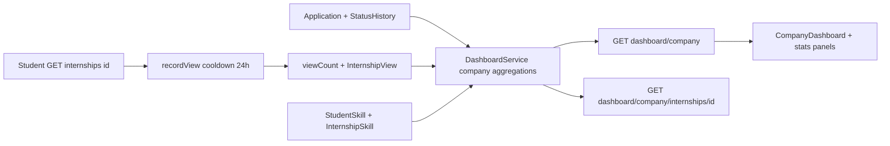

# Kế hoạch: Thống kê tuyển dụng cho doanh nghiệp

> **Trạng thái:** Chưa triển khai — tài liệu hướng dẫn triển khai  
> **Phạm vi:** NestJS + Prisma + React hiện tại  
> **Phụ thuộc:** Nên triển khai **sau** [`COMPANY_VERIFICATION_AND_INTERNSHIP_TEMPLATES_PLAN.md`](./COMPANY_VERIFICATION_AND_INTERNSHIP_TEMPLATES_PLAN.md)  
> **Nguyên tắc:** Chỉ đọc + ghi view có kiểm soát; không PII sinh viên; không invent vòng phỏng vấn ngoài `ApplicationStatus` hiện có

---

## 1. Mục tiêu

Cung cấp số liệu để doanh nghiệp đánh giá hiệu quả tin tuyển dụng:

- Số lượt xem và số người xem duy nhất.
- Số đơn và phân bố trạng thái.
- Tỷ lệ qua từng vòng ứng tuyển (`PENDING → REVIEWING → ACCEPTED | REJECTED`, kèm `WITHDRAWN`).
- Thời gian tuyển trung bình (tới accept / tới quyết định).
- Nguồn kỹ năng ứng viên (top skills) và độ phủ kỹ năng bắt buộc của tin.
- Tỷ lệ lấp đầy vị trí (`filledSlots / slots`).

---

## 2. Hiện trạng

| Thành phần | Hiện có |
| --- | --- |
| Admin dashboard | `GET /dashboard/admin` — [`DashboardService`](../../Backend/src/dashboard/dashboard.service.ts) |
| Company dashboard FE | [`CompanyDashboard.tsx`](../../Frontend/src/components/CompanyView/CompanyDashboard.tsx) đếm local: số tin, OPEN, DRAFT, tổng `filledSlots` |
| Application data | Status, history, `appliedAt`, `acceptedAt`, `rejectedAt`, `withdrawnAt`, `matchScore` |
| Skills | `StudentSkill`, `InternshipSkill` |
| Lượt xem tin | **Chưa có** — `GET /internships/:id` chỉ đọc |

---

## 3. Quyết định đã chốt

1. API đặt trong **`DashboardModule`** (cùng pattern admin), không tách analytics module riêng.
2. **Lượt xem** chỉ tăng khi role `STUDENT` gọi `GET /internships/:id` thành công (tin nhìn thấy được theo rule hiện tại). Company / Admin / Lecturer **không** tăng view.
3. **Chống spam:** model `InternshipView` unique `(internshipId, viewerUserId)` + counters trên `Internship`.
   - Lần đầu xem SV → tạo row; `viewCount++`; `uniqueViewerCount++`.
   - Xem lại sau **≥ 24 giờ** từ `lastViewedAt` → `viewCount++`, cập nhật `lastViewedAt` (không tăng unique).
   - Trong cửa sổ 24h → no-op.
4. Funnel bám `ApplicationStatus` hiện có — **không** thêm vòng phỏng vấn trong feature này.
5. Thời gian:
   - `avgHoursToAccept` = trung bình `(acceptedAt - appliedAt)` trên đơn `ACCEPTED` có `acceptedAt`.
   - `avgHoursToDecision` = trung bình tới `acceptedAt` hoặc `rejectedAt` trên đơn `ACCEPTED | REJECTED`.
   - `WITHDRAWN` / `PENDING` / `REVIEWING` không vào avg hire.
6. Quyền đọc: company `APPROVED` **hoặc** `SUSPENDED`. `DRAFT / PENDING / REJECTED` → 403. Mọi query scope theo `companyId` của user.
7. Template / repost (plan trước): tin mới `viewCount = 0`, `uniqueViewerCount = 0`, không copy views. Suspend đóng tin **không** xóa/reset stats.



---

## 4. Schema / migration

### 4.1. `Internship` (additive)

```prisma
viewCount          Int @default(0)
uniqueViewerCount  Int @default(0)
```

### 4.2. Model `InternshipView`

```prisma
model InternshipView {
  id            String   @id @default(cuid())
  internshipId  String
  viewerUserId  String
  firstViewedAt DateTime @default(now())
  lastViewedAt  DateTime @default(now())

  internship Internship @relation(fields: [internshipId], references: [id], onDelete: Cascade)
  viewer     User       @relation(fields: [viewerUserId], references: [id], onDelete: Cascade)

  @@unique([internshipId, viewerUserId])
  @@index([internshipId, lastViewedAt])
}
```

- Không lưu IP, user-agent, hay thông tin hồ sơ sinh viên.
- Migration mới; không sửa migration cũ.
- Có thể gộp cột counters vào migration của plan xác minh/mẫu tin để giảm số lần migrate, nhưng **logic `recordStudentView` và API thống kê làm ở phase này**.

---

## 5. Ghi nhận lượt xem

File: [`Backend/src/internships/internships.service.ts`](../../Backend/src/internships/internships.service.ts)

Trong `findOne`, sau authorize thành công:

1. Nếu `user.role !== STUDENT` → không ghi view.
2. Gọi `recordStudentView(internshipId, userId)` (await ngắn trong request; không cần queue).
3. Upsert / transaction:
   - Chưa có row → create + tăng cả hai counter.
   - Có row và `now - lastViewedAt >= 24h` → update `lastViewedAt` + `viewCount++`.
   - Ngược lại → return.
4. Lỗi ghi view **không** làm fail GET chi tiết (try/catch + log).

Không tăng view ở `GET /internships` (list).

---

## 6. Định nghĩa metric

### 6.1. Scope filter (query DTO)

- `semesterId?` — lọc internship theo đợt.
- `page?`, `limit?` — phân trang `perInternship` (mặc định page=1, limit=20).
- Phase 1 **không** bắt buộc date range trên `appliedAt` (tránh phức tạp timezone).

### 6.2. Overview — `GET /dashboard/company`

**`kpis`**

- `totalInternships`, `openInternships`, `closedInternships`, `draftInternships`, `cancelledInternships`
- `totalSlots`, `filledSlots`, `fillRate` (`filledSlots/slots`; slots=0 → `0` hoặc `null` — **chốt:** trả `0`)
- `totalViews`, `uniqueViewers` (sum counters các tin trong scope)
- `totalApplications`
- `applicationsByStatus`: đủ 5 giá trị `ApplicationStatus`
- `avgHoursToAccept` (nullable nếu chưa có mẫu)
- `avgHoursToDecision` (nullable)

**`funnel`**

| Field | Định nghĩa |
| --- | --- |
| `applied` | Tổng đơn trong scope |
| `everReviewing` | Đơn từng có history `toStatus=REVIEWING` **hoặc** hiện `REVIEWING \| ACCEPTED \| REJECTED` |
| `accepted` / `rejected` / `withdrawn` | Count theo status hiện tại |
| `reviewRate` | `everReviewing / applied` |
| `acceptRate` | `accepted / applied` |
| `rejectRate` | `rejected / applied` |
| `withdrawRate` | `withdrawn / applied` |
| `acceptGivenReview` | `accepted / everReviewing` |

Mẫu số = 0 → rate = `null` (không NaN / Infinity).

**`applicantSkills`** — top 10:

```text
{ skillId, name, applicantCount, share }
```

`applicantCount` = số student distinct đã apply (trong scope) có skill đó.

**`perInternship`** (paged):

```text
{ id, title, status, semesterId, views, uniqueViewers, applications, fillRate, acceptRate, filledSlots, slots }
```

### 6.3. Chi tiết tin — `GET /dashboard/company/internships/:id`

- Cùng KPI + funnel scoped 1 tin (ownership check → 404 nếu không thuộc company).
- `requiredSkillCoverage`: mỗi `InternshipSkill` → `{ skillId, name, isRequired, applicantHaveCount, applicantHaveRate }`
- `topApplicantSkills`: top 10 scoped tin
- `matchScore`: `{ avg, min, max, counted }` từ `Application.matchScore IS NOT NULL` (chỉ hỗ trợ)

Công thức giờ:

```text
hours = round1( (end.getTime() - appliedAt.getTime()) / 3_600_000 )
```

---

## 7. API

Prefix `/api/v1`, wrapper success chuẩn.

| Method | Path | Role | Việc |
| --- | --- | --- | --- |
| `GET` | `/dashboard/company` | `COMPANY` | Overview + `perInternship` |
| `GET` | `/dashboard/company/internships/:id` | `COMPANY` | Chi tiết 1 tin |

Implement:

- [`Backend/src/dashboard/dashboard.controller.ts`](../../Backend/src/dashboard/dashboard.controller.ts)
- [`Backend/src/dashboard/dashboard.service.ts`](../../Backend/src/dashboard/dashboard.service.ts)

Resolve company bằng `userId` → `CompanyProfile`. Dùng `groupBy` / aggregate như admin dashboard — tránh N+1.

**Không** trả email, tên, mã SV, hay id student trong response stats.

---

## 8. Frontend

1. [`CompanyDashboard.tsx`](../../Frontend/src/components/CompanyView/CompanyDashboard.tsx): thay metric local bằng `GET /dashboard/company`.
2. Filter chọn đợt (reuse semester list / `SemesterSelect`).
3. Layout: KPI cards → funnel (số + %) → top skills → bảng theo tin.
4. [`CompanyInternships.tsx`](../../Frontend/src/components/CompanyView/CompanyInternships.tsx): hiện views / applications / fillRate trên card; nút “Xem thống kê” gọi detail endpoint.
5. Client types + API: ưu tiên `Frontend/src/dashboard/api.ts` (hoặc mở rộng module dashboard hiện có). **Không** tính funnel ở browser.
6. Empty / loading / error; company chưa `APPROVED`/`SUSPENDED` → CTA hồ sơ, không hiện chart lỗi.

---

## 9. Ảnh hưởng plan xác minh + mẫu tin

Đã ghi trong [`COMPANY_VERIFICATION_AND_INTERNSHIP_TEMPLATES_PLAN.md`](./COMPANY_VERIFICATION_AND_INTERNSHIP_TEMPLATES_PLAN.md) mục 6.4 và thứ tự triển khai:

| Tình huống | Quy tắc |
| --- | --- |
| Create từ template / repost | `viewCount=0`, `uniqueViewerCount=0`; không copy `InternshipView` |
| Suspend đóng `OPEN→CLOSED` | Giữ nguyên counters, applications, fill data |
| Unsuspend | Không tự mở tin; stats không đổi |
| Company `SUSPENDED` | Vẫn **đọc** được `/dashboard/company` |
| `sourceTemplateId` | Chỉ audit — không gộp stats theo template ở phase này |

Thứ tự đề xuất:

1. Xác minh + mẫu tin (plan trước).
2. Migration / wire view + dashboard company (plan này).
3. Cập nhật `systemDesign.md` / `requirementProject.md`.

---

## 10. Thứ tự triển khai (feature này)

1. Migration `InternshipView` + counters trên `Internship` (nếu chưa pre-add).
2. `recordStudentView` trong `findOne` + unit test cooldown / unique.
3. `GET /dashboard/company` + detail + tests aggregate (funnel, fillRate, avg hours, skills).
4. FE CompanyDashboard + per-job stats.
5. Smoke thủ công: SV mở tin 2 lần trong 24h → `viewCount` +1; sau 24h +1 thêm; company overview khớp DB.
6. Cập nhật tài liệu hệ thống (API map).

---

## 11. Test tối thiểu

- Student view lần 1 tăng `viewCount` và `uniqueViewerCount`.
- View lại &lt; 24h không tăng; ≥ 24h chỉ tăng `viewCount`.
- Company / Admin GET detail không tăng view.
- Company khác gọi stats tin không thuộc mình → 404.
- Company `DRAFT` → 403 trên dashboard company.
- Company `SUSPENDED` đọc overview OK.
- Funnel mẫu số 0 → rate `null`.
- Fill rate đúng `filledSlots / slots`.
- Avg hours chỉ trên đơn có timestamp phù hợp.
- Top skills không lộ student id.

---

## 12. Ngoài phạm vi

- Pipeline phỏng vấn / nhiều vòng tuyển mở rộng.
- Chart realtime qua Socket.IO.
- Export Excel / PDF.
- Đếm view từ recommendation card nếu chưa gọi `GET /internships/:id`.
- So sánh A/B theo `sourceTemplateId`.
- Cache Redis cho dashboard company.

---

## 13. Tiêu chí hoàn thành

- Company thấy đủ: lượt xem, số đơn, tỷ lệ vòng, thời gian tuyển TB, top skill ứng viên, tỷ lệ lấp đầy — đúng scope đợt / tin.
- View chống spam 24h hoạt động.
- Không PII trong response stats.
- Template / repost / suspend không làm hỏng hoặc nhân bản số liệu.
- Build / test backend liên quan và lint / build frontend đạt.
