# Kế hoạch: Hoàn thiện xác minh doanh nghiệp + Mẫu tin / đăng lại có kiểm soát

> **Trạng thái:** Chưa triển khai — tài liệu hướng dẫn triển khai  
> **Phạm vi:** NestJS + Prisma + React hiện tại  
> **Phụ thuộc:** Luồng company verification MVP và internship CRUD đã có  
> **Feature kế tiếp:** [`COMPANY_RECRUITMENT_STATS_PLAN.md`](./COMPANY_RECRUITMENT_STATS_PLAN.md) — triển khai **sau** plan này  
> **Nguyên tắc:** Mở rộng baseline, không phá `CompanyStatus` / lifecycle đợt `RECRUITING` / transaction accept application hiện có

---

## 1. Mục tiêu

### 1.1. Hoàn thiện xác minh doanh nghiệp

Chuẩn hóa quy trình admin duyệt hồ sơ doanh nghiệp:

- Checklist đối chiếu tài liệu bắt buộc (backend enforce).
- Thời gian xử lý (SLA) và sắp xếp hồ sơ quá hạn.
- Lý do yêu cầu bổ sung có mã chuẩn + chi tiết.
- Tạm dừng doanh nghiệp vi phạm: đóng tin đang mở, có khôi phục có kiểm soát.

### 1.2. Mẫu tin tuyển dụng và đăng lại

Cho phép doanh nghiệp:

- Lưu tin làm mẫu (không gắn đợt / deadline / application).
- Sao chép hoặc đăng lại sang đợt tuyển mới mà không nhập lại toàn bộ nội dung.
- Hệ thống vẫn kiểm tra đợt `RECRUITING`, deadline và ngày học vụ trước khi mở tin.

---

## 2. Hiện trạng (đã có — không làm lại)

| Thành phần | Vị trí | Đã có |
| --- | --- | --- |
| Company status machine | `CompanyProfile.status` | `DRAFT / PENDING / APPROVED / REJECTED / SUSPENDED` |
| Submit / approve / reject / suspend | [`Backend/src/companies/companies.service.ts`](../../Backend/src/companies/companies.service.ts) | Có; reject/suspend chỉ free-text ≥3 ký tự |
| Admin UI moderation | [`Frontend/src/components/AdminView/CompanyModeration.tsx`](../../Frontend/src/components/AdminView/CompanyModeration.tsx) | Checklist 3 mục, auto-tick theo “có field” |
| Internship create/update | [`Backend/src/internships/internships.service.ts`](../../Backend/src/internships/internships.service.ts) | Validate semester `RECRUITING`, dates, `ensureCanOpen` |
| Public list | `InternshipsService.buildWhere` | Chỉ tin company `APPROVED` |

---

## 3. Khoảng trống cần lấp

### Phần 1 — Xác minh

- Checklist chỉ ở frontend, không lưu, không bắt buộc đúng nghĩa đối chiếu tài liệu.
- Có `submittedAt` nhưng không có SLA / `reviewDueAt` / sort quá hạn.
- “Yêu cầu bổ sung” = `REJECTED` + free-text; chưa có `reasonCode`.
- `suspend` chưa đóng tin `OPEN`, chưa có `unsuspend`, chưa có mã lý do vi phạm.

### Phần 2 — Mẫu tin / đăng lại

- Chưa có entity mẫu; UI chỉ CRUD `Internship` trực tiếp.
- Chưa có clone/repost có kiểm soát khi đổi đợt.

---

## 4. Quyết định đã chốt

### 4.1. Xác minh

1. **Giữ nguyên** enum `CompanyStatus`. “Yêu cầu bổ sung” tiếp tục dùng `REJECTED`.
2. Checklist **6 mục** cố định; lưu `CompanyProfile.reviewChecklist` (JSON) khi approve; backend **bắt buộc** mọi mục `true`.
3. SLA: env `COMPANY_REVIEW_SLA_HOURS` mặc định **72**. Submit → `reviewDueAt = submittedAt + SLA`.
4. Reject / suspend: `reasonCode` (enum) + `reasonDetail` (≥10 ký tự). Chuỗi hiển thị vẫn ghi vào `rejectionReason` / `suspensionReason` (tương thích UI cũ).
5. Suspend **một transaction**: `APPROVED → SUSPENDED`, mọi internship `OPEN → CLOSED`, audit + notification. Không xóa application / placement / report / evaluation / số liệu thống kê.
6. Unsuspend: `SUSPENDED → APPROVED`; tin `CLOSED` **không** tự mở lại.

### 4.2. Mẫu tin / đăng lại

1. Model riêng `InternshipTemplate` (+ `InternshipTemplateSkill`) — không reuse `Internship`.
2. Template **không** lưu `semesterId`, `deadline`, `status`, `filledSlots`, applications.
3. Trên `Internship` thêm `sourceTemplateId?`, `sourceInternshipId?` (SetNull) chỉ để audit.
4. Tối đa **20 template / company**; `@@unique([companyId, name])`.
5. Create-from-template / repost tái sử dụng `ensureCanOpen`, `validateDates`, `getApprovedCompanyForUser` — không bypass.
6. Tin mới: `filledSlots = 0`, `viewCount = 0`, `uniqueViewerCount = 0` (khi đã có cột stats); không copy views / applications.

```mermaid
flowchart TD
  subgraph verify [CompanyVerification]
    Submit[submitVerification] --> Pending[PENDING + reviewDueAt]
    Pending --> Approve[approve + checklist]
    Pending --> Reject[reject + reasonCode]
    Approve --> Approved[APPROVED]
    Reject --> Rejected[REJECTED]
    Approved --> Suspend[suspend + close OPEN posts]
    Suspend --> Suspended[SUSPENDED]
    Suspended --> Unsuspend[unsuspend]
    Unsuspend --> Approved
  end

  subgraph templates [TemplatesAndRepost]
    Job[Internship] --> SaveTpl[saveAsTemplate]
    SaveTpl --> Tpl[InternshipTemplate]
    Tpl --> CreateFrom[createFromTemplate]
    Job --> Repost[repostToSemester]
    CreateFrom --> NewDraft[New Internship DRAFT or OPEN]
    Repost --> NewDraft
    NewDraft --> Validate[semester RECRUITING + deadline + dates]
  end
```



---

## 5. Phần 1 — Hoàn thiện xác minh doanh nghiệp

### 5.1. Schema / migration

Mở rộng `CompanyProfile` trong [`Backend/prisma/schema.prisma`](../../Backend/prisma/schema.prisma):

```prisma
reviewDueAt            DateTime?
reviewChecklist        Json?
rejectionReasonCode    CompanyRejectionReasonCode?
suspensionReasonCode   CompanySuspensionReasonCode?

@@index([status, reviewDueAt])
@@index([status, submittedAt])
```

Enum mới:

```prisma
enum CompanyRejectionReasonCode {
  MISSING_DOCUMENT
  DOCUMENT_UNCLEAR
  NAME_MISMATCH
  REGISTRATION_MISMATCH
  ADDRESS_MISMATCH
  CONTACT_INVALID
  OTHER
}

enum CompanySuspensionReasonCode {
  POLICY_VIOLATION
  FAKE_INFORMATION
  ABUSIVE_POSTING
  LEGAL_COMPLAINT
  OTHER
}
```

`reviewChecklist` dạng:

```json
{
  "items": [{ "code": "LEGAL_NAME_MATCH", "label": "...", "checked": true }],
  "completedAt": "ISO-8601",
  "reviewerId": "cuid"
}
```

- Tạo migration mới; **không** sửa migration cũ.
- Local: `npm exec prisma migrate dev -- --name company_verification_hardening`
- Shared/prod: `npm exec prisma migrate deploy`

### 5.2. Checklist chuẩn (constants trong code)

| Code | Label (VI) | Enforce đặc biệt |
| --- | --- | --- |
| `LEGAL_NAME_MATCH` | Tên pháp lý khớp giấy ĐKDN | Admin tick |
| `REGISTRATION_NUMBER_MATCH` | Mã số khớp giấy ĐKDN | Admin tick |
| `ADDRESS_CONSISTENT` | Địa chỉ hợp lý / khớp tài liệu | Admin tick |
| `CONTACT_REACHABLE` | Người liên hệ / SĐT / email hợp lệ | Admin tick |
| `DOCUMENT_READABLE` | Giấy ĐKDN đọc được, đúng loại | Admin tick |
| `ACCOUNT_EMAIL_VERIFIED` | Email tài khoản đã xác thực | Backend đọc `user.emailVerifiedAt`; nếu null → 400 dù admin tick |

Approve DTO phải gửi đủ 6 mã, tất cả `checked: true`.

### 5.3. Env

- Thêm `COMPANY_REVIEW_SLA_HOURS` (number, default 72) vào:
  - [`Backend/src/config/env.validation.ts`](../../Backend/src/config/env.validation.ts)
  - `Backend/.env.example`

### 5.4. API (giữ path, mở rộng body)

Prefix `/api/v1`.

| Method | Path | Thay đổi |
| --- | --- | --- |
| `POST` | `/companies/me/submit-verification` | Set `reviewDueAt`; clear checklist + `rejectionReason*` |
| `POST` | `/companies/:id/approve` | Body: `{ checklist: [{ code, checked }] }` |
| `POST` | `/companies/:id/reject` | Body: `{ reasonCode, reasonDetail }` |
| `POST` | `/companies/:id/suspend` | Body: `{ reasonCode, reasonDetail }` |
| `POST` | `/companies/:id/unsuspend` | **Mới** — body: `{ reasonDetail }` (≥10 ký tự) |
| `GET` | `/companies` | Sort `PENDING`: quá hạn trước, rồi `submittedAt` ASC; thêm `reviewDueAt`, `isOverdue`, `hoursRemaining` |

Chuỗi hiển thị lý do (lưu DB):

```text
[{reasonCode label}] {reasonDetail}
```

Giữ anti-race approve/reject bằng `updateMany` với `status = PENDING` như hiện tại.

### 5.5. Hành vi suspend / unsuspend

**Suspend** (transaction):

1. `CompanyProfile` `APPROVED → SUSPENDED` + mã/lý do + `suspendedAt`.
2. `internship.updateMany({ where: { companyId, status: OPEN }, data: { status: CLOSED } })`.
3. Audit `COMPANY_SUSPENDED` với metadata `{ reasonCode, closedCount }`.
4. Notification type `COMPANY`, action `OPEN_COMPANY_PROFILE`.

**Unsuspend**:

1. Chỉ từ `SUSPENDED` → `APPROVED`.
2. Clear `suspensionReason`, `suspensionReasonCode`, `suspendedAt`.
3. Audit + notification.
4. **Không** đổi status internship (company tự mở / repost).

### 5.6. Frontend

**Admin —** [`CompanyModeration.tsx`](../../Frontend/src/components/AdminView/CompanyModeration.tsx):

- Checklist 6 mục, tick thủ công (bỏ auto-tick “có field”).
- Hiện `submittedAt`, `reviewDueAt`, badge quá hạn.
- Reject/suspend: select `reasonCode` + textarea chi tiết.
- Nút “Khôi phục” cho `SUSPENDED` → `unsuspend`.

**Company —** [`CompanyProfile.tsx`](../../Frontend/src/components/CompanyView/CompanyProfile.tsx):

- Hiện mã + chi tiết lý do bổ sung / tạm dừng.
- `PENDING`: “Dự kiến xử lý trước {reviewDueAt}”.

**Client —** [`Frontend/src/companies/api.ts`](../../Frontend/src/companies/api.ts): cập nhật types/DTO.

### 5.7. Test tối thiểu (Phần 1)

- Approve thiếu checklist / có mục `false` → 400.
- Email chưa verified → 400 dù checklist đủ.
- Reject/suspend thiếu code hoặc `reasonDetail` &lt; 10 → 400.
- Submit set `reviewDueAt` đúng SLA.
- Suspend đóng tin `OPEN`; list public không còn tin company đó.
- Unsuspend không tự `OPEN` lại tin.
- Hai admin approve đồng thời: chỉ một thành công.

---

## 6. Phần 2 — Mẫu tin và đăng lại có kiểm soát

### 6.1. Schema

```prisma
model InternshipTemplate {
  id            String   @id @default(cuid())
  companyId     String
  name          String
  title         String
  department    String?
  location      String?
  workType      String?
  stipend       String?
  description   String
  requirements  String?
  slotsDefault  Int      @default(1)
  createdAt     DateTime @default(now())
  updatedAt     DateTime @updatedAt

  company CompanyProfile           @relation(...)
  skills  InternshipTemplateSkill[]

  @@unique([companyId, name])
  @@index([companyId, updatedAt])
}

model InternshipTemplateSkill {
  templateId String
  skillId    String
  isRequired Boolean @default(true)
  weight     Int     @default(1)

  template InternshipTemplate @relation(...)
  skill    Skill              @relation(...)

  @@id([templateId, skillId])
}
```

Trên `Internship`:

```prisma
sourceTemplateId   String?
sourceInternshipId String?
// (optional FKs SetNull — không cascade xóa tin mới)
```

Khi đã có / sẽ có plan stats: `viewCount Int @default(0)`, `uniqueViewerCount Int @default(0)` — template/repost **luôn** để 0.

### 6.2. API

Company phải `APPROVED`. Prefix `/api/v1`.

| Method | Path | Việc |
| --- | --- | --- |
| `GET` | `/internship-templates/me` | List mẫu của company |
| `POST` | `/internship-templates` | Tạo mẫu |
| `PATCH` | `/internship-templates/:id` | Sửa mẫu |
| `DELETE` | `/internship-templates/:id` | Xóa mẫu |
| `POST` | `/internship-templates/:id/create-internship` | Tạo tin từ mẫu |
| `POST` | `/internships/:id/save-as-template` | Lưu tin hiện có thành mẫu `{ name }` |
| `POST` | `/internships/:id/repost` | Đăng lại sang đợt khác |

- Module mới `internship-templates` đăng ký trong [`app.module.ts`](../../Backend/src/app.module.ts).
- `save-as-template` / `repost` đặt trên `InternshipsController` để tái ownership check.

Body `create-internship` / `repost` (chính):

```text
semesterId (bắt buộc)
deadline?, startDate?, endDate?, slots?, status? (DRAFT|OPEN), title? và override field nội dung tùy chọn
```

### 6.3. Quy tắc validate khi tạo tin từ mẫu / repost

Tái sử dụng private helpers hiện có (extract nếu cần — **không** copy lệch):

1. Company `APPROVED` (không `SUSPENDED`).
2. Semester phase `RECRUITING` (`assertRecruitmentOpen`).
3. Nếu `status = OPEN`: deadline future (nếu có) + đợt đang recruiting.
4. Cặp `startDate/endDate` đủ hoặc trống; nằm trong khung đợt.
5. `slots >= 1`; `filledSlots = 0`.
6. Copy skills từ template; skill đã xóa khỏi catalog → **skip** + trả `warnings[]` trong response.
7. Audit: `INTERNSHIP_CREATED_FROM_TEMPLATE` / `INTERNSHIP_REPOSTED` / `INTERNSHIP_TEMPLATE_*`.

Repost nguồn: thuộc company; cho phép `DRAFT | OPEN | CLOSED | CANCELLED`. Kết quả là **bản ghi mới**.

Giới hạn: >20 template → `400` code `INTERNSHIP_TEMPLATE_LIMIT`; tên trùng → `409`.

### 6.4. Ràng buộc với thống kê tuyển dụng

Xem chi tiết [`COMPANY_RECRUITMENT_STATS_PLAN.md`](./COMPANY_RECRUITMENT_STATS_PLAN.md).

- Không copy `InternshipView` / counters.
- Suspend đóng tin: **giữ** số liệu lịch sử.
- `sourceTemplateId` chỉ audit — **không** gộp stats theo template ở phase này.

### 6.5. Frontend

[`CompanyInternships.tsx`](../../Frontend/src/components/CompanyView/CompanyInternships.tsx):

- Nút “Lưu làm mẫu”, “Đăng lại vào đợt khác”.
- Section “Mẫu tin”: list, đổi tên, xóa, “Tạo tin từ mẫu”.
- Modal chọn đợt `RECRUITING` + deadline/ngày trước khi chọn `OPEN`.
- Không thêm match % giả; reuse field form hiện có.

### 6.6. Test tối thiểu (Phần 2)

- Template vượt 20 → 400.
- Tên trùng trong company → 409.
- Create vào đợt không recruiting → 400.
- `OPEN` + deadline quá khứ → 400.
- `SUSPENDED` không tạo template / repost.
- Repost không copy `filledSlots` / applications / views.
- Skills tin mới độc lập với template sau khi tạo.

---

## 7. Thứ tự triển khai

1. Migration + enum + env (Phần 1 fields + Phần 2 models). Có thể pre-add `viewCount` / `uniqueViewerCount` nếu muốn giảm số lần migrate — **chưa** wire ghi view.
2. Backend Phần 1 (checklist, reason codes, SLA, suspend close, unsuspend) + unit tests.
3. Frontend Phần 1 (`CompanyModeration`, `CompanyProfile`, api types).
4. Backend Phần 2 (templates module + save-as-template + repost + create-from-template).
5. Frontend Phần 2 (`CompanyInternships`).
6. Cập nhật [`systemDesign.md`](./systemDesign.md) và [`requirementProject.md`](./requirementProject.md) (API map + quy tắc).
7. Triển khai [`COMPANY_RECRUITMENT_STATS_PLAN.md`](./COMPANY_RECRUITMENT_STATS_PLAN.md).

Không đụng recommendation, chat, application state machine, OCR / tra cứu MST bên ngoài.

---

## 8. Ngoài phạm vi

- OCR / CSDL doanh nghiệp bên thứ ba.
- Admin duyệt nội dung từng tin trước khi `OPEN`.
- Versioning pháp lý sau `APPROVED`.
- Multi-branch / nhiều người quản trị một company.
- Tự động republish khi unsuspend.
- Gộp thống kê theo `sourceTemplateId`.

---

## 9. Tiêu chí hoàn thành

- Admin không duyệt được nếu thiếu checklist chuẩn hoặc email chưa verified.
- `PENDING` có SLA hiển thị và sắp xếp quá hạn.
- Reject / suspend có mã lý do + chi tiết; company đọc được trên hồ sơ.
- Suspend đóng tin `OPEN`; unsuspend không tự mở tin.
- Company lưu tối đa 20 mẫu; tạo / đăng lại sang đợt recruiting vẫn qua cùng bộ validate như create hiện tại.
- Không xung đột với plan thống kê (view/filledSlots độc lập trên tin mới).
- Build / test backend liên quan và lint / build frontend đạt.
