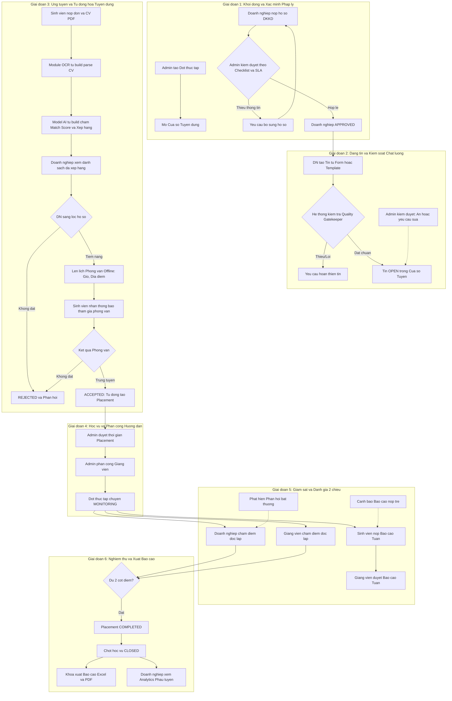
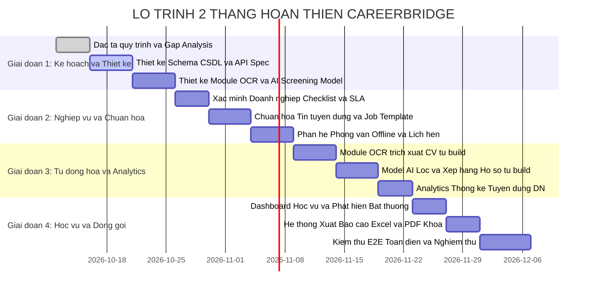

# KẾ HOẠCH TOÀN DIỆN 2 THÁNG HOÀN THIỆN HỆ THỐNG CAREERBRIDGE
## Lộ trình Chuẩn hóa Quy trình, Tự động hóa Tuyển dụng & Quản trị Học vụ

> **Dự án**: Nền tảng Quản lý và Kết nối Thực tập Thông minh — **CareerBridge**  
> **Thời gian thực hiện**: 2 tháng (8 tuần làm việc)  
> **Cấu trúc**: 4 giai đoạn (Giai đoạn 1: Lập kế hoạch chi tiết; Giai đoạn 2, 3, 4: Triển khai hoàn thiện & nghiệm thu)  
> **Tài liệu tham chiếu**: [systemDesign.md](file:///d:/CareerBridge/docs/plans/systemDesign.md), [requirementProject.md](file:///d:/CareerBridge/docs/plans/requirementProject.md), [schema.prisma](file:///d:/CareerBridge/Backend/prisma/schema.prisma)  
> **Thành viên phụ trách**: Phạm Hoàng Sơn & Võ Văn Quyến  

---

## MỤC LỤC
1. [Bối cảnh, Định hướng & Mục tiêu Dự án](#i-bối-cảnh-định-hướng--mục-tiêu-dự-án)
2. [Quy trình Chuẩn Toàn diện (Standard End-to-End Workflow)](#ii-quy-trình-chuẩn-toàn-diện-standard-end-to-end-workflow)
3. [Lộ trình 4 Giai đoạn trong 2 Tháng](#iii-lộ-trình-4-giai-đoạn-trong-2-tháng)
   - [Giai đoạn 1 (Tuần 1 - Tuần 2): Kế hoạch Chi tiết, Chuẩn hóa Quy trình & Thiết kế Kỹ thuật](#giai-đoạn-1-tuần-1---tuần-2-kế-hoạch-chi-tiết-chuẩn-hóa-quy-trình--thiết-kế-kỹ-thuật)
   - [Giai đoạn 2 (Tuần 3 - Tuần 4): Nghiệp vụ Cốt lõi Doanh nghiệp, Chuẩn hóa Tin tuyển dụng & Phỏng vấn Offline](#giai-đoạn-2-tuần-3---tuần-4-nghiệp-vụ-cốt-lõi-doanh-nghiệp-chuẩn-hóa-tin-tuyển-dụng--phỏng-vấn-offline)
   - [Giai đoạn 3 (Tuần 5 - Tuần 6): Tự động hóa Tuyển dụng (OCR CV & AI Screening) & Analytics Tuyển dụng](#giai-đoạn-3-tuần-5---tuần-6-tự-động-hóa-tuyển-dụng-ocr-cv--ai-screening--analytics-tuyển-dụng)
   - [Giai đoạn 4 (Tuần 7 - Tuần 8): Dashboard Học vụ Nhà trường, Cảnh báo, Xuất Báo cáo & Kiểm thử Nghiệm thu](#giai-đoạn-4-tuần-7---tuần-8-dashboard-học-vụ-nhà-trường-cảnh-báo-xuất-báo-cáo--kiểm-thử-nghiệm-thu)
4. [Thiết kế Cơ sở Dữ liệu Mở rộng (Database Schema Delta)](#iv-thiết-kế-cơ-sở-dữ-liệu-mở-rộng-database-schema-delta)
5. [Thiết kế Kiến trúc Module Mới & Luồng Dữ liệu](#v-thiết-kế-kiến-trúc-module-mới--luồng-dữ-liệu)
6. [Ma trận Phân công Công việc (RACI & WBS Matrix)](#vi-ma-trận-phân-công-công-việc-raci--wbs-matrix)
7. [Quản lý Rủi ro & Giải pháp Dự phòng (Risk & Contingency)](#vii-quản-lý-rủi-ro--giải-pháp-dự-phòng-risk--contingency)
8. [Tiêu chuẩn Đánh giá Hoàn thành (Definition of Done - DoD)](#viii-tiêu-chuẩn-đánh-giá-hoàn-thành-definition-of-done---dod)

---

## I. BỐI CẢNH, ĐỊNH HƯỚNG & MỤC TIÊU DỰ ÁN

### 1. Ý kiến Định hướng từ Giảng viên Hướng dẫn
Qua buổi đánh giá tiến độ định kỳ, giảng viên hướng dẫn đã đóng góp 3 nguyên tắc trọng tâm để đưa CareerBridge từ mức "chạy được tính năng cơ bản" lên mức "hệ thống ứng dụng thực tế chuẩn mực":
1. **Quy trình chuẩn là ưu tiên hàng đầu**: Phải rà soát và chuẩn hóa mọi luồng nghiệp vụ giữa 4 vai trò (`ADMIN`, `COMPANY`, `STUDENT`, `LECTURER`). Không đi đường tắt; dữ liệu học vụ và tuyển dụng phải có vòng đời chặt chẽ, ràng buộc logic rõ ràng.
2. **Tự động hóa quy trình cho doanh nghiệp**: Giảm thiểu thao tác thủ công khi nhận hàng trăm hồ sơ sinh viên bằng cách:
   - Xây dựng module **OCR/Parsing CV tự build** (trích xuất thông tin cấu trúc từ file PDF CV của sinh viên).
   - Xây dựng **Model lọc và xếp hạng hồ sơ tự build** (đối sánh kỹ năng, kinh nghiệm của ứng viên với yêu cầu của tin tuyển dụng để tính điểm match score và xếp hạng tự động).
3. **Thực tế hóa quy trình phỏng vấn**: Phỏng vấn không nhất thiết phải làm hệ thống video call trực tuyến phức tạp (dễ nghẽn băng thông và kém thực tế trong môi trường doanh nghiệp). Thay vào đó, tập trung xây dựng nghiệp vụ **Lên lịch phỏng vấn Offline** (thời gian, địa điểm văn phòng, hướng dẫn chuẩn bị, cập nhật kết quả phỏng vấn vào tiến trình ứng tuyển).

### 2. Các Mục tiêu Nghiệp vụ Cốt lõi Cần Hoàn thiện
- **Hồ sơ & Xác minh Doanh nghiệp**: Bổ sung bộ checklist chuẩn hóa duyệt hồ sơ, thiết lập SLA thời gian xử lý (hạn xử lý 48h-72h), cung cấp lý do yêu cầu bổ sung minh bạch theo từng tiêu chí, thiết lập cơ chế tạm dừng (`SUSPENDED`) doanh nghiệp vi phạm có kiểm soát.
- **Chuẩn hóa Chất lượng Tin tuyển dụng**: Thiết lập bộ lọc kiểm duyệt (Quality Gatekeeper) bắt buộc đầy đủ thông tin: số lượng tuyển, địa điểm, hình thức làm việc, lịch làm việc, trợ cấp, kỹ năng chi tiết, hạn nộp và người liên hệ. Quản trị viên có quyền ẩn hoặc yêu cầu chỉnh sửa tin vi phạm, thiếu thông tin hoặc trùng lặp.
- **Mẫu Tin tuyển dụng & Tái đăng tin (Templates & Repost)**: Cho phép doanh nghiệp lưu tin mẫu, sao chép hoặc đăng lại vào đợt tuyển mới mà không phải nhập lại từ đầu, đồng thời hệ thống vẫn tự động kiểm tra thời hạn và chất lượng nội dung trước khi mở tin.
- **Thống kê Tuyển dụng Chuyên sâu cho Doanh nghiệp**: Đo lường lượt xem tin, số đơn ứng tuyển, phễu chuyển đổi qua từng vòng (Funnel), thời gian tuyển trung bình (Time-to-Hire), phân tích nguồn kỹ năng ứng viên và tỷ lệ lấp đầy vị trí (Fill Rate).
- **Dashboard Học vụ cho Nhà trường**: Giám sát sinh viên chưa có placement, phát hiện báo cáo tuần nộp trễ, cảnh báo doanh nghiệp có phản hồi bất thường/tiêu cực, và theo dõi các placement sắp hết hạn học vụ.
- **Xuất Báo cáo Học vụ Quản lý (Excel / PDF)**: Hỗ trợ kết xuất file Excel và PDF danh sách sinh viên thực tập, phân công placement, tiến độ báo cáo và bảng tổng hợp kết quả đánh giá 2 chiều phục vụ công tác xét tốt nghiệp của Khoa.

---

## II. QUY TRÌNH CHUẨN TOÀN DIỆN (STANDARD END-TO-END WORKFLOW)

Hệ thống CareerBridge vận hành theo chu trình 6 giai đoạn khép kín, phân định minh bạch trách nhiệm giữa 4 bên:

#### 1. Sơ đồ Chu trình Tổng thể (Dạng Sơ đồ Khối Trực quan)

```text
+---------------------------------------------------------------------------------------------------+
| GIAI ĐOẠN 1: KHỞI ĐỘNG ĐỢT & XÁC MINH PHÁP LÝ                                                     |
| [Admin tạo Semester] ---> [Mở Cửa sổ Tuyển dụng]                                                  |
| [Doanh nghiệp gửi ĐKKD] ---> [Admin kiểm duyệt theo Checklist & SLA 48h]                          |
|       |                                                                                           |
|       +---> Thiếu thông tin: Gửi lý do yêu cầu bổ sung ---> DN cập nhật lại                      |
|       +---> Hợp lệ: Phê duyệt (APPROVED)                                                          |
+---------------------------------------------------------------------------------------------------+
                                                  |
                                                  v
+---------------------------------------------------------------------------------------------------+
| GIAI ĐOẠN 2: ĐĂNG TIN TUYỂN DỤNG & KIỂM SOÁT CHẤT LƯỢNG                                            |
| [DN soạn tin mới HOẶC dùng Mẫu tin/Clone] ---> [Bộ lọc Quality Gatekeeper tự động]                 |
|       |                                                                                           |
|       +---> Thiếu trường bắt buộc / Trùng lặp: Báo lỗi & yêu cầu hoàn thiện                       |
|       +---> Đạt chuẩn: Mở tin (OPEN) trong thời gian cửa sổ tuyển                                 |
|       * Admin có quyền hậu kiểm: Ẩn tin vi phạm (HIDDEN) hoặc yêu cầu chỉnh sửa                   |
+---------------------------------------------------------------------------------------------------+
                                                  |
                                                  v
+---------------------------------------------------------------------------------------------------+
| GIAI ĐOẠN 3: ỨNG TUYỂN, TỰ ĐỘNG HÓA CV & PHỎNG VẤN OFFLINE                                        |
| [Sinh viên nộp đơn + CV PDF]                                                                      |
|       |                                                                                           |
|       v                                                                                           |
| [OCR Parser tự build] ---> [Trích xuất: Học vấn, Kỹ năng, Kinh nghiệm, SĐT]                       |
|       |                                                                                           |
|       v                                                                                           |
| [AI Model tự build]  ---> [Tính Match Score 0-100 & Xếp hạng ứng viên]                            |
|       |                                                                                           |
|       v                                                                                           |
| [Doanh nghiệp xem danh sách đã xếp hạng]                                                          |
|       |                                                                                           |
|       +---> Không phù hợp: Từ chối (REJECTED) kèm nhận xét                                        |
|       +---> Tiềm năng: Đặt lịch Phỏng vấn Offline (Ngày, giờ, địa điểm văn phòng)                  |
|                   |                                                                               |
|                   v                                                                               |
|             [Sinh viên nhận thông báo/email tham gia phỏng vấn trực tiếp]                         |
|                   |                                                                               |
|                   +---> Phỏng vấn không đạt: REJECTED                                             |
|                   +---> Trúng tuyển: ACCEPTED ---> Tự động khởi tạo Placement                     |
+---------------------------------------------------------------------------------------------------+
                                                  |
                                                  v
+---------------------------------------------------------------------------------------------------+
| GIAI ĐOẠN 4: HỌC VỤ & PHÂN CÔNG GIẢNG VIÊN                                                        |
| [Admin phê duyệt lịch Placement chính thức] ---> [Admin phân công Giảng viên Supervision]          |
| ---> Đợt thực tập chuyển sang trạng thái GIÁM SÁT (MONITORING)                                     |
+---------------------------------------------------------------------------------------------------+
                                                  |
                                                  v
+---------------------------------------------------------------------------------------------------+
| GIAI ĐOẠN 5: GIÁM SÁT THỰC TẬP & ĐÁNH GIÁ 2 CHIỀU ĐỘC LẬP                                         |
| - Sinh viên nộp Báo cáo Tuần (Hệ thống tự động phát hiện & cảnh báo Báo cáo nộp trễ)              |
| - Giảng viên hướng dẫn chấm duyệt báo cáo tuần                                                    |
| - Cuối kỳ: Doanh nghiệp chấm điểm & nhận xét thực tế (Thang điểm 10)                               |
| - Cuối kỳ: Giảng viên chấm điểm & nhận xét học thuật (Thang điểm 10)                                |
| * Hệ thống quét phát hiện Doanh nghiệp có phản hồi bất thường / Điểm lệch chuẩn                    |
+---------------------------------------------------------------------------------------------------+
                                                  |
                                                  v
+---------------------------------------------------------------------------------------------------+
| GIAI ĐOẠN 6: NGHIỆM THU, XUẤT BÁO CÁO & ĐÓNG ĐỢT                                                  |
| - Cả 2 điểm hoàn tất ---> Placement chuyển COMPLETED                                              |
| - Khóa phần học vụ (AcademicStatus CLOSED)                                                        |
| - Khoa xuất Báo cáo Excel / PDF: Danh sách SV, tiến độ báo cáo, bảng điểm tổng kết                |
| - Doanh nghiệp xem Dashboard Analytics: Lượt xem, phễu tuyển dụng, thời gian tuyển trung bình      |
+---------------------------------------------------------------------------------------------------+
```

#### 2. Sơ đồ Mã nguồn Mermaid (Dành cho trình xem hỗ trợ Mermaid)



---

## III. LỘ TRÌNH 4 GIAI ĐOẠN TRONG 2 THÁNG

Tổng thời lượng dự án: **8 tuần**. Mỗi giai đoạn kéo dài **2 tuần**.

#### 1. Bảng Tổng Hợp Tiến Độ 8 Tuần

| Giai đoạn | Tuần | Hạng mục thực hiện chính | Đầu ra nghiệm thu |
| :--- | :---: | :--- | :--- |
| **Giai đoạn 1** | **Tuần 1** | - Rà soát toàn bộ quy trình chuẩn (State Machine & Logic)<br>- Gap Analysis so với hệ thống hiện tại | Tài liệu đặc tả quy trình & ma trận trạng thái |
| | **Tuần 2** | - Thiết kế Prisma Schema Delta & DTOs<br>- Thiết kế giải pháp OCR & AI Scoring Model tự build<br>- Thiết kế Wireframe & UI Flows | Bản thiết kế Schema, API Spec, Tài liệu giải pháp AI |
| **Giai đoạn 2** | **Tuần 3** | - Hoàn thiện Xác minh Doanh nghiệp (Checklist 5 bước, SLA đếm ngược 48h)<br>- Cơ chế Yêu cầu bổ sung & Tạm dừng (`SUSPENDED`) DN vi phạm | API & Màn hình xét duyệt DN có SLA & Checklist |
| | **Tuần 4** | - Chuẩn hóa Tin tuyển dụng & Quality Gatekeeper (bắt buộc đủ trường)<br>- Mẫu tin tuyển dụng (Job Templates) & Đăng lại tin (Clone/Repost)<br>- Phân hệ Phỏng vấn Offline (Lên lịch, thông báo địa điểm, cập nhật kết quả) | Màn hình đăng tin chuẩn hóa, Mẫu tin & Đặt lịch phỏng vấn |
| **Giai đoạn 3** | **Tuần 5** | - Xây dựng Module OCR trích xuất thông tin CV PDF tự build<br>- Xây dựng bộ Parser thông tin: Học vấn, Kỹ năng, Kinh nghiệm, SĐT | Service OCR bóc tách CV hoạt động độc lập |
| | **Tuần 6** | - Xây dựng Model AI chấm điểm Match Score & xếp hạng ứng viên tự build<br>- Tích hợp pipeline OCR + Matching vào luồng ứng tuyển<br>- Xây dựng Dashboard Analytics Tuyển dụng cho Doanh nghiệp (Views, Funnel, Time-to-hire) | Danh sách ứng viên tự động xếp hạng & Dashboard Analytics |
| **Giai đoạn 4** | **Tuần 7** | - Dashboard Học vụ Nhà trường (SV chưa có placement, báo cáo trễ, DN bất thường)<br>- Hệ sinh thái cảnh báo tự động qua Realtime Socket.IO & Email | Dashboard Học vụ Khoa & Cảnh báo thông minh |
| | **Tuần 8** | - Module Xuất Báo cáo Excel đa sheet (`exceljs`) & PDF (`pdfkit`) bảng điểm học vụ<br>- Kiểm thử tích hợp E2E toàn hệ thống, tối ưu hóa & đóng gói nghiệm thu | Chức năng xuất file Excel/PDF & Báo cáo đồ án tổng kết |

#### 2. Biểu đồ Tiến độ Mermaid Gantt



---

### Giai đoạn 1 (Tuần 1 - Tuần 2): Kế hoạch Chi tiết, Chuẩn hóa Quy trình & Thiết kế Kỹ thuật

#### 1. Mục tiêu Giai đoạn 1
- Xác định toàn bộ khoảng trống (Gap Analysis) giữa hệ thống hiện tại và yêu cầu mới.
- Hoàn thiện tài liệu đặc tả kiến trúc, hợp đồng API (API Contracts), và thiết kế cơ sở dữ liệu mở rộng.
- Lên giải pháp kiến trúc chi tiết cho 2 thành phần tự build: Module OCR bóc tách CV và Model AI chấm điểm lọc ứng viên.
- Phê duyệt Wireframe và kịch bản tương tác người dùng (UI Flow).

#### 2. Các Hạng mục Triển khai Cụ thể
- **Hạng mục 1.1: Rà soát Quy trình Chuẩn & Lập Ma trận Nghiệp vụ**
  - Rà soát các trạng thái: `CompanyStatus`, `InternshipStatus`, `ApplicationStatus`, `PlacementStatus`, `ReportStatus`.
  - Bổ sung trạng thái phỏng vấn cho `Application`: `INTERVIEW_SCHEDULED`, `INTERVIEW_COMPLETED`.
  - Bổ sung trạng thái kiểm duyệt tin cho `Internship`: `PENDING_REVIEW`, `REQUEST_REVISION`, `HIDDEN`.
- **Hạng mục 1.2: Thiết kế Mở rộng Prisma Schema**
  - Bổ sung model `CompanyVerificationChecklist` hoặc các trường checklist trong `CompanyProfile`.
  - Bổ sung model `JobTemplate` và các trường quản lý chất lượng trong `Internship` (`workSchedule`, `contactPerson`, `viewsCount`, `isTemplate`).
  - Bổ sung model `InterviewSchedule` gắn liền với `Application`.
  - Bổ sung model `ParsedCvData` và `ApplicationCandidateScore`.
  - Bổ sung model `InternshipViewLog` phục vụ tracking lượt xem duy nhất.
- **Hạng mục 1.3: Thiết kế Kỹ thuật Module OCR & Model AI Sàng lọc CV Tự Build**
  - *Giải pháp OCR tự build*: Sử dụng Python Service độc lập (FastAPI) hoặc tích hợp Node engine (`pdf-parse`, `tesseract.js`, `pdfjs-dist`). Lựa chọn kiến trúc Microservice Python nhẹ kết hợp `PyMuPDF` (cho PDF text) + `Tesseract OCR` (cho PDF scan/ảnh) để bóc tách các trường: Họ tên, Email, SĐT, Học vấn/Trường, Danh sách kỹ năng (Skills), Dự án & Kinh nghiệm.
  - *Giải pháp Model AI Sàng lọc tự build*: Xây dựng thuật toán Matching Engine kết hợp TF-IDF / Cosine Similarity hoặc Embedding nhẹ (Sentence-Transformers offline `all-MiniLM-L6-v2` / PhoBERT nếu tiếng Việt) kết hợp Rule-based Weighting (trọng số kỹ năng bắt buộc 50%, học vấn 20%, kinh nghiệm/dự án 30%) để tính Match Score từ 0 đến 100.
- **Hạng mục 1.4: Thiết kế Kiến trúc Xuất Báo cáo Excel / PDF**
  - Thiết kế thư viện sử dụng: `exceljs` cho xuất bảng biểu Excel nhiều sheet (Sinh viên, Placement, Báo cáo, Đánh giá), định dạng màu sắc học vụ; `pdfkit` / Puppeteer HTML-to-PDF cho xuất biên bản đánh giá thực tập và danh sách nghiệm thu có tiêu đề trường.

#### 3. Sản phẩm Đầu ra của Giai đoạn 1 (Deliverables)
1. Tài liệu Kế hoạch Toàn diện (`KE_HOACH_TOAN_DIEN_2_THANG_HOAN_THIEN_CAREERBRIDGE.md`).
2. Bản vẽ Schema Prisma cập nhật hoàn chỉnh sẵn sàng migrate.
3. Tài liệu OpenAPI / Swagger đặc tả các API mới.
4. Tài liệu Thiết kế Kỹ thuật chi tiết cho Module OCR & Model AI Sàng lọc.

---

### Giai đoạn 2 (Tuần 3 - Tuần 4): Nghiệp vụ Cốt lõi Doanh nghiệp, Chuẩn hóa Tin tuyển dụng & Phỏng vấn Offline

#### 1. Mục tiêu Giai đoạn 2
- Hoàn thiện quy trình xét duyệt doanh nghiệp với checklist chi tiết, SLA xử lý và cơ chế tạm dừng có lý do minh bạch.
- Triển khai cổng kiểm duyệt chất lượng tin tuyển dụng (Quality Gatekeeper), tính năng lưu mẫu tin và đăng lại (Clone/Repost).
- Xây dựng hoàn chỉnh luồng Phỏng vấn Offline thực tế giữa Doanh nghiệp và Sinh viên.

#### 2. Các Hạng mục Triển khai Cụ thể
- **Hạng mục 2.1: Phân hệ Hoàn thiện Hồ sơ & Xác minh Doanh nghiệp**
  - **Checklist 5 bước kiểm duyệt**:
    1. Tên pháp lý đối chiếu chính xác với Giấy phép ĐKKD.
    2. Mã số doanh nghiệp hợp lệ và duy nhất trên hệ thống.
    3. Địa chỉ trụ sở trùng khớp với tài liệu đăng ký.
    4. Đại diện/Người liên hệ và phương thức liên hệ khả dụng (SĐT, Email công vụ).
    5. Tính hợp lệ, nguyên vẹn và thời hạn của file Giấy phép ĐKKD.
  - **Cơ chế SLA Kiểm duyệt**: Hệ thống gắn mốc thời gian `slaDeadline = submittedAt + 48 hours`. Dashboard Admin hiển thị đồng hồ đếm ngược và gắn nhãn cảnh báo (Normal, Approaching Due, Overdue).
  - **Lý do Yêu cầu Bổ sung (`REJECTED`)**: Cho phép Admin chọn checklist các mục chưa đạt (checkbox) và nhập hướng dẫn bổ sung chi tiết. Doanh nghiệp nhận thông báo, xem đúng lý do và tải lại tài liệu thay thế mà không phải đăng ký lại từ đầu.
  - **Cơ chế Tạm dừng Doanh nghiệp Vi phạm (`SUSPENDED`)**: Cho phép Admin đình chỉ doanh nghiệp vi phạm chính sách kèm lý do bắt buộc. Khóa quyền tạo tin mới, khóa nhận đơn mới; các placement đang thực tập của doanh nghiệp vẫn duy trì để bảo vệ quyền lợi sinh viên hoàn thành kỳ thực tập.
- **Hạng mục 2.2: Chuẩn hóa Chất lượng Tin tuyển dụng & Bộ lọc Gatekeeper**
  - **Strict Validation trước khi mở tin (`OPEN`)**: Bắt buộc nhập đầy đủ: `slots >= 1`, `location`, `workType` (ONSITE/HYBRID/REMOTE), `workSchedule` (Full-time/Part-time/Ca kíp), `stipend` (ghi rõ mức hỗ trợ hoặc thỏa thuận minh bạch), tối thiểu 1 kỹ năng có đánh dấu `isRequired`, `deadline` hợp lệ trong cửa sổ tuyển, và thông tin `contactPerson`.
  - **Admin Moderation & Phát hiện Tin Trùng lặp**:
    - Thuật toán kiểm tra trùng lặp (trùng tiêu đề và nội dung trên 85% trong cùng kỳ của công ty).
    - Quyền Admin: Gắn cờ vi phạm, ẩn bài viết (`HIDDEN`), hoặc gửi yêu cầu chỉnh sửa (`REQUEST_REVISION`) kèm lý do cụ thể.
- **Hạng mục 2.3: Mẫu Tin Tuyển dụng (Job Templates) & Đăng lại (Clone & Repost)**
  - Doanh nghiệp có thể gắn cờ lưu tin hiện tại làm "Mẫu tuyển dụng" (`isTemplate = true`).
  - Nút **"Tạo từ mẫu"** hoặc **"Đăng lại vị trí này"**: Sao chép toàn bộ thông tin mô tả, yêu cầu, kỹ năng; tự động yêu cầu doanh nghiệp chọn kỳ thực tập mới (`semesterId`) và thiết lập hạn nộp mới (`deadline`).
  - Hệ thống tự động kích hoạt lại bộ kiểm duyệt Gatekeeper trước khi cho phép xuất bản.
- **Hạng mục 2.4: Phân hệ Phỏng vấn Offline Thực tế**
  - Khi doanh nghiệp chuyển đơn sang phỏng vấn: Mở hộp thoại **"Đặt lịch phỏng vấn Offline"**.
  - Nhập thông tin: Ngày giờ hẹn, Địa điểm phỏng vấn (Văn phòng công ty, phòng họp), Người đón tiếp/phỏng vấn, Hồ sơ cần mang theo (bản in CV, bảng điểm, portfolio), và Ghi chú lưu ý.
  - Trạng thái `Application` chuyển sang `INTERVIEW_SCHEDULED`. Hệ thống gửi email tự động + thông báo Socket.IO thời gian thực đến sinh viên.
  - Cập nhật kết quả sau phỏng vấn: Doanh nghiệp chọn `PASSED` (chuyển sang bước gửi Offer / `ACCEPTED`) hoặc `FAILED` (kèm nhận xét đóng góp để sinh viên cải thiện).

#### 3. Sản phẩm Đầu ra của Giai đoạn 2 (Deliverables)
1. Giao diện và API hoàn chỉnh phân hệ Xác minh Doanh nghiệp (Checklist + SLA + Đình chỉ).
2. Quy trình đăng tin tuyển dụng chuẩn hóa có kiểm duyệt và tính năng Template/Clone.
3. Luồng phỏng vấn offline hoàn chỉnh từ đặt lịch, gửi thông báo đến chốt kết quả.

---

### Giai đoạn 3 (Tuần 5 - Tuần 6): Tự động hóa Tuyển dụng (OCR CV & AI Screening) & Analytics Tuyển dụng

#### 1. Mục tiêu Giai đoạn 3
- Xây dựng và tích hợp module OCR / CV Parser tự build để tự động đọc nội dung PDF CV của ứng viên.
- Xây dựng Model AI Lọc và Xếp hạng Hồ sơ tự build tính toán Match Score theo yêu cầu của từng tin tuyển dụng.
- Xây dựng Dashboard Thống kê Tuyển dụng chuyên sâu cho Doanh nghiệp (Recruitment Analytics).

#### 2. Các Hạng mục Triển khai Cụ thể
- **Hạng mục 3.1: Module OCR / Parsing CV Tự Build**
  - **Kiến trúc Dịch vụ**: Xây dựng service xử lý văn bản chuyên dụng. Đối với file PDF dạng văn bản: trích xuất trực tiếp bằng text stream; đối với file PDF dạng hình ảnh scan: chạy Tesseract OCR engine với bộ dữ liệu tiếng Việt + tiếng Anh (`vie + eng`).
  - **Bộ trích xuất Cấu trúc (Information Extractor)**:
    - *Thông tin cá nhân*: Tên, Email, Số điện thoại, Địa chỉ, Liên kết Github/LinkedIn.
    - *Học vấn*: Tên trường (đặc biệt nhận diện ĐH Giao thông Vận tải / UTH, ĐHQG...), Chuyên ngành, GPA.
    - *Kỹ năng*: So khớp từ điển kỹ năng chuẩn hóa (`skills` trong hệ thống) + kỹ năng công nghệ mềm và cứng.
    - *Kinh nghiệm & Dự án*: Tách khối kinh nghiệm làm việc và dự án cá nhân.
  - **Lưu trữ Cấu trúc**: Kết quả bóc tách được lưu vào trường `parsedData` (JSON) của bản ghi hồ sơ ứng tuyển, phục vụ tìm kiếm và hiển thị nhanh trên UI cho Nhà tuyển dụng mà không cần mở file PDF.
- **Hạng mục 3.2: Model AI Lọc & Xếp hạng Hồ sơ Tự Build (Candidate Screening Engine)**
  - **Cơ chế Tính Điểm Match Score Đa Tiêu Chí**:
    $$Score_{Total} = (0.50 \times S_{Skills}) + (0.25 \times S_{Experience}) + (0.15 \times S_{Education}) + (0.10 \times S_{Preferences})$$
    - $S_{Skills}$: Tính theo tỷ lệ kỹ năng bắt buộc (`isRequired = true`) đạt được trong CV + độ khớp của các kỹ năng ưu tiên theo trọng số `weight`.
    - $S_{Experience}$: Độ khớp giữa từ khóa mô tả công việc (Job Description) và dự án/kinh nghiệm thực tế trong CV thông qua giải thuật TF-IDF Cosine Similarity hoặc Vector Embedding cục bộ.
    - $S_{Education}$: Độ phù hợp về ngành đào tạo và điểm học tập GPA.
    - $S_{Preferences}$: Địa điểm làm việc và hình thức làm việc mong muốn.
  - **Giải thích Điểm số (Match Breakdown)**: Cung cấp trực quan: Kỹ năng đã thỏa mãn (màu xanh), Kỹ năng còn thiếu (màu đỏ), Điểm mạnh nổi bật.
  - **Xếp hạng Ứng viên Tự động**: Trong danh sách ứng viên của tin tuyển dụng, cho phép doanh nghiệp sắp xếp theo: "Độ phù hợp từ cao đến thấp", lọc ứng viên có điểm match >= 70%.
- **Hạng mục 3.3: Dashboard Thống kê Tuyển dụng Doanh nghiệp (Company Recruitment Analytics)**
  - **Bộ chỉ số đo lường hiệu quả**:
    1. *Lượt xem tin (Views)*: Tracking số lượt xem theo từng vị trí tuyển dụng (phân biệt xem duy nhất / Unique Views theo phiên).
    2. *Số lượng đơn nộp (Applications)*: Tổng số đơn, số đơn mới trong ngày/tuần.
    3. *Phễu chuyển đổi tuyển dụng (Conversion Funnel)*: `Lượt xem` $\rightarrow$ `Nộp đơn` $\rightarrow$ `Đang duyệt/Parsed` $\rightarrow$ `Phỏng vấn Offline` $\rightarrow$ `Trúng tuyển (Accepted)`.
    4. *Thời gian tuyển dụng trung bình (Time-to-Hire)*: Số ngày trung bình từ khi sinh viên nộp đơn đến khi doanh nghiệp chốt trúng tuyển.
    5. *Phân tích Nguồn kỹ năng Ứng viên (Skill Gap Distribution)*: Biểu đồ cột/radar thể hiện các kỹ năng phổ biến nhất của các ứng viên nộp vào công ty.
    6. *Tỷ lệ lấp đầy vị trí (Fill Rate)*: $\frac{\text{filledSlots}}{\text{slots}} \times 100\%$ và số ngày còn lại trước hạn chốt tuyển.

#### 3. Sản phẩm Đầu ra của Giai đoạn 3 (Deliverables)
1. Dịch vụ OCR CV tự build hoạt động ổn định, bóc tách chính xác thông tin cấu trúc.
2. Engine AI chấm điểm Match Score và xếp hạng ứng viên minh bạch, giải thích được.
3. Màn hình Dashboard Analytics trực quan cho Doanh nghiệp với đầy đủ biểu đồ phễu chuyển đổi và chỉ số tuyển dụng.

---

### Giai đoạn 4 (Tuần 7 - Tuần 8): Dashboard Học vụ Nhà trường, Cảnh báo, Xuất Báo cáo & Kiểm thử Nghiệm thu

#### 1. Mục tiêu Giai đoạn 4
- Hoàn thiện Dashboard Học vụ cho Nhà trường và Khoa phục vụ giám sát toàn diện sinh viên và đơn vị thực tập.
- Thiết lập hệ thống phát hiện bất thường và cảnh báo tự động.
- Xây dựng module Xuất Báo cáo Excel / PDF chuyên nghiệp chuẩn học vụ.
- Thực hiện kiểm thử tích hợp End-to-End toàn hệ thống, tối ưu hóa hiệu năng và đóng gói tài liệu nghiệm thu.

#### 2. Các Hạng mục Triển khai Cụ thể
- **Hạng mục 4.1: Dashboard Học vụ Nhà trường (Academic Monitoring Dashboard)**
  - **Theo dõi Sinh viên Chưa có Placement**: Lọc danh sách sinh viên theo đợt thực tập, chuyên ngành, lớp sinh hoạt chưa được nhận vào bất kỳ công ty nào, số lượng đơn đã nộp nhưng bị từ chối để Khoa kịp thời hỗ trợ kết nối doanh nghiệp.
  - **Giám sát Báo cáo Nộp Trễ (Overdue Reports)**: Hệ thống tự động tính toán tuần thực tập hiện tại của từng placement; hiển thị danh sách sinh viên quá hạn chưa nộp báo cáo tuần, cảnh báo Giảng viên hướng dẫn vào nhắc nhở.
  - **Phát hiện Doanh nghiệp Có Phản hồi Bất thường**:
    - Đánh giá điểm số bất thường: Doanh nghiệp chấm điểm toàn bộ sinh viên quá thấp (< 5.0) hoặc quá lỏng lẻo không có nhận xét.
    - Doanh nghiệp có tỷ lệ hủy thực tập cao (`CANCELLED` placements).
    - Sinh viên gửi phản hồi tiêu cực hoặc khiếu nại về môi trường làm việc thông qua hệ thống trao đổi.
  - **Cảnh báo Placement Sắp Hết Thời Gian Theo Dõi**: Liệt kê các sinh viên còn dưới 2 tuần là kết thúc thời gian thực tập nhưng vẫn còn thiếu điểm đánh giá của Giảng viên hoặc Doanh nghiệp.
- **Hạng mục 4.2: Hệ thống Xuất Báo cáo Quản lý Đào tạo (Export Excel & PDF)**
  - **Xuất Báo cáo Excel (`.xlsx`)**:
    - *Sheet 1 — Danh sách Sinh viên & Đơn vị Thực tập*: Mã SV, Họ tên, Lớp, Doanh nghiệp tiếp nhận, Vị trí, Giảng viên hướng dẫn, Thời gian thực tập.
    - *Sheet 2 — Tiến độ Báo cáo Tuần*: Tổng hợp số báo cáo đã nộp/đã duyệt của từng tuần từ Tuần 1 đến Tuần 12.
    - *Sheet 3 — Bảng Điểm Tổng hợp Nghiệm thu*: Điểm Doanh nghiệp (hệ số 50%), Điểm Giảng viên (hệ số 50%), Điểm Trung bình Tổng kết, Xếp loại học vụ (Xuất sắc, Giỏi, Khá, Đạt, Không đạt).
  - **Xuất Biên bản & Danh sách PDF (`.pdf`)**:
    - Mẫu Biên bản Đánh giá Kết quả Thực tập Tốt nghiệp có đầy đủ Quốc hiệu, Tiêu ngữ, Tên Khoa/Trường, chữ ký xác nhận của Doanh nghiệp và Giảng viên.
    - Danh sách tổng hợp điểm có định dạng in A4 chuẩn văn bản hành chính.
- **Hạng mục 4.3: Kiểm thử Toàn diện & Tối ưu Hệ thống**
  - Viết Unit Test và Integration Test bổ sung cho các module mới (`applications`, `companies`, `cv-parser`, `analytics`, `dashboard`, `reports-export`).
  - Kiểm thử tải (Load Test) luồng tải lên và parse CV đồng thời.
  - Kiểm tra an toàn bảo mật và phân quyền dữ liệu (Data Isolation RBAC giữa các doanh nghiệp và giảng viên).
  - Đóng gói tài liệu báo cáo nghiệm thu đồ án tốt nghiệp.

#### 3. Sản phẩm Đầu ra của Giai đoạn 4 (Deliverables)
1. Dashboard Học vụ Khoa hoạt động theo thời gian thực với đầy đủ 4 bộ lọc cảnh báo.
2. Bộ công cụ xuất báo cáo Excel đa sheet và PDF chuẩn mẫu hành chính.
3. Bộ tài liệu nghiệm thu hoàn chỉnh: Video demo, Slide báo cáo, và Báo cáo Đồ án Tổng kết.

---

## IV. THIẾT KẾ CƠ SỞ DỮ LIỆU MỞ RỘNG (DATABASE SCHEMA DELTA)

Để đáp ứng toàn bộ các tính năng trên, file [schema.prisma](file:///d:/CareerBridge/Backend/prisma/schema.prisma) được bổ sung các cấu trúc sau:

### 1. Mở rộng Enum
```prisma
// Bổ sung trạng thái cho Application để hỗ trợ luồng Phỏng vấn Offline
enum ApplicationStatus {
  PENDING
  REVIEWING
  INTERVIEW_SCHEDULED // Mới: Đã lên lịch phỏng vấn offline
  INTERVIEW_COMPLETED // Mới: Đã hoàn tất phỏng vấn, chờ duyệt kết quả
  ACCEPTED
  REJECTED
  WITHDRAWN
}

// Bổ sung trạng thái kiểm duyệt chất lượng bài đăng của Admin
enum ModerationStatus {
  APPROVED
  PENDING_REVIEW
  REQUEST_REVISION
  HIDDEN
}

// Kết quả phỏng vấn offline
enum InterviewResult {
  PENDING
  PASSED
  FAILED
  RESCHEDULED
}
```

### 2. Cập nhật Model `CompanyProfile`
```prisma
// Bổ sung các trường Checklist kiểm duyệt và SLA
model CompanyProfile {
  // ... các trường hiện có ...
  slaDeadline           DateTime? // Hạn chót Admin phải duyệt hồ sơ (submittedAt + 48h)
  checklistPassed       Json?     // Lưu trạng thái 5 tiêu chí: { legalName: true, taxCode: true, address: true, representative: true, docValid: true }
  revisionRequests      Json?     // Danh sách các mục yêu cầu sửa đổi chi tiết
  isSuspended           Boolean   @default(false)
  suspensionReason      String?   // Lý do tạm dừng doanh nghiệp vi phạm
  suspendedAt           DateTime?
  // ... quan hệ hiện có ...
}
```

### 3. Cập nhật Model `Internship` & Tạo mới `JobTemplate`
```prisma
model Internship {
  // ... các trường hiện có ...
  workSchedule          String?              // Lịch làm việc: "Thứ 2 - Thứ 6 (8h00 - 17h30)"
  contactPersonName     String?              // Người liên hệ trực tiếp
  contactPhone          String?
  contactEmail          String?
  isTemplate            Boolean              @default(false) // Đánh dấu dùng làm tin mẫu
  viewsCount            Int                  @default(0)     // Số lượt xem tin
  moderationStatus      ModerationStatus     @default(APPROVED)
  moderationReason      String?              // Lý do ẩn hoặc yêu cầu chỉnh sửa
  
  views                 InternshipViewLog[]  // Quan hệ lưu log lượt xem
  // ... quan hệ hiện có ...
}

// Model lưu log lượt xem tin tuyển dụng (Tracking Views)
model InternshipViewLog {
  id           String     @id @default(cuid())
  internshipId String
  viewerId     String?    // Nếu là sinh viên đã đăng nhập
  ipAddress    String?
  userAgent    String?
  viewedAt     DateTime   @default(now())

  internship   Internship @relation(fields: [internshipId], references: [id], onDelete: Cascade)

  @@index([internshipId, viewedAt])
}
```

### 4. Tạo mới Model `InterviewSchedule` & Cập nhật `Application`
```prisma
model Application {
  // ... các trường hiện có ...
  parsedCvData      Json?                 // Dữ liệu bóc tách từ OCR CV (Học vấn, kỹ năng, kinh nghiệm)
  aiMatchScore      Float?                // Điểm số match score từ model tự build (0 - 100)
  aiMatchBreakdown  Json?                 // Phân tích chi tiết điểm số theo từng tiêu chí
  
  interviewSchedule InterviewSchedule?    // Lịch hẹn phỏng vấn offline
  // ... quan hệ hiện có ...
}

// Lịch hẹn phỏng vấn Offline
model InterviewSchedule {
  id              String          @id @default(cuid())
  applicationId   String          @unique
  scheduledAt     DateTime        // Thời gian hẹn phỏng vấn
  location        String          // Địa chỉ phòng phỏng vấn trực tiếp
  interviewerName String?         // Người phỏng vấn / đón tiếp
  instructions    String?         // Hướng dẫn mang theo hồ sơ, trang phục
  result          InterviewResult @default(PENDING)
  notes           String?         // Ghi chú sau phỏng vấn
  createdAt       DateTime        @default(now())
  updatedAt       DateTime        @updatedAt

  application     Application     @relation(fields: [applicationId], references: [id], onDelete: Cascade)
}
```

---

## V. THIẾT KẾ KIẾN TRÚC MODULE MỚI & LUỒNG DỮ LIỆU

### 1. Kiến trúc Module Backend (`Backend/src`)
```text
Backend/src/
├── cv-parser/                     # [MỚI] Module OCR & Bóc tách CV tự build
│   ├── cv-parser.controller.ts
│   ├── cv-parser.service.ts      # Trích xuất PDF text stream + Tesseract OCR fallback
│   ├── cv-extractor.util.ts      # Biểu thức chính quy & rule trích xuất entity
│   └── cv-matcher.service.ts      # Model AI tính toán Match Score & xếp hạng
├── analytics/                     # [MỚI] Module Thống kê Tuyển dụng Doanh nghiệp
│   ├── analytics.controller.ts
│   ├── analytics.service.ts      # Funnel calculation, time-to-hire, fill rate
│   └── dto/
├── academic-monitoring/           # [MỚI] Phân hệ Giám sát Học vụ Nhà trường
│   ├── academic-monitoring.controller.ts
│   ├── academic-monitoring.service.ts # Overdue reports, unusual feedback, unplaced students
│   └── dto/
├── reports-export/                # [MỚI] Module Xuất Báo cáo Excel / PDF
│   ├── reports-export.controller.ts
│   ├── excel-export.service.ts   # Tích hợp exceljs
│   └── pdf-export.service.ts     # Tích hợp pdfkit / template generator
├── companies/                     # [CẬP NHẬT] Bổ sung Checklist, SLA, Suspension
├── internships/                   # [CẬP NHẬT] Quality Gatekeeper, Template, Clone/Repost
└── applications/                  # [CẬP NHẬT] Phỏng vấn Offline, Trạng thái phỏng vấn
```

### 2. Kiến trúc Giao diện Frontend (`Frontend/src`)
```text
Frontend/src/
├── companies/
│   ├── pages/CompanyAnalyticsPage.tsx     # [MỚI] Dashboard phễu tuyển dụng & KPIs
│   ├── pages/JobTemplatesPage.tsx         # [MỚI] Quản lý mẫu tin & Đăng lại tin
│   ├── components/InterviewScheduleModal.tsx # [MỚI] Modal đặt lịch phỏng vấn offline
│   └── components/VerificationStatusCard.tsx  # [CẬP NHẬT] Xem lý do bổ sung & SLA
├── dashboard/
│   ├── pages/AcademicMonitoringPage.tsx   # [MỚI] Giám sát học vụ real-time cho Khoa
│   └── components/ExportReportModal.tsx   # [MỚI] Modal chọn tiêu chí xuất Excel/PDF
├── internships/
│   ├── components/JobQualityGatekeeper.tsx# [MỚI] Checklist kiểm tra chất lượng tin trước khi mở
│   └── components/CandidateRankedList.tsx # [MỚI] Danh sách ứng viên xếp hạng theo AI Match Score
└── applications/
    └── components/InterviewInfoCard.tsx   # [MỚI] Thẻ hiển thị địa điểm & giờ phỏng vấn cho SV
```

---

## VI. MA TRẬN PHÂN CÔNG CÔNG VIỆC (RACI & WBS MATRIX)

- **A** (Accountable): Người chịu trách nhiệm chính về chất lượng và tiến độ.
- **R** (Responsible): Người trực tiếp triển khai code và kiểm thử.
- **C** (Consulted): Người được tham vấn chuyên môn và giải pháp.
- **I** (Informed): Người được thông báo kết quả.

| Nhóm Công việc (WBS) | Hạng mục chi tiết | Phạm Hoàng Sơn | Võ Văn Quyến | Tuần Triển khai |
| :--- | :--- | :---: | :---: | :---: |
| **Giai đoạn 1: Lập kế hoạch** | Đặc tả quy trình chuẩn & gap analysis | **A / R** | C | Tuần 1 |
| | Thiết kế Schema CSDL Prisma Delta & DTOs | **A / R** | R | Tuần 1 - 2 |
| | Thiết kế kiến trúc OCR & AI Matching Engine | C | **A / R** | Tuần 2 |
| | Thiết kế Wireframe & UI Flows | R | **A / R** | Tuần 2 |
| **Giai đoạn 2: Nghiệp vụ & Cốt lõi** | Xác minh Doanh nghiệp (Checklist, SLA, Đình chỉ) | **A / R** | C | Tuần 3 |
| | Chuẩn hóa Tin tuyển dụng & Quality Gatekeeper | **A / R** | R | Tuần 3 - 4 |
| | Mẫu tin tuyển dụng (Job Templates) & Clone/Repost | R | **A / R** | Tuần 4 |
| | Phân hệ Phỏng vấn Offline (Lịch hẹn, Địa điểm) | **A / R** | R | Tuần 4 |
| **Giai đoạn 3: Tự động hóa & Analytics** | Xây dựng Module OCR bóc tách CV tự build | C | **A / R** | Tuần 5 |
| | Xây dựng Model AI Lọc & Xếp hạng Ứng viên | C | **A / R** | Tuần 5 - 6 |
| | Tích hợp CV Parser vào pipeline nộp đơn | **A / R** | R | Tuần 6 |
| | Module Thống kê Tuyển dụng Doanh nghiệp (Analytics) | **A / R** | C | Tuần 6 |
| **Giai đoạn 4: Học vụ & Nghiệm thu** | Dashboard Học vụ Khoa (Báo cáo trễ, SV chưa placement)| **A / R** | C | Tuần 7 |
| | Phát hiện Phản hồi Bất thường & Cảnh báo Socket | C | **A / R** | Tuần 7 |
| | Phân hệ Xuất Báo cáo Excel / PDF Học vụ | **A / R** | R | Tuần 8 |
| | Kiểm thử E2E, Tối ưu hiệu năng & Báo cáo Tổng kết | **A / R** | **A / R** | Tuần 8 |

---

## VII. QUẢN LÝ RỦI RO & GIẢI PHÁP DỰ PHÒNG (RISK & CONTINGENCY)

| Rủi ro tiềm ẩn | Mức độ | Khả năng xảy ra | Giải pháp Giảm thiểu & Phương án Dự phòng |
| :--- | :---: | :---: | :--- |
| **1. File PDF CV định dạng phức tạp khiến OCR bóc tách sai lệch** | Cao | Trung bình | - Ưu tiên đọc text stream trực tiếp từ các file PDF chuẩn (Canva, Word export).<br>- Chỉ kích hoạt Tesseract OCR khi file là dạng scanned image.<br>- Cho phép sinh viên xem trước và chỉnh sửa thông tin đã parse trong hồ sơ cá nhân nếu hệ thống nhận diện chưa chính xác. |
| **2. Model AI tính Match Score quá nặng gây trễ thời gian phản hồi** | Trung bình | Thấp | - Tính toán Match Score theo cơ chế Background Job / Async Worker khi sinh viên nộp đơn.<br>- Sử dụng giải thuật TF-IDF + Dictionary Matching vector hóa trước thay vì gọi mô hình ngôn ngữ lớn (LLM) đắt đỏ và chậm chạp.<br>- Cache kết quả điểm số vào database, không tính toán lại nếu CV và Job không thay đổi. |
| **3. Doanh nghiệp không cập nhật kết quả phỏng vấn offline** | Trung bình | Trung bình | - Thiết lập Cron Job tự động gửi email thông báo nhắc nhở nhà tuyển dụng sau ngày hẹn phỏng vấn 24 giờ.<br>- Cung cấp nút chuyển trạng thái nhanh trên danh sách ứng viên chỉ với 1 click. |
| **4. Xuất file Excel / PDF dữ liệu lớn gây tràn bộ nhớ server** | Cao | Thấp | - Áp dụng cơ chế Stream Processing của `exceljs` khi kết xuất dữ liệu.<br>- Giới hạn phạm vi xuất dữ liệu theo từng Đợt thực tập (`Semester`) hoặc theo chuyên ngành cụ thể, không query toàn bộ cơ sở dữ liệu cùng lúc. |

---

## VIII. TIÊU CHUẨN ĐÁNH GIÁ HOÀN THÀNH (DEFINITION OF DONE - DOD)

Hệ thống chỉ được coi là hoàn thiện và sẵn sàng nghiệm thu đồ án khi đạt đủ các tiêu chí sau:

1. **Chuẩn hóa 100% Quy trình Nghiệp vụ**:
   - Vòng đời dữ liệu từ Doanh nghiệp, Tin tuyển dụng, Đơn ứng tuyển, Placement đến Báo cáo và Đánh giá diễn ra trơn tru không có xung đột trạng thái logic.
   - Cơ chế phân quyền RBAC chặt chẽ: Doanh nghiệp chỉ xem được dữ liệu của mình; Giảng viên chỉ xem được sinh viên được phân công; Sinh viên không can thiệp được điểm số hoặc báo cáo của người khác.
2. **Khả năng Tự động hóa Tuyển dụng Đạt Chuẩn**:
   - Tỷ lệ bóc tách thông tin cơ bản (Tên, SĐT, Kỹ năng) từ CV sinh viên đạt độ chính xác trên 85%.
   - Điểm số Match Score phản ánh đúng mức độ tương đồng giữa hồ sơ và yêu cầu tuyển dụng, hỗ trợ xếp hạng trực quan cho doanh nghiệp.
3. **Tính Thực tế của Luồng Phỏng vấn**:
   - Đặt lịch phỏng vấn offline thành công, sinh viên nhận đầy đủ thông tin địa điểm và thời gian qua giao diện và email.
4. **Dashboard & Báo cáo Học vụ Hoàn chỉnh**:
   - Dashboard Khoa phát hiện chính xác danh sách sinh viên chưa có đơn vị thực tập và danh sách báo cáo tuần nộp trễ.
   - Xuất file Excel và PDF chuẩn mẫu, định dạng bảng biểu rõ ràng, không lỗi font tiếng Việt, có đầy đủ điểm số thành phần và tổng kết.
5. **Chất lượng Mã nguồn & Vận hành**:
   - Mã nguồn tuân thủ Clean Architecture của NestJS và module hóa React TypeScript.
   - Toàn bộ các API mới đều có kiểm thử tự động (Unit / Integration tests) với tỷ lệ bao phủ code cốt lõi đạt trên 80%.
   - Không có lỗi nghiêm trọng (Critical Bugs) trong quá trình chạy thử nghiệm nghiệm thu.
