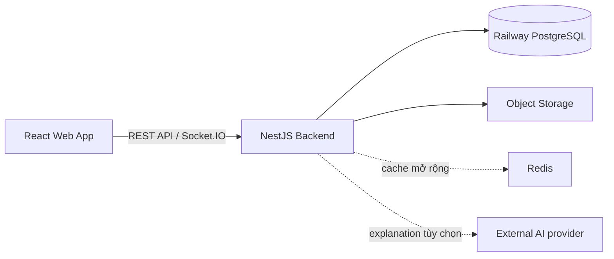
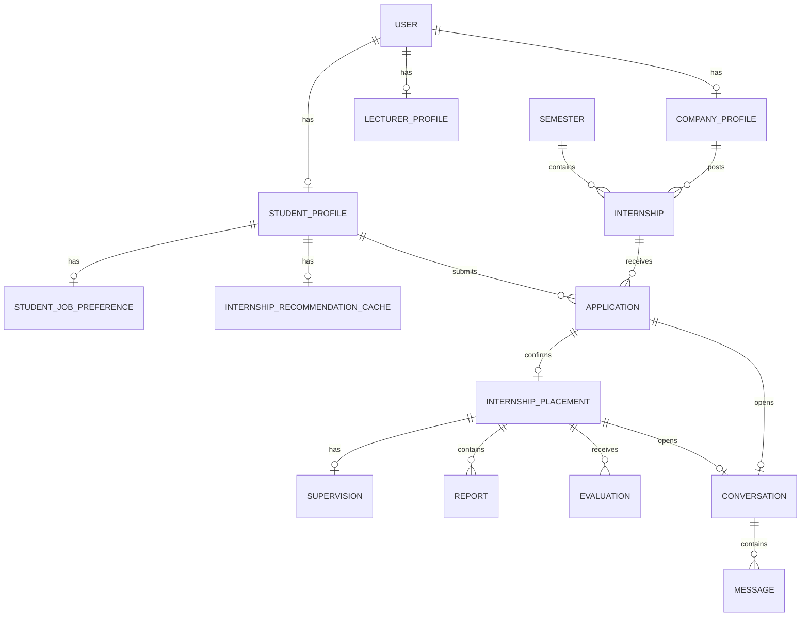

# InternHub — Thiết kế hệ thống

Tài liệu này mô tả cấu trúc backend và database **đang có trong repository**. Các phần ghi “roadmap” là định hướng lịch sử; Recommendation API, preferences, cache và UI Internship đã được triển khai sau baseline.

## 1. Kiến trúc tổng quan



| Thành phần           | Trách nhiệm                                                                                               |
| -------------------- | --------------------------------------------------------------------------------------------------------- |
| React                | Giao diện cho bốn role; gọi REST API và nhận realtime events.                                             |
| NestJS               | Authentication, RBAC, nghiệp vụ, transaction và phát hành signed URL.                                     |
| Prisma               | Schema, generated client và migration PostgreSQL.                                                         |
| Railway PostgreSQL   | Nguồn dữ liệu chính của dự án.                                                                            |
| Object Storage       | Lưu nội dung tệp; database chỉ lưu metadata.                                                              |
| External AI provider | Chỉ tạo diễn giải cho top 3 recommendation đã được backend xếp hạng; không quyết định điểm hoặc thứ hạng. |
| Redis / Socket.IO    | Hạng mục mở rộng cho cache, rate limit theo distributed store và realtime.                                |

## 2. Cấu trúc backend

```text
Backend/
├── prisma/
│   └── schema.prisma              # Nguồn chuẩn của database model
├── src/
│   ├── auth/                      # JWT, refresh token, Passport strategy
│   ├── users/                     # Quản trị user/role
│   ├── students/                  # Hồ sơ, dự án, CV, kỹ năng
│   ├── lecturers/                 # Hồ sơ giảng viên
│   ├── companies/                 # Doanh nghiệp và phê duyệt
│   ├── semesters/                 # Đợt thực tập và lifecycle theo thời gian
│   ├── skills/                    # Danh mục và matching metadata
│   ├── recommendations/            # Ranking, cache và AI explanation có kiểm soát
│   ├── internships/               # Bài đăng thực tập
│   ├── internship-templates/      # Mẫu tin tuyển dụng và quản lý template
│   ├── applications/              # Đơn ứng tuyển và state machine
│   ├── placements/                # Đợt thực tập đã xác nhận
│   ├── supervisions/              # Phân công giảng viên theo placement
│   ├── reports/                   # Báo cáo tuần và review
│   ├── evaluations/               # Đánh giá độc lập từ company/lecturer
│   ├── files/                     # Metadata và policy truy cập file
│   ├── chat/                      # Conversation và message
│   ├── notifications/             # Thông báo trong hệ thống
│   ├── dashboard/                 # Query tổng hợp, chỉ đọc
│   ├── audit-logs/                # Audit trail
│   ├── common/                    # Decorator, guard, filter, interceptor
│   ├── prisma/                    # PrismaService
│   ├── generated/prisma/          # Sinh tự động; không commit
│   ├── app.module.ts              # Đăng ký các module
│   └── main.ts                    # Bootstrap, CORS, Helmet, validation
├── .env.example
└── package.json
```

Tên module dùng số nhiều nhất quán, gồm `supervisions` (không dùng `supervision`). Chỉ `src/supervisions/supervisions.module.ts` được đăng ký bởi `AppModule`.

## 3. Domain model và quan hệ



`InternshipPlacement` là bản ghi xác nhận sinh viên thực tập tại một internship trong một đợt thực tập. Đây là “aggregate” dùng cho theo dõi sau tuyển dụng; không dùng `student_id` đơn lẻ cho report, supervision hoặc evaluation. `academicStatus` tách phần trường theo dõi khỏi trạng thái làm việc thực tế tại công ty.

## 4. Thiết kế database

Schema nguồn: `Backend/prisma/schema.prisma`. Prisma Client được generate vào `src/generated/prisma` bởi `postinstall` hoặc `npm run build`.

### 4.1. Nhóm identity và profile

| Model                           | Trường / ràng buộc quan trọng                        | Mục đích                                                |
| ------------------------------- | ---------------------------------------------------- | ------------------------------------------------------- |
| `User`                          | `email` unique, `role`, `status`, `emailVerifiedAt`  | Tài khoản gốc cho bốn role.                             |
| `VerificationToken`             | `token` unique, `userId`, `expiresAt`                | Token xác thực email một lần cho tài khoản mới.          |
| `PasswordResetToken`            | `tokenHash` unique, `userId`, `expiresAt`, `usedAt`  | Token đặt lại mật khẩu một lần, lưu dưới dạng hash.      |
| `RefreshToken`                  | `tokenHash` unique, `expiresAt`, `revokedAt`         | Phiên đăng nhập có thể thu hồi.                         |
| `StudentProfile`                | `userId` unique, `studentCode` unique, `cvFileId`    | Hồ sơ sinh viên.                                        |
| `StudentProject`                | `studentId`, repo/demo URL                           | Dự án cá nhân của sinh viên.                            |
| `StudentJobPreference`          | `studentId` unique, role/location/work-type arrays   | Mong muốn công việc của sinh viên.                      |
| `InternshipRecommendationCache` | `studentId` unique, fingerprint, result JSON, expiry | Cache recommendation theo dữ liệu profile và candidate. |
| `LecturerProfile`               | `userId` unique, `department`                        | Hồ sơ giảng viên.                                       |
| `CompanyProfile`                | `status`, mã số doanh nghiệp, `registrationDocumentFileId`, `submittedAt`, `reviewDueAt`, `reviewChecklist`, `reviewedById/reviewedAt`, `rejectionReason`, `rejectionReasonCode`, `suspensionReason/suspensionReasonCode/suspendedAt` | Hồ sơ pháp lý, tệp ĐKDN và lịch sử xét duyệt doanh nghiệp kèm SLA và checklist. |

### 4.2. Nhóm kỳ, vị trí và kỹ năng

| Model                     | Trường / ràng buộc quan trọng                                                                         | Mục đích                                                               |
| ------------------------- | ----------------------------------------------------------------------------------------------------- | ---------------------------------------------------------------------- |
| `Semester`                | `name` unique, `startDate`, `endDate`, `status`                                                       | Đợt thực tập; cửa sổ tuyển được suy ra là một tháng trước `startDate`. |
| `Internship`              | `companyId`, `semesterId`, `slots`, `filledSlots`, `deadline`, optional `startDate/endDate`, `status`, `sourceTemplateId`, `sourceInternshipId`, `viewCount`, `uniqueViewerCount` | Vị trí tuyển và lịch học vụ dự kiến của doanh nghiệp; liên kết nguồn tạo từ template / repost. |
| `InternshipTemplate`      | unique `(companyId, name)`, `slotsDefault`, các trường nội dung                                       | Mẫu tin tuyển dụng độc lập với đợt, tối đa 20 mẫu/công ty.             |
| `InternshipTemplateSkill` | PK `(templateId, skillId)`, `isRequired`, `weight`                                                  | Kỹ năng gắn với mẫu tin tuyển dụng.                                    |
| `Skill`                   | `name` unique                                                                                         | Danh mục kỹ năng chuẩn.                                                |
| `StudentSkill`            | PK `(studentId, skillId)`, `level`                                                                    | Kỹ năng và mức độ của sinh viên.                                       |
| `InternshipSkill`         | PK `(internshipId, skillId)`, `isRequired`, `weight`                                                  | Yêu cầu kỹ năng của vị trí.                                            |

### 4.3. Nhóm workflow thực tập

| Model                      | Trường / ràng buộc quan trọng                                                                                          | Mục đích                                                 |
| -------------------------- | ---------------------------------------------------------------------------------------------------------------------- | -------------------------------------------------------- |
| `Application`              | unique `(studentId, internshipId)`, `status`, `cvFileId`                                                               | Đơn ứng tuyển.                                           |
| `ApplicationStatusHistory` | `fromStatus`, `toStatus`, `changedById`                                                                                | Lịch sử thay đổi trạng thái đơn.                         |
| `InternshipPlacement`      | `applicationId` unique, student/company/internship/semester, `startDate/endDate`, `academicStatus`, `academicClosedAt` | Placement và khoảng trường theo dõi riêng cho sinh viên. |
| `Supervision`              | `placementId` unique, `lecturerId`, `assignedById`, `assignedAt`, `completedAt`                                       | Một giảng viên hướng dẫn placement, có audit phân công.  |
| `Report`                   | unique `(placementId, week)`, `fileId`, `status`                                                                       | Báo cáo tuần.                                            |
| `Evaluation`               | unique `(placementId, type)`, `evaluatorId`, `score`                                                                   | Một đánh giá company và một đánh giá lecturer.           |

### 4.4. Nhóm hỗ trợ hệ thống

| Model          | Trường / ràng buộc quan trọng                                | Mục đích                             |
| -------------- | ------------------------------------------------------------ | ------------------------------------ |
| `File`         | `storageKey` unique, `originalName`, `mimeType`, `sizeBytes` | Metadata cho tệp private.            |
| `Conversation` | `applicationId` unique, `placementId` unique, student/company/lecturer IDs | Hội thoại theo application hoặc placement. |
| `Message`      | `conversationId`, `senderId`, `readAt`                       | Tin nhắn trong conversation.         |
| `Notification` | `userId`, `isRead`, `readAt`                                 | Thông báo cho người dùng.            |
| `AuditLog`     | `userId`, `action`, `entity`, `entityId`, `metadata`         | Truy vết hoạt động.                  |

### 4.5. Enum chính

| Enum                       | Giá trị                                                     |
| -------------------------- | ----------------------------------------------------------- |
| `Role`                     | `ADMIN`, `STUDENT`, `LECTURER`, `COMPANY`                   |
| `UserStatus`               | `ACTIVE`, `INACTIVE`, `PENDING_VERIFICATION`, `BANNED`      |
| `ApplicationStatus`        | `PENDING`, `REVIEWING`, `ACCEPTED`, `REJECTED`, `WITHDRAWN` |
| `PlacementStatus`          | `PENDING`, `ACTIVE`, `COMPLETED`, `CANCELLED`               |
| `AcademicMonitoringStatus` | `PENDING`, `ACTIVE`, `CLOSED`, `CANCELLED`                  |
| `ReportStatus`             | `DRAFT`, `SUBMITTED`, `APPROVED`, `REJECTED`                |
| `EvaluationType`           | `COMPANY`, `LECTURER`                                       |
| `CompanyStatus`            | `DRAFT`, `PENDING`, `APPROVED`, `REJECTED`, `SUSPENDED`    |
| `CompanyRejectionReasonCode` | `MISSING_DOCUMENT`, `DOCUMENT_UNCLEAR`, `NAME_MISMATCH`, `REGISTRATION_MISMATCH`, `ADDRESS_MISMATCH`, `CONTACT_INVALID`, `OTHER` |
| `CompanySuspensionReasonCode` | `POLICY_VIOLATION`, `FAKE_INFORMATION`, `ABUSIVE_POSTING`, `LEGAL_COMPLAINT`, `OTHER` |
| `FileType`                 | `CV`, `REPORT`, `CERTIFICATE`, `COMPANY_REGISTRATION`, `AVATAR` |
| `SemesterStatus`           | `UPCOMING`, `ACTIVE`, `RECRUITING`, `MONITORING`, `COMPLETED`, `CANCELLED` |
| `InternshipStatus`         | `DRAFT`, `OPEN`, `CLOSED`, `CANCELLED`                      |
| `SupervisionStatus`        | `ACTIVE`, `COMPLETED`, `CANCELLED`                          |
| `RecommendationSource`     | `AI_ENHANCED`, `DETERMINISTIC_FALLBACK`, `DETERMINISTIC_ONLY` |
| `SkillLevel`               | `BEGINNER`, `INTERMEDIATE`, `ADVANCED`, `EXPERT`            |
| `NotificationType`         | `APPLICATION`, `REPORT`, `SUPERVISION`, `PLACEMENT`, `COMPANY`, `EVALUATION`, `SYSTEM` |
| `NotificationAction`       | `NONE`, `OPEN_APPLICATION`, `OPEN_REPORT`, `OPEN_SUPERVISION`, `OPEN_PLACEMENT`, `OPEN_COMPANY_PROFILE`, `OPEN_EVALUATION` |

## 5. Transaction và phân quyền đang được thực thi

Các ràng buộc unique trong schema xử lý tính nhất quán cơ bản. Các quy tắc dưới đây phải nằm trong service và chạy transaction khi có nhiều thao tác ghi:

1. Khi company chấp nhận application: kiểm tra internship còn chỗ, chuyển status, tạo status history, tạo placement, tạo conversation nếu chưa có, rồi tăng `filledSlots`.
2. Một đợt có ba pha tự tính theo thời gian: `UPCOMING`, `RECRUITING` (một tháng trước ngày bắt đầu), `MONITORING` (từ ngày bắt đầu đến hết ngày kết thúc), sau đó `COMPLETED`. Chỉ pha `RECRUITING` được đăng tin, ứng tuyển và chấp nhận.
3. Khi đợt chuyển sang `MONITORING`, các tin `OPEN` còn lại được đóng. Placement chỉ chuyển `academicStatus` từ `PENDING` sang `ACTIVE` khi đã có giảng viên và tới `placement.startDate`; trạng thái học vụ đóng khi qua `placement.endDate` hoặc đợt kết thúc, nhưng không tự kết thúc công việc thực tế tại doanh nghiệp.
4. Ngày dự kiến trên tin phải được nhập đủ theo cặp và nằm trong khung đợt, hoặc bỏ trống cả hai. Trước khi phân công giảng viên, Admin phải chốt đủ hai ngày placement trong khung đợt; không sửa lịch sau khi theo dõi bắt đầu.
5. Tuần báo cáo được tính theo từng block 7 ngày từ `placement.startDate`. Chỉ cho tạo/nộp tuần đã bắt đầu và nằm trong khoảng theo dõi; giảng viên vẫn được duyệt báo cáo đã gửi sau khi khoảng theo dõi đóng.
6. Khi tạo hoặc sửa evaluation, kiểm tra đúng company/lecturer và placement đang trong khoảng theo dõi học vụ.
7. Khi cấp signed URL, kiểm tra quyền trên entity tham chiếu tới file trước khi trả URL.
8. Mọi thao tác quản trị và state transition ghi `AuditLog`.
9. Company verification chỉ cho `DRAFT`/`REJECTED` submit thành `PENDING` sau khi kiểm tra đủ trường pháp lý và file do chính company sở hữu, loại `FileType.COMPANY_REGISTRATION`. Khi submit, thiết lập `reviewDueAt` theo `COMPANY_REVIEW_SLA_HOURS` (mặc định 72 giờ) và xóa metadata từ chối/checklist cũ. `PENDING` không được sửa; admin duyệt bắt buộc đủ 6 mục checklist và email user phải verified; từ chối/đình chỉ bắt buộc chọn mã lý do (`reasonCode`) và giải thích chi tiết ≥10 ký tự. Suspend trong cùng transaction đóng mọi tin `OPEN` của công ty. Unsuspend chuyển từ `SUSPENDED` sang `APPROVED` có kiểm soát lý do và không tự mở lại tin cũ.
10. Mẫu tin và đăng lại: Doanh nghiệp `APPROVED` được lưu tối đa 20 mẫu (`InternshipTemplate`), quản lý CRUD độc lập với đợt thực tập và không nhân bản số liệu thống kê/ứng viên. Khi tạo tin từ mẫu hoặc repost sang đợt mới, hệ thống tái sử dụng toàn bộ quy tắc validate đợt tuyển (`RECRUITING`), ngày bắt đầu/kết thúc và deadline tương lai nếu tin ở trạng thái `OPEN`. Các kỹ năng bị xóa khỏi danh mục sẽ được bỏ qua và trả cảnh báo `warnings[]`.

## 6. API map hiện tại

Mọi controller đều dùng prefix `/api/v1` và wrapper thành công `{ success, data, timestamp }`. Lỗi có `{ success: false, statusCode, code, message, timestamp, path }`.

| Module | Endpoint đang có |
| --- | --- |
| Auth | `POST /auth/register`, `/login`, `/refresh`, `/logout`, `/verify-email`, `/resend-verification`, `/forgot-password`, `/reset-password`; `GET /auth/me` |
| Users | `GET, POST /users`; `GET, PATCH, DELETE /users/:id` |
| Student / Lecturer / Company profiles | `GET, POST, PATCH, DELETE /students/me`, `/lecturers/me`, `/companies/me`; `POST /companies/me/submit-verification`; admin `GET /companies`, `GET /companies/:id`, `POST /companies/:id/approve` (checklist), `/reject` (code + detail), `/suspend` (code + detail, đóng tin OPEN), `/unsuspend` (detail) |
| Skills | `GET, POST /skills`; `GET, PATCH, DELETE /skills/:id`; `GET, PUT /students/me/skills`; `GET, PUT /internships/:internshipId/skills`; `GET /internships/:internshipId/match/me` |
| Semesters / Internships / Templates | CRUD `/semesters` (including `PATCH /:id/status`); list/detail/CRUD `/internships`, `GET /internships/me`, `POST /internships/:id/save-as-template`, `POST /internships/:id/repost`; CRUD `/internship-templates`, `GET /internship-templates/me`, `POST /internship-templates/:id/create-internship` |
| Applications | `POST, GET /applications`; `GET /applications/me`, `/:id`, `/:id/history`; `PATCH /:id/status` |
| Placements / Supervisions | `GET /placements`, `/placements/me`, `/placements/:id`; `PATCH /placements/:id`, `/:id/status`; `GET, POST /supervisions`, `/supervisions/me`, `/supervisions/lecturer-options`, `/:id`; `PATCH /supervisions/:id`, `/:id/status` |
| Reports / Evaluations | `POST /reports`; `GET /reports/me`, `/supervised`, `/:id`; `PATCH /reports/:id`; `POST /reports/:id/submit`, `/:id/review`; `POST, GET /evaluations`, `/evaluations/me`, `/:id`; `PATCH, DELETE /evaluations/:id` |
| Files / Chat / Notifications | `POST /files/upload-url`, `GET /files/:id/download-url`; conversation/message/read routes under `/conversations`; notification list, unread count, read/delete routes under `/notifications` |
| Dashboard / Audit | `GET /dashboard/admin`; `GET /audit-logs`, `/audit-logs/:id` |
| Recommendations | student preferences under `/students/me/job-preferences`; cached read and generation under `/recommendations/internships/me` |

## 7. Railway PostgreSQL và migration

Railway chỉ cung cấp PostgreSQL; backend/Prisma chạy từ máy local trong giai đoạn hiện tại.

1. Tạo PostgreSQL service trên Railway.
2. Copy `DATABASE_PUBLIC_URL` (hoặc URL TCP Proxy) vào `Backend/.env` dưới tên `DATABASE_URL`.
3. Chạy `npm install` tại thư mục `Backend`.
4. Khi database còn trống, tạo migration đầu tiên: `npm exec prisma migrate dev -- --name init`.
5. Commit thư mục `prisma/migrations`; không commit `.env` hay `src/generated/prisma`.

Sau khi migration đã tồn tại, môi trường dùng chung chỉ nên áp dụng migration bằng `npm exec prisma migrate deploy`.

## 8. Kiểm tra nền dự án

```bash
cd Backend
npm run build
npm test -- --runInBand
```
